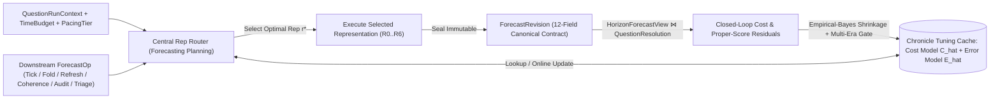

# FRANKENFORECAST (`fcast`): REPRESENTATION-ROUTED FORECASTING ARCHITECTURE

* **Document:** `ALTERNATIVE_PLAN_V1.md` (Alternate Master Architecture — Central Representation Router Edition)
* **Version:** `1.0` (`2026-11-26`)
* **Repository:** `franken_forecast` (Companion to `COMPREHENSIVE_PLAN_FOR_FRANKEN_FORECAST.md` `v2.1`)
* **Workspace Baseline:** `M0` + `M0.5` + `M1` + `gemini-api-cli` (`Tier 2: Crate-Verified` for `14 / 24` gates, `57` Rust tests, `0` Clippy warnings, `#![forbid(unsafe_code)]`)

---

## Reading Guide

This document reframes **FrankenForecast (`fcast`)** around a single organizing abstraction: a **Central Representation Router (`RepRouter`)** that performs **Forecasting Planning** by matching every downstream forecasting operation to its cost- and error-optimal epistemic representation via a persistent **Tuning Cache**. It preserves all hard invariants (`INV-01..13`), the immutable `12`-field `ForecastRevision` contract, and the pure-Rust `6`-crate Franken Suite substrate, while replacing static pipeline wiring with learned, closed-loop representation selection.

* **Systems Architects & Core Rust Engineers:** Read the **Thesis Statement**, **The Decalogue**, **Part II (The Rep Router & Forecasting Planning)**, and **Part III.1 (Foundational Substrate Layer)** alongside the **Crate Dependency Map** and **Hardware Specs** tables.
* **Probabilistic Forecasters & Calibration Scientists:** Focus on **The Big Bets**, **Part II (Cost/Error Models & Tuning Cache)**, and **Part III.2 (Algorithmic Bedrock)**.
* **Tournament Operators & Delivery Leads:** Review **Part IV (Performance Targets, Risk Register & Milestone Roadmap)** to see how `M2`–`M5` layer cleanly onto the verified `M0`–`M1` substrate.

---

## Thesis Statement

Most automated forecasting systems fail not because their underlying foundation models lack general reasoning ability, but because they force every question and every operational context through a single, rigid epistemic representation. A breaking geopolitical shock on a deep orderbook, a slow-moving macroeconomic time series with a five-year seasonal baseline, a 13-percentile open-bounded numeric question on Metaculus, a 25-bin quantitative PMF on Mantic Crucible, a two-leg Fréchet-constrained `Combo` question on ForecastBench, and a zero-token interactive sensitivity query inside a terminal cockpit do not share the same optimal state representation, evidence granularity, or compute budget. Treating them identically produces predictable pathologies: runaway API spend on low-value-of-information updates, catastrophic log-score blowups on thin or open-bounded tails, stale beliefs when causal parents move, and brittle calibration that flips sign across tournament eras.

**FrankenForecast (`fcast`)** resolves this by elevating **representation selection** into a first-class, empirically learned control plane called the **Rep Router**. Rather than hardcoding one fixed forecasting pipeline, `fcast` maintains a disciplined library of mathematically sound representations—from microsecond-cheap conjugate log-odds filters and liquid orderbook marks up to three-document memory overlays, causal `FrankenNetworkX` graphs, multimodal probability-space mixtures, and multi-vendor ensembles—all of which seal their outputs into one immutable canonical object (`ForecastRevision`). Before any downstream forecasting operation runs, the Rep Router executes **Forecasting Planning**: it queries a durable **Tuning Cache** of out-of-sample **cost models** (USD, wall-clock latency, token and I/O overhead) and **error models** (proper-score Brier/Log regret, calibration error, and variance across regimes) to choose the exact representation that minimizes expected proper-score loss per marginal dollar under the current `QuestionRunContext`, close-derived `TimeBudget`, and 4-tier `BillingPacingTier`. Every resolved outcome feeds directly back into the Tuning Cache over the irreversible full eligible universe, turning `fcast` from a static prompt script into a self-calibrating epistemic compiler.

---

## The Decalogue

1. **One Immutable Output Contract, Many Internal Representations.** No matter which representation the Rep Router selects for a given operation, every forecast issuance or update seals an immutable `12`-field `ForecastRevision` (`InitialForecast`, `SubsequentRevision`, `HorizonForecastView`, disjoint `QuestionResolution`).
2. **Route by Downstream Operation, Not by Habit.** A streaming news tick, a pre-spot tournament refresh, a cross-question coherence projection, a rationale audit, and a terminal What-If simulation are distinct operations; the Rep Router plans each explicitly against its Tuning Cache rather than running a one-size-fits-all chain.
3. **Seal `p_indep` Before Unblinding `p_market`.** Independent reasoning and endogenous belief decay execute strictly behind `MarketBlindingScrubber` (`INV-04`); market prices attach only post-seal through liquidity-scaled Kalman/TimeSeek blending.
4. **Separate Physical Time, Public Time, and Database Availability.** Every fact, orderbook mark, and vintage data pack carries `(event_utc, published_utc, available_utc)` with strict `available_utc <= as_of_utc` enforcement (`INV-03`).
5. **LLMs Propose Evidence and Likelihoods; Rust Owns All Arithmetic.** Large language models never sum rubric integers, normalize simplices, interpolate CDFs, or echo raw SHA-256 digests (`INV-06`, `INV-07`).
6. **Measure the Entire Eligible Universe, Never Just the Survivors.** Admission to `universe_question_ledger` is irreversible (`INV-13`); the Tuning Cache and all scorecards account for excluded, abandoned, and sunk-cost questions so the Rep Router can never inflate accuracy by cherry-picking easy contracts.
7. **Zero-Token Triage Before Metered Compute.** Browsing markets, inspecting revision waterfalls, checking `Gold/Episodic/State` documents, and testing What-If cruxes cost `\$0.00` in API spend; metered calls wake only when Bayesian Surprise, novelty, or tournament deadlines justify their expected Value of Information.
8. **Pure-Rust Substrate With Zero Runtime Sprawl.** All six workspace crates compile under `#![forbid(unsafe_code)]` with zero banned async runtimes (`tokio`, `reqwest`, `hyper`) or C/C++ FFI bridges, using `FrankenSQLite` for durable state and `google-gemini/gemini-api-cli` for clean external Gemini API transport.
9. **Crash-Safe Coordination via Transactional Outbox and Durable Cursors.** Every cross-subsystem handoff flows through `Chronicle`'s WAL-committed `domain_events` table and persistent `event_consumers` cursors, eliminating dual-write races and duplicate LLM spend across `SIGKILL` restarts.
10. **Empirical Falsification Governs Every Knob.** Every representation, prompt upgrade, and calibration transform is isolated in `config/ablation.toml` and promoted into the Tuning Cache only when out-of-sample, multi-era proper scores confirm a real gain.

---

## The Big Bets

1. **Learned Representation Routing ("Forecasting Planning") Beats Any Fixed Monolithic Pipeline.**
   Existing forecasting bots hardcode a single heavyweight research-and-ensemble loop for every question, wasting budget on settled or trivial updates while still under-investing in high-complexity, high-prize contracts. We bet that separating *representation design* from *representation selection*—via a central Rep Router backed by a persistent cost/error Tuning Cache—achieves strictly higher full-universe Brier and Log Skill per dollar than any fixed pipeline. If a `100`-question prospective tournament comparison shows the Rep Router fails to outperform a static best-single-representation baseline on full-universe `BSS_univ` at equal or lower spend, we fall back to a deterministic rule-based dispatch table keyed solely by `(question_type, remaining_time, pacing_tier)` while keeping the Tuning Cache purely as an observability telemetry store.

2. **Two-Speed Conjugate Streaming Escalating to Handle-Only PBM Folds Preserves Accuracy While Cutting Spend by `>= 40%`.**
   Continuous forecasting over weeks or months cannot afford full multi-vendor deep-research folds on every wire headline, yet static one-shot forecasts go stale as facts evolve. We bet that maintaining a fast Tier-0 log-odds filter (`ConjugateBelief` + market-blind `DecayController` + `Frankensearch` novelty) and escalating to Tier-1 CAS-handle PBM folds only on genuine Bayesian Surprise or high Martingale `VoI_log` reduces longitudinal LLM spend by `>= 40%` at `<= 0.003` Brier degradation across `HorizonForecastView` checkpoints. If prospective evaluation falsifies this trade-off, we disable metered Tier-0 LLM ticks and retain zero-cost `DecayController` + `DataPack` z-score triggers to wake Tier-1 folds directly.

3. **Structured Evidence Representations (`fetch_raw_data`, `SEASONAL_NOTE`, Dual Independent Reports, `13`-Percentile Grids) Outperform Prompt Engineering.**
   Controlled multi-competitor A/B evidence demonstrates that cosmetic persona or framing tweaks slightly degrade accuracy (`-0.9` pts/Q), whereas richer epistemic inputs deliver large, repeatable lifts: direct raw-data dashboard fetching (`+7.0` pts/Q), 3–5 year calendar-window `SEASONAL_NOTE` grounding (`+5.5` pts/Q), `13`-percentile grids over `6`-percentile grids (`+10.3–12.3` pts/Q), and dual independent research reports (`3.75×` genuine informational spread). We bet that making these structured representations first-class targets of the Rep Router—paired with a 4-rung `ValueExtractionLadder` and fixed-point simplex/open-tail flooring—delivers durable cross-tournament alpha on FutureEval, Mantic Crucible, Market Pulse, Animal Futures, and ForecastBench. If any individual representation fails single-knob ablation on `MiniBench`/`ForecastBench`, its `config/ablation.toml` toggle is switched off and its Tuning Cache prior is penalized automatically.

4. **Mechanical Staged-Reveal `6D+2G` Auditing and Binding Red-Team Verification Prevent Catastrophic Tail and Contract-Misread Misses.**
   Under logarithmic proper scoring, a single misread resolution criterion (`G1`) or overconfident tail miss on a degraded single-model run can wipe out weeks of incremental gains. We bet that physically withholding prices in Rust memory during Turn A rationale scoring (`INV-05`), making `red_team_audit.tmpl` + `load_bearing_claims` verification *binding* on material shifts (`|Δlogit| >= 0.35`, tails, or freeze), and enforcing `THIN_PUBLISH_FLOOR` (`[0.05, 0.95]` when `survivors == 1`) plus `>= 5%` Mantic open-tail floors dramatically reduces left-tail log-score blowups without sacrificing calibration sharpness. If staged-reveal doubles latency for `< 0.05` Spearman `ρ` improvement on our `50`-rationale gold panel, batch scoring falls back to `--single-pass` while retaining `--staged-reveal` for Top-10 finalists and binding Red-Team checks for live submissions.

5. **Pure-Rust Local-First Storage (`FrankenSQLite` + Zstd Parquet/CAS) and Subprocess `gemini-api-cli` Eliminate Operational Fragility.**
   Python bot frameworks frequently suffer from dependency drift, async event-loop deadlocks, silent partial writes, and accidental credential leaks. We bet that anchoring `fcast` on a strict `6`-crate pure-Rust DAG with `#![forbid(unsafe_code)]`, WAL-backed `FrankenSQLite` immutability triggers, durable `event_consumers` cursors, and the official `google-gemini/gemini-api-cli` binary (giving instant access to Gemini 4 Interactions, Deep Research, and Antigravity sandboxes with zero banned HTTP/runtime crates) yields deterministic sub-millisecond local operations and crash-proof background execution. If high-volume concurrent workloads ever outgrow subprocess invocation latency for Tier-0 ticks, `fcast-infra::llm` can introduce a pooled pure-Rust HTTP/1.1 transport behind the identical `LlmRouter` trait without altering any higher crate.

6. **Multi-Era Regularized Calibration and Full-Universe `dspy.GEPA` Prevent Overfitting to Transient Tournament Regimes.**
   Unregularized post-hoc Platt scaling overfits small cohorts and flips extremization sign across tournament eras. We bet that gating `enable_ridge_platt_extremize` strictly on `n >= 100` resolved forecasts per domain *and* positive out-of-sample sign stability across `>= 2` disjoint chronological eras—while evaluating air-gapped `dspy.GEPA` prompt evolution strictly on full-universe `BSS_univ` (`B = 2,000` paired bootstrap, `p < 0.10`)—captures genuine calibration gains while staying immune to survivorship bias and regime churn. If two consecutive `GEPA` runs fail `p < 0.10`, prompt templates stay frozen and `GEPA` is restricted to failure-cluster diagnostics.

---

## Part II · The Central Representation Router ("Rep Router") & Forecasting Planning

### II.1 Architecture of the Rep Router

The **Rep Router** (`fcast-epistemic::router`, backed by durable Tuning Cache tables in `Chronicle`) sits at the nexus between `Metronome`'s `QuestionRunContext` dispatch and `Loom` / `Notary` / `Harvester` execution. Every forecasting task enters the Rep Router as a typed **Downstream Operation (`ForecastOp`)** paired with an immutable context vector $x = (\text{domain}, \text{question\_type}, \text{horizon\_bucket}, \phi_{\text{liq}}, \text{complexity } \Xi, \text{TimeBudget}, \text{BillingPacingTier})$.

### II.2 Canonical Representation Library (`R0` .. `R6`)

The Rep Router selects from seven explicit, composable representations—never inventing ad-hoc unversioned formats:

* **`R0: ConjugateStream`:** `(μ_t, N_t)` Beta-logit filter + market-blind `DecayController` + `Frankensearch` novelty; microsecond local update or lightweight Tier-0 tick (`gemini-3.5-flash-lite`).
* **`R1: DirichletSimplex`:** $K$-way Dirichlet–Categorical belief with log-sum-exp updates, fixed-point `>= 0.01` simplex flooring, and `restore_option_names` canonical label repair.
* **`R2: DensityGrid`:** `13`-percentile (`1..99`) probability-space multimodal mixture converted to Metaculus `Cdf201` / discrete `inbound_outcome_count + 1` or Mantic `N <= 31` per-bin PMF with `>= 5%` open-tail mass floor and open-bound date compression.
* **`R3: ThreeDocOverlay`:** Frozen `Gold Dossier` + append-only `Episodic Log` + incremental `State Doc` (`<= 4,000` tokens) paired with `fetch_raw_data`, `SEASONAL_NOTE`, and optional dual independent research reports over a shared `prompt_cache_prefix_hash`.
* **`R4: CausalGraphFold`:** `FrankenNetworkX` 4-layer causal graph (`L0_VERIFIED`, `L1_MECHANISM`, `L2_SIGNPOST`) driving CAS-handle PBM `fold`, Martingale `VoI_log` crux selection, and 1-hop causal spillover wakeups.
* **`R5: StagedRevealAudit`:** Mechanical 2-turn `6D+2G` rationale rubric (`TurnARequest` omitting prices) and binding `red_team_audit.tmpl` + `load_bearing_claims` `VERIFY` gate.
* **`R6: MarketKalmanBlend`:** `BookMarkPrice` Stoikov microprice (`L_tob >= \$100`, `spread <= 800 bps`, `phi_liq`) feeding 1D Latent-Logit Kalman blending and zero-token Bayesian Surprise detection.

### II.3 Learned Cost & Error Models in the Tuning Cache

The Tuning Cache (`rep_router_tuning_cache` in `Chronicle`'s `ops.fsqlite`) stores Empirical-Bayes sufficient statistics keyed by `(rep_id, op_kind, domain, question_type, horizon_bucket, liquidity_regime)`:

1. **Cost Model $\widehat{C}(r, \text{op}, x)$:** Predicts total marginal USD spend (calibrated against true provider billing deltas `usage_before[t+1] - usage_before[t]`, accounting for `max_tokens + inflight_share` pre-auth headroom and KV-cache prefix reuse) plus `p50`/`p90` wall-clock latency decomposed into connector I/O vs. LLM inference time. Every completed or abandoned run updates the cache's running cost residuals (`QuestionMetaForecast` closed loop).
2. **Error Model $\widehat{E}(r, \text{op}, x)$:** Predicts expected out-of-sample proper-score loss (Brier score, Log loss, calibration ECE, and tail-miss variance) shrunk hierarchically toward a domain-level prior $\mu_{\text{parent}}$ via pseudo-count $m = 5$ so sparse cells never overfit. Updates strictly from disjoint `HorizonForecastView ⋈ QuestionResolution` joins over the **full eligible universe** (`INV-13`) and tags every cache snapshot into `ForecastRevision.calibration_version`.
3. **Bounded-Risk Exploration:** To prevent the Tuning Cache from locking prematurely onto a stale representation when new models (`fcast doctor --check-models`) or tournament regimes arrive, the Rep Router routes a bounded `Control / Control / Challenger` slice (or zero-publish `shadow_experiment` slot) over the exact same vaulted `prompt_cache_prefix_hash` to collect paired cost/error deltas without risking leaderboard rank.

### II.4 Forecasting Planning (The Constrained Routing Objective)

When `Metronome` or an interactive user invokes a downstream operation $\text{op}$, **Forecasting Planning** executes in four deterministic steps:

1. **Feasibility Filtering ($\mathcal{R}_{\text{feasible}}$):** Eliminates any representation violating hard constraints—`skip_after_spot_scoring_time` or `remaining < 120 s` (`IntakeSkip`) returns an immediate `$0` skip; `remaining < 600 s` (`FastPath`) or `BillingPacingTier::Minimal` restricts candidates to single-pass representations with `THIN_PUBLISH_FLOOR`; `BillingPacingTier::Stop` halts metered dispatch; `INV-04` bars `R6` prior to `p_indep` sealing.
2. **Lagrangian Cost–Error Scoring:** Evaluates each feasible representation $r \in \mathcal{R}_{\text{feasible}}(\text{op}, x)$ using the Tuning Cache:
   $$r^* = \arg\min_{r \in \mathcal{R}_{\text{feasible}}(\text{op}, x)} \Bigl[\widehat{E}(r, \text{op}, x) + \lambda(\text{pacing\_tier}, \text{prize\_weight}) \cdot \widehat{C}(r, \text{op}, x)\Bigr]$$
   where $\lambda$ scales shadow price smoothly across `Full` → `Economy` → `Minimal` pacing tiers and inversely with tournament prize weight (`FutureEval` > `Mantic Crucible` > `MiniBench` > `Market Pulse` / `Animal Futures`).
3. **Plan Materialization & Execution:** Stamps `(selected_rep, expected_cost, expected_error, tuning_cache_ver)` onto the immutable `QuestionRunContext`, executes the chosen representation (attaching binding `R5` Red-Team if `|Δlogit| >= 0.35`, tails, or freeze), and seals the resulting `ForecastRevision` atomically in `Chronicle`.
4. **Closed-Loop Feedback:** Realized latency and USD spend update $\widehat{C}$ immediately at job completion; realized Brier/Log scores update $\widehat{E}$ asynchronously on `QuestionResolved` events via `event_consumers`.

---

## Part III · Architectural Overview

### III.1 Foundational Substrate Layer

The foundational substrate guarantees deterministic local persistence, crash-safe coordination, SSRF-hardened I/O, and zero-dependency-bloat LLM execution across standard developer workstations without requiring GPUs or external database servers.

#### Target Workstation & Hardware Specifications

| Profile | Target OS / Arch | CPU / Memory Envelope | Local Storage & I/O | GPU Requirement | Concurrency Lanes (`fcastd`) |
| :--- | :--- | :--- | :--- | :--- | :--- |
| **Primary Workstation** | macOS (Apple Silicon `arm64`) | `8+` cores, `16–32 GB` unified RAM | Local SSD (`fsqlite` WAL + Zstd CAS + Zstd L2 ticks) | `None` (`0` GPU) | `ingest:4`, `stream:2`, `heavy:2`, `maint:1` |
| **Headless Server / CI** | Linux (`x86_64` / `arm64`) | `4+` cores, `8–16 GB` RAM | Local SSD / ephemeral CI volume | `None` (`0` GPU) | Configurable (`--workers` / `ablation.toml`) |
| **Zero-Key Quickstart** | macOS / Linux | `2+` cores, `4 GB` RAM | `< 50 MB` initial footprint (`fcast init`) | `None` (`0` GPU) | Inline CLI fallback when `fcastd` stopped |

#### Core Substrate Components

* **`Chronicle` (`fcast-infra::{store,vault}`):** Powered by upstream `FrankenSQLite` (`fsqlite::blocking`, WAL mode, `PRAGMA foreign_keys = ON`, `synchronous = FULL` on revision seals). Enforces append-only `ForecastRevision` immutability via SQLite `BEFORE UPDATE/DELETE` triggers, disjoint `question_resolutions`, irreversible `universe_question_ledger` admission, content-addressed `EvidenceVault` (`Zstd-3` spill `> 64 KiB`), `Tier W1` partitioned Zstd L2 tick archives, forward-only SHA-256-locked migrations (`0001..0003+`), and lossless `V1 -> V2` payload upcasting.
* **`Metronome` (`fcast-infra::{jobs,sys,daemon}`):** Coordinates all eight subsystems through the transactional `domain_events` outbox and durable `event_consumers` cursors (`0003_event_consumers.sql`). Enforces singleton execution via `#![forbid(unsafe_code)]` `DaemonLock` (`File::try_lock_exclusive`), `0600`-permissioned `UdsEventBus` respecting the `104`-byte POSIX `sun_path` ceiling, `P0..P4` priority preemption, `45m`/`75m` stalled-worker watchdog rescue, `DEAD_LETTER` quarantine, and automatic `scrub_secrets` redaction.
* **`SafeExternalFetch` & `GeminiCliClient` (`fcast-infra::{fetch,llm}`):** `SafeExternalFetch` enforces HTTPS-only, `<= 5`-hop redirects, IPv4-mapped IPv6 normalization blocking loopback/RFC1918/CGNAT/IMDS, connect-time `SocketAddr` pinning, `Read::take` caps, and XXE rejection. `GeminiCliClient` wraps the official `google-gemini/gemini-api-cli` (`gemini-api`) subprocess for `whoami`, `generate` (`--stdin`, `--stream=false -o json`, `--previous-interaction-id`, `--body` JSON schema, `--dry-run`), `analyze`, `agent run/status` (`deep-research-preview-04-2026`, `antigravity-preview-09-2026`), and `models list` with zero banned HTTP/async crates.

#### Six-Crate Acyclic Dependency Map (`rank(dep) < rank(pkg)`)

| Crate | DAG Layer | Allowed Workspace Dependencies | Primary Subsystems & Rep Router Role | Rust LOC Scope Cap |
| :--- | :--- | :--- | :--- | :--- |
| `fcast-core` | `L0` | *None (`0` I/O, `0` net, `0` SQL)* | `ForecastRevision`, `OutcomeDistribution`, `MetaculusCdfBuilder`, `ConjugateBelief`, `DecayController`, PAV/Fréchet/EB coherence, `MarketBlindingScrubber` | `<= 4,800 LOC` `[BUDGET]` |
| `fcast-infra` | `L1` | `fcast-core` | `Chronicle` (`fsqlite`, Tuning Cache store, `EvidenceVault`), `Metronome` (`DurableJobStore`, `event_consumers`, `DaemonLock`, `UdsEventBus`, `QuestionRunContext`), `SafeExternalFetch`, `GeminiCliClient` | `<= 7,500 LOC` `[BUDGET]` |
| `fcast-ingest` | `L2` | `core`, `infra` | `Harvester`: `BookMarkPrice`, `MetaculusQuestion` + `ManticCrucibleAdapter`, `ForecastBenchMedianBackfill`, `DomainGate`, `Tier W1` tick archive, `DataPacks`, `fetch_raw_data`, `SEASONAL_NOTE` | `<= 7,000 LOC` `[BUDGET]` |
| `fcast-epistemic` | `L3` | `core`, `infra`, `ingest` | **Central `RepRouter` (Forecasting Planning)**, `Notary` (`TemplateCatalog`, `BiTemporalAudit`, `ValueExtractionLadder`, staged-reveal `6D+2G`), `Loom` (`fnx-*` KG, Two-Speed belief, PBM `fold`, Red-Team, King-Zeng cyber) | `<= 8,000 LOC` `[BUDGET]` |
| `fcast-bench` | `L4` | `core`, `infra`, `ingest`, `epistemic` | `Crucible`: `QuestionMetaForecast`, full-universe 10-metric scorecard, `ForecastBench` + `FutureEval` + `Mantic` runners, two-way FE difficulty-adjusted Brier, `dspy.GEPA`, Tuning Cache evaluator | `<= 5,400 LOC` `[BUDGET]` |
| `fcast-app` | `L5` | `core`, `infra`, `ingest`, `epistemic`, `bench` | Binaries & surfaces: `fcast` CLI (`init`, `verify-receipts`, `gemini`, `daemon`), `fcastd`, `Tether` (`fcast-mcp` + compiled skills), `Cockpit` (`FrankenTUI` 7-view workstation) | `<= 7,500 LOC` `[BUDGET]` |

### III.2 Algorithmic Bedrock Sitting on Top of the Substrate

Built directly atop the substrate and orchestrated by the Rep Router are four tightly integrated epistemic engines:

1. **Microstructure & Vintage Ingestion (`Harvester`):** Computes Stoikov microprice and tick-aware sweep credibility $\phi_{\text{liq}}$ (`L_tob >= \$100`, `spread <= 800 bps`), flagging thin/stub books (`dim_24h_use_7d`, `mute_short_shocks`) so the Rep Router never wakes expensive folds on illiquid noise. Normalizes multi-competition contracts (Metaculus `201`-pt/discrete/log/date, Mantic `N <= 31` per-bin PMF with `>= 5%` open-tail floor, Market Pulse `30 h` pre-spot, Animal Futures `7 d` cadence, ForecastBench `Combo`), backfills masked community medians via a 3-tier cascade, filters out-of-scope contracts via `DomainGate`, and attaches vintage-locked `DataPacks` (`available_utc <= as_of_utc`) with Horvitz-Thompson right-censoring detection (`< 0.30` completeness).
2. **Verification, Extraction & Rationale Auditing (`Notary`):** Locks all `9` prompt templates by SHA-256 with compile/load-time blinding verification (`INV-04`, `INV-05`). Audits bi-temporal `(event_utc, published_utc, available_utc)` timelines with union-strictness `first_public` selection and `[HH:MM:00Z, HH:MM:59.999Z]` lead/lag joins. Parses every LLM output through the 4-rung `ValueExtractionLadder` (rejecting duplicate JSON keys, booleans, truncated literals, and incomplete option multisets) with `THIN_PUBLISH_FLOOR` (`[0.05, 0.95]`). Scores rationales via mechanical 2-turn staged-reveal `6D+2G` (`TurnARequest` omitting prices, zero-LLM-arithmetic ranking, deterministic tie-breaks).
3. **Two-Speed Belief, Causal Coherence & Calibration (`Loom`):** Runs the Tier-0 `(μ_t, N_t)` conjugate filter (`"Still"` invariance, endogenous `DecayController`, EvolveCast $\kappa_{\text{LR}}$) and escalates to Tier-1 CAS-handle PBM `fold` governed by Fréchet-feasible Martingale `VoI_log` (`>= 2` productive folds floor), binding `red_team_audit.tmpl` + `load_bearing_claims` `VERIFY`, and `fnx-*` 1-hop causal spillover wakeups. Enforces cross-question coherence (PAV temporal monotonicity, Fréchet `Combo` bounds, fixed-point `>= 0.01` MC simplex flooring, `13`-percentile multimodal probability-space pooling), applies King-Zeng prior-shifted `arXiv:2610.04798` cyber calibration, blends post-seal `p_market` via 1D Latent-Logit Kalman filtering, and records an exact 5-component logit attribution waterfall (`< 1e-12` residual).
4. **Full-Universe Evaluation & Tuning Cache Closure (`Crucible`):** Tracks `100%` of eligible questions across `issued`, `excluded`, `abandoned`, and `queued_missed` dispositions, computing all `10` mandatory metrics on both investigated-only and full-universe imputed denominators. Runs two-way fixed-effects difficulty-adjusted Brier scoring, enforces the `n >= 100` + multi-era sign-stability gate on Ridge-Platt extremizing, executes air-gapped `dspy.GEPA` optimization, and feeds realized cost and proper-score residuals directly back into the Rep Router's Tuning Cache.

---

## Part IV · Performance Targets, Risk Register & Milestone Roadmap

### Performance & Calibration Targets

| Category | Metric / Gate | Target Threshold | Verification Mechanism |
| :--- | :--- | :--- | :--- |
| **Core Math Parity** | Python ↔ Rust golden numerical parity (`GATE-04`, `05`) | `<= 1e-9` `[TARGET]` relative error | `crates/fcast-core/tests/golden_parity.rs` (`60,000+` `proptest`) |
| **Temporal & Blinding** | Post-cutoff leaks & pre-seal `p_market` leaks (`GATE-07..09`) | `0` `[TARGET]` leaks (`100%` blocked) | `TemporalFence`, `MarketBlindingScrubber`, `TemplateCatalog` |
| **Domain Filtering** | `300`-question Geo/Macro/Cyber benchmark (`GATE-12`) | Precision `>= 0.92`, Recall `>= 0.90` `[TARGET]` | `domain_gate_and_cluster_alignment.rs` |
| **Rationale Ranking** | `50`-rationale gold panel Spearman agreement (`GATE-18`) | `ρ >= 0.70` `[TARGET]` (`10,000` `proptest` `GATE-17`) | `rationale_gold_panel_agreement.rs` |
| **Calibration & Cyber** | Full-universe `ECE` & King-Zeng cyber (`GATE-14`, `15`) | `ECE < 0.035` (`< 0.005` cyber), `BSS > 0.08` `[TARGET]` | `HorizonForecastView ⋈ QuestionResolution` |
| **Budget & Spend** | Daily background cap / `ForecastBench` round cap (`GATE-15`, `19`) | `<= \$5.00/day`, `<= \$15.00/round` `[BUDGET]` | `daemon_budget_ledger` + 4-tier `BillingPacingTier` |
| **Daemon & MCP** | `fcast_job_enqueue` latency & JSON-RPC purity (`GATE-20`) | `< 15 ms` `[TARGET]`, `100%` framing purity | `mcp_stdio_http_and_async_jobs.rs` |
| **Cockpit & Quickstart** | `2,000`-contract TUI frame p99 & zero-key `init` (`GATE-22`, `24`) | `< 8.0 ms` `[TARGET]` p99, `< 60 s` `[TARGET]` init | `FrankenTUI` headless bench + `zero_key_quickstart_onboarding.rs` |

### Pre-Mortem Risk Register (`RISK-01` .. `RISK-08`)

| Risk ID | Failure Scenario | Severity | Architectural Mitigation |
| :--- | :--- | :--- | :--- |
| `RISK-01` | Nightly compiler or upstream Franken Suite rev skew breaks build. | High | Pin `nightly-2026-08-31` in `rust-toolchain.toml`, exact `frankensqlite` rev in `Cargo.toml`, shallow gitoxide fetch, offline CI cache. |
| `RISK-02` | Breaking crisis triggers runaway overnight cloud API spend. | Critical | Rep Router Lagrangian $\lambda$ + 4-tier `BillingPacingTier` (`\$5.00/day` hard cap) + `Frankensearch` novelty dedup + `6 h` cooldown. |
| `RISK-03` | Tuning Cache overfits small-$n$ cells or chases noisy short-term luck. | High | Hierarchical Empirical-Bayes shrinkage ($m = 5$), irreversible full-universe denominator (`INV-13`), and multi-era sign-stability gating (`n >= 100`). |
| `RISK-04` | Retroactive mutation or latest-row selection corrupts replay. | Critical | SQLite `BEFORE UPDATE/DELETE` immutability triggers on `forecast_revisions`, mandatory `HorizonForecastView`, disjoint `question_resolutions`. |
| `RISK-05` | High-frequency L2 orderbook polling bloats `ops.fsqlite` WAL. | High | Stream raw L2 snapshots to `Tier W1` partitioned Zstd archives; persist only marks and sealed `ForecastRevision.p_market` in SQLite. |
| `RISK-06` | Prompt injection via RSS/comments or secret leakage in logs/DLQ. | High | Structural delimiters, `MarketBlindingScrubber`, `ValueExtractionLadder`, static skill linter (`GATE-21`), and mandatory `scrub_secrets`. |
| `RISK-07` | Single-model degradation or open-bound tail causes log-score blowup. | Critical | `THIN_PUBLISH_FLOOR` (`[0.05, 0.95]`), Mantic `>= 5%` open-tail floor, fixed-point `>= 0.01` MC simplex, binding `red_team_audit.tmpl`. |
| `RISK-08` | Hung external fetch or worker stalls tournament freeze deadline. | High | Close-derived `TimeBudget` (`skip_after_spot_scoring_time`, `IntakeSkip`, `FastPath`), `P0` preemption, and `45m`/`75m` watchdog reclaim. |

### Dependency-Ordered Milestone Roadmap (`M0` .. `M5`)

| Milestone | Scope & Rep Router Deliverables | Target Gates | Current Status (`2026-11-26`) |
| :--- | :--- | :--- | :--- |
| **`M0` + `M0.5`** | `6`-crate acyclic Rust DAG, `Chronicle` WAL + immutability triggers + `V1 -> V2` upcast, `EvidenceVault`, `SafeExternalFetch`, `<= 1e-9` golden parity, `fcast init` + `verify-receipts`. | `GATE-01, 02, 04, 05, 09, 24` | **`Tier 2: Crate-Verified`** (`22` tests + receipts) |
| **`M1` + `Gemini CLI`** | `Harvester` (`BookMarkPrice`, `Metaculus`/`Mantic`, `DomainGate`, `Tier W1` ticks), `Notary` (`TemplateCatalog`, `BiTemporalAudit`, `ValueExtractionLadder`, staged-reveal `6D+2G`), `Metronome` (`0003_event_consumers`, `DaemonLock`, `UdsEventBus`, `QuestionRunContext`, `TimeBudget`, pacing, watchdog, `scrub_secrets`), and `GeminiCliClient` (`google-gemini/gemini-api-cli`). | `GATE-08, 10, 11, 12, 16, 17, 18, 19` | **`Tier 2: Crate-Verified`** (`57` total Rust tests + `14` receipts) |
| **`M2`** | Vintage `DataPacks` (`available_utc` + Horvitz-Thompson `< 0.30`), `fetch_raw_data`, `SEASONAL_NOTE`, multi-provider search + PDF/CSV parsing, `24m` `symphonia` audio stitch, `fnx-*` causal KG, and **initial `RepRouter` + `rep_router_tuning_cache` schema**. | `GATE-03, 07, 21` | **Next Up** (`Tier 1: Contract-Proved`) |
| **`M3`** | Full **Forecasting Planning** optimizer in `RepRouter`, `Loom` Two-Speed `(μ_t, N_t)` + Tier-1 CAS-handle PBM `fold` + Martingale `VoI_log` + binding Red-Team + King-Zeng cyber calibrator + `Tether` (`fcast-mcp` + compiled skills). | `GATE-13, 14, 20` | Pending (`Tier 1: Contract-Proved`) |
| **`M4`** | `Cockpit` `FrankenTUI` 7-view workstation (`< 8 ms` p99, View `[1]` decision wireframe, `[d]` Why-Moved waterfall, `[w]` What-If sandbox, `[6:Meta]` Rep Router & Universe Scorecard, `[7:Revisions]`) + atomic `[H]` PTY handoff. | `GATE-22, 23` | Pending (`Tier 0/1`) |
| **`M5`** | `Crucible` `ForecastBench` + `FutureEval` + `Mantic` + `MiniBench` tournament engine, closed-loop Tuning Cache calibration, multi-era Ridge-Platt gate, and air-gapped `dspy.GEPA` optimization. | `GATE-06, 15` | Pending (`Tier 1: Contract-Proved`) |
