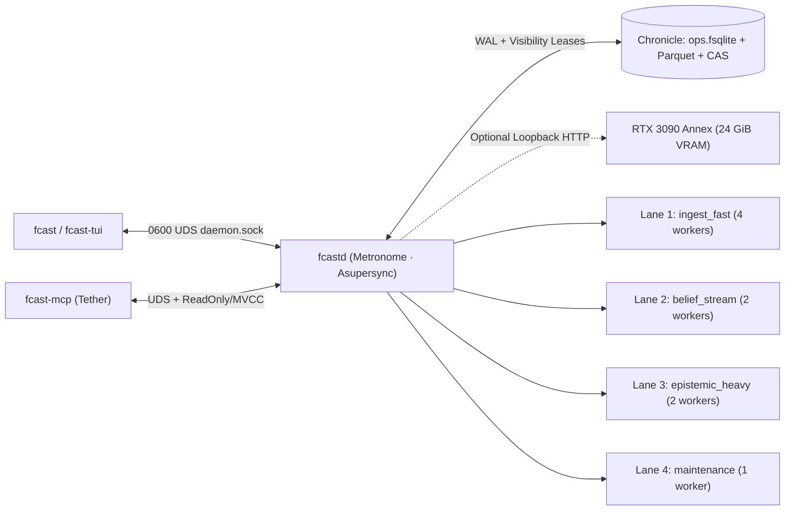

# COMPREHENSIVE PLAN FOR FRANKENFORECAST (`fcast`)

* **Repository:** `franken_forecast`
* **Master Plan Version:** `1.0` (`2026-11-25`)
* **Repository Maturity:** `Tier 0 (Plan-Only)` for Rust Cargo workspace (`0 / 7` `[MEASURED]` crates implemented); `Tier 1 (Contract-Proved)` for reference math, SQLite WAL/backup/migration contracts, rationale staging, log-score VoI stopping, conjugate decay, and document hygiene (`scripts/verify_math_and_contracts.py`, `scripts/verify_plan_hygiene.py`)
* **Core Instruments:** `fcast` (Core CLI), `fcastd` (`Asupersync` Job Daemon), `fcast-mcp` (Model Context Protocol Server), `fcast-verify` (Offline Receipt & Temporal-Fence Auditor), `fcast-tui` (`FrankenTUI` Terminal Cockpit)
* **Target Hardware & OS Envelope:** macOS 15+ (`aarch64` Apple Silicon) and Linux 6.1+ (`x86_64` / `aarch64`), **4 TB (`4,000 GB` `[BUDGET]`) NVMe SSD**, CPU-complete baseline with optional **1× NVIDIA RTX 3090 (`24 GiB` `[UPSTREAM-SPEC]` GDDR6X VRAM)** local compute annex

---

## Part 0 · Document Control

### §0.1 Normative Language, Evidence Labels & Maturity Tiers

Requirement keywords **MUST**, **MUST NOT**, **REQUIRED**, **SHALL**, **SHALL NOT**, **SHOULD**, **SHOULD NOT**, and **MAY** in this specification are to be interpreted strictly per RFC 2119 and RFC 8174 `[UPSTREAM-SPEC]`.

Every quantitative claim, latency bound, token/dollar figure, accuracy metric, line-count ceiling, storage allocation, or VRAM budget in this specification **MUST** carry an explicit evidence label from the following closed taxonomy:

| Evidence Label | Meaning & Verification Protocol |
| :--- | :--- |
| `[MEASURED]` | Empirically executed and verified against an executable script, benchmark fixture, or reference harness in this repository (`scripts/verify_math_and_contracts.py`, `scripts/verify_plan_hygiene.py`). |
| `[UPSTREAM-SPEC]` | Fixed by an external hardware datasheet, OS kernel limit, wire protocol, market exchange rulebook, or peer-reviewed benchmark (`ForecastBench`, Gemini `/v1` & `/v1beta`, `arXiv:2610.04798`, `arXiv:2611.27286`, `EvolveCast`, `TimeSeek`, RTX 3090 Ampere SM `8.6`). |
| `[DERIVED]` | Computed analytically from closed-form mathematical identities, byte layouts, bandwidth formulas, or published API rate tables with explicit parameter disclosure. |
| `[BUDGET]` | Engineered resource ceiling or scope cap enforced by runtime circuit breakers or CI checks (USD spend limit, crate LOC ceiling, NVMe tier quota, VRAM residency cap). |
| `[TARGET]` | Falsifiable engineering, latency, or out-of-sample calibration acceptance threshold bound to a named validation gate (`GATE-01` .. `GATE-24`). |
| `[HYPOTHESIS]` | Research conjecture whose empirical sign or magnitude is not yet proven on `ForecastBench` holdouts and MUST pass an ablation gate before default activation. |

Subsystem and gate maturity are tracked exclusively in `docs/delivery/DELIVERY_LOG.md` across four monotonic tiers:
* **`Tier 0 (Plan-Only)`:** Specified in this document with formal invariants and mapped `GATE-*` acceptance criteria; zero compiled Rust crate code exists yet.
* **`Tier 1 (Contract-Proved)`:** Validated by executable reference models, SQLite DDL harnesses, or synthetic cassettes (`scripts/verify_*.py`).
* **`Tier 2 (Crate-Verified)`:** Implemented in pure Rust on pinned nightly, passing `cargo nextest`, `proptest`, `cargo deny`, cancel-safety tests, and `fcast-verify` receipt generation.
* **`Tier 3 (Tournament-Calibrated)`:** Proven out-of-sample on live or time-fenced `ForecastBench` tournament rounds with positive Brier/Log Skill vs. published baselines.

### §0.2 What "Implemented" Means

Nothing in this repository's Rust crate graph is implemented as of `Plan v1.0` (`0` `[MEASURED]` `.rs` files exist). A subsystem, command verb, or gate **MUST NOT** be described as *Implemented* until **all eight (`8` `[BUDGET]`) mandatory conditions** hold simultaneously:

1. **Zero Stubs & Strict Toolchain:** Compiles cleanly under `nightly-2026-11-01` (Rust Edition 2024 `[UPSTREAM-SPEC]`) with `#![deny(clippy::todo, clippy::unimplemented, clippy::unwrap_used)]` and `#![forbid(unsafe_code)]` outside the audited `<= 120` `[BUDGET]` LOC POSIX FD/lock module (`fcast-infra::sys`).
2. **Dependency Hygiene:** Passes `cargo deny check bans advisories licenses sources` with singleton `asupersync` (`0` `[BUDGET]` instances of `tokio`, `reqwest`, `hyper`, `ort`, `openssl-sys`, `rusqlite`, `sqlx`, or `petgraph`).
3. **Deterministic Wire Schemas:** Every CLI `--json` output and `fcast-mcp` tool/resource payload validates against a committed JSON Schema (`schemas/v1/*.schema.json`).
4. **Cancel & Crash Safety:** Survives `Asupersync` structured task cancellation and simulated `SIGKILL` mid-transaction without WAL corruption, orphaned Gemini Files API uploads, or leaked file descriptors (`0` `[TARGET]` leaked FDs).
5. **Cryptographic Temporal Blinding:** Passes `TemporalFence` replay cassettes proving `available_utc <= as_of_utc` on all queries and `MarketBlindingScrubber` active on all pre-seal `BlindAI` inputs (`0` `[TARGET]` leaked market tokens).
6. **Analytic & Property Parity:** Matches reference mathematical invariants in `scripts/verify_math_and_contracts.py` to `<= 1e-9` `[TARGET]` relative tolerance and passes `10,000` `[BUDGET]` `proptest` cases per numerical module.
7. **Offline Gate Receipt:** Emits a deterministic SHA-256-signed receipt `receipts/GATE-XX.json` verified offline by `fcast-verify`.
8. **Externalized Delivery Record:** Recorded in `docs/delivery/DELIVERY_LOG.md` with commit SHA and receipt digest. Closing an issue, PR, or agent task bead **NEVER** constitutes implementation acceptance.

### §0.3 Stable Identifier Prefixes

Every normative artifact in this plan carries an immutable identifier prefix. Retired identifiers **MUST** be marked `DEPRECATED` in place and **MUST NEVER** be renumbered or reassigned:

* **`CLAIM-01` .. `CLAIM-08`:** Core falsifiable project claims (`§2.2` & `§21`).
* **`GOAL-01` .. `GOAL-10` / `NGOAL-01` .. `NGOAL-06` / `AGOAL-01` .. `AGOAL-07`:** In-scope goals, out-of-scope non-goals, and actively forbidden anti-goals (`§6`).
* **`BET-01` .. `BET-07`:** Explicit architectural bets paired with empirical falsifiers and fallback designs (`§4`).
* **`SUB-01` .. `SUB-09`:** Canonical named subsystems (`§0.5`).
* **`KA-01` .. `KA-10`:** Key mathematical and systems abstractions (`Parts II–IV`).
* **`INV-01` .. `INV-12`:** Hard compile-time or runtime system invariants (`§20`).
* **`INT-01` .. `INT-08`:** External and inter-process protocol boundaries (`Parts III–IV`).
* **`GATE-01` .. `GATE-24`:** Automated acceptance gates, each bound to **exactly one** primary `CLAIM-XX` (`§22`).
* **`RISK-01` .. `RISK-10` & `OQ-01` .. `OQ-06`:** Pre-mortem technical risks (`§23`) and open owner rulings (`§24`).
* **Crate & Binary Prefixes:** All workspace crates use `fcast-*` (`fcast-core`, `fcast-infra`, `fcast-ingest`, `fcast-epistemic`, `fcast-bench`, `fcast-sim`, `fcast-app`); canonical user/system entrypoints are `fcast`, `fcastd`, `fcast-mcp`, `fcast-verify`, and `fcast-tui`.

### §0.4 Reading Guide

* **Forecasting Practitioners & Superforecasters:** Start at `§1` (Landscape Audit), `§9` (Bi-Temporal Verification), `§10` (`6D+2G` Rationale Scoring), `§11` (Two-Speed Dynamic Belief Engine & TimeSeek Deferral), and `§16` (`Cockpit` TUI workflow).
* **Rust Systems, Storage & GPU Engineers:** Read `§5` & `§19` (macOS/Linux + `4 TB` NVMe + Optional RTX 3090 Annex), `§13` (`Metronome` Job Daemon), `§17` (7-Crate DAG & LOC Caps), `§18` (`Chronicle` WAL/Backups/Migrations), and `§20` (Security & Invariants).
* **AI Agent, MCP & Harness Integrators (`pi_agent_rust`, `Hermes`, `Antigravity`):** Read `§13` (`Metronome` Async Queues), `§14` (`Tether` MCP Server & Compiled Skill Packs), and `§15` (Gemini `/v1` vs. `/v1beta` Wire Router).
* **Verification & Calibration Auditors:** Read `§0.7` (Plan Hygiene), `§8` (King-Zeng Cyber Calibration), `§12` (`PurgedChronoSplitter` + `dspy.GEPA`), `§21` (Gauntlet), and `§22` (`GATE-01..24`).

### §0.5 Canonical Subsystem Names

Every capability in `franken_forecast` belongs to exactly one of nine (`9` `[MEASURED]`) named subsystems, eliminating ambiguous cross-crate ownership:

| Subsystem ID | Canonical Name | Crate / Module Ownership | Core Responsibility |
| :--- | :--- | :--- | :--- |
| `SUB-01` | **Chronicle** | `fcast-infra::{store,vault,eidetic}` | Native `fsqlite` WAL + MVCC store, online `zstd` backups, two-layer `belief_revisions` migrations, content-addressed `EvidenceVault` CAS, Parquet tick archiver, and `ee_outbox` institutional memory bridge. |
| `SUB-02` | **Harvester** | `fcast-ingest::*`, `fcast-infra::fetch` | Orderbook microstructure (`BookMarkPrice` Stoikov microprice + tick-aware `φ_liq`), comment/rationale fetchers, ForecastBench human/community median backfill, `available_utc` data packs with Horvitz-Thompson lag correction, `symphonia` `24m` audio chunker, `SafeExternalFetch`, and `DomainGate`. |
| `SUB-03` | **Notary** | `fcast-epistemic::{verify,rationales}`, `fcast-core::blinding` | Verbatim bi-temporal `event_utc` vs. `published_utc` union-envelope auditor, mechanical 2-turn staged-reveal `6D+2G` (`CT/EI/OV/ME/EJ/PR` + `G1/G2`) rationale judge, and `MarketBlindingScrubber`. |
| `SUB-04` | **Loom** | `fcast-epistemic::{graph,belief,ops}`, `fcast-core::math` | 4-layer `fnx-*` causal Knowledge Graph, Two-Speed Dynamic Belief Engine (Tier-0 `ConjugateBelief` + Kulhavý–Zarrop `DecayController` + EvolveCast `κ_LR` + KL-gated cache escalating to Tier-1 CAS-handle PBM `fold`, Martingale KL `FoldStoppingController`, `0..5` `SEIPH`, TimeSeek deferral, `2610.04798` cyber calibrator), and `map`/`decision`/`scenario`/`decompose`. |
| `SUB-05` | **Crucible** | `fcast-bench::*`, `scripts/optimize-gepa` | ForecastBench solver (`Combo` signed Fréchet bounds, geometry-aware horizons, VoI Batch router, TimeSeek lifecycle checkpoint Brier/Log Skill vs. Superforecaster & Community medians) and air-gapped `PurgedChronoSplitter` + `ReplayAsOf` `dspy.GEPA` Pareto optimizer. |
| `SUB-06` | **Wargame** | `fcast-sim::*` | Compile-time `ReadOnlyStore`-isolated (`L3_HYPOTHETICAL`) 4-phase commit-reveal `Referee`, Hegselmann-Krause `CrowdField`, `8×5×5` stratified scenario tree, and 5-step `ExternalMiroFishAdapter`. |
| `SUB-07` | **Metronome** | `fcast-infra::jobs`, `fcast-app::daemon` | Persistent `Asupersync` 4-lane background job daemon (`fcastd`), `O_CLOEXEC` singleton lock, crash-safe `fcast_jobs` visibility leases, `0600` UDS `daemon.sock` push bus, `launchd`/`systemd` supervisors, daily USD spend circuit breaker, and optional RTX 3090 annex router. |
| `SUB-08` | **Tether** | `fcast-app::{mcp,skills}` | First-class Model Context Protocol server (`fcast-mcp` on `dup`/`dup2`-quarantined `stdio` + loopback `Streamable HTTP`) with async `Metronome` job handles, `fcast://` resource subscriptions, parameterized prompts, and static-linted compiled skill packs (`pi_agent_rust`, `Hermes`, `Antigravity`). |
| `SUB-09` | **Cockpit** | `fcast-app::{tui,cli,onboard}` | Sub-16ms `FrankenTUI` 7-view terminal dashboard, 3-curve split vs. 6-strip synchronized comparison physics, coexisting `24h`/`7d` cadence deltas, progressive `fcast init`/`DoctorProbe` onboarding, and atomic 4-phase `[H]` PTY harness handoff. |

### §0.6 How This Plan Was Produced

This specification was synthesized through six (`6` `[MEASURED]`) iterative architecture and adversarial audit rounds:
1. **Form-Factor Pivot:** Rejected an initial Electron + Python GUI architecture in favor of a pure-Rust Franken-stack Core CLI + `Metronome` Job Daemon + `Tether` MCP Server + `Cockpit` TUI + multi-harness skill architecture.
2. **Parallel 4-Agent Structural Audit:** Executed a 4-auditor verification workflow covering Rust/Franken-stack topology, forecasting calibration, ForecastBench data leakage, and macOS/Linux systems security—producing `12` `[MEASURED]` structural patches (`PATCH-01` .. `PATCH-12`) and collapsing an cyclic `19`-crate draft into a strict **`7`-crate acyclic DAG** (`rank(dep) < rank(pkg)`).
3. **Microstructure & Stopping Hardening:** Replaced naive `\$1,000` VWAP marks on thin books with Stoikov top-of-book microprice + excess-above-tick liquidity weighting (`φ_liq`), and replaced premature `|Δlogit| < ε` fold stopping with Martingale Expected Log-Score KL VoI (`VoI_log`) + a hard `>= 2`-fold minimum floor.
4. **Hindsight-Blind Rationale & Bi-Temporal Locks:** Locked byte-exact bi-temporal `event_utc` vs. `published_utc` verification (`templates/bitemporal_event_audit.tmpl`) and mechanical 2-turn staged-reveal `6D+2G` rationale scoring backed by `forecastbench-datasets` published human/community medians.
5. **Two-Speed Conjugate Filtering & Lifecycle Deferral:** Critically audited and repaired raw pseudo-count Beta pooling into a mean–precision `(μ_t, N_t)` streaming filter with a closed-form Kulhavý–Zarrop `DecayController`, EvolveCast `κ_LR` conservative-bias correction, Adams–MacKay shock precision reset, and TimeSeek lifecycle market deferral.
6. **Hardware & Document Governance Alignment:** Engineered the `4 TB` NVMe tiered storage budget, optional `1× RTX 3090` (`24 GiB` VRAM) out-of-process compute annex, and automated `§0.7` hygiene linter (`scripts/verify_plan_hygiene.py`).

### §0.7 Plan Hygiene Rules

The following eight (`8` `[MEASURED]`) hygiene rules govern all edits to this repository and are enforced mechanically by `scripts/verify_plan_hygiene.py`:

1. **Delivery Tracking Quarantine:** Execution progress, sprint logs, task checklists (`- [ ]` / `- [x]`), and gate-receipt statuses **MUST** reside exclusively in `docs/delivery/DELIVERY_LOG.md`, **NEVER** inside `COMPREHENSIVE_PLAN_FOR_FRANKEN_FORECAST.md`.
2. **Closed Tasks Are Not Acceptance:** Closing an agent bead, issue, or pull request **NEVER** equates to formal acceptance; only satisfying all eight (`8` `[BUDGET]`) criteria in `§0.2` promotes a gate.
3. **Process Is Never the Product:** Orchestration ceremonies, prompt scaffolding, and multi-agent logs have zero standalone value unless they improve verifiable forecasting Brier/Log Skill, bi-temporal audit accuracy, or deterministic workstation latency.
4. **Line Counts Are Scope Caps, Never Schedules:** Crate and module LOC figures in `§17` carry `[BUDGET]` tags strictly as complexity ceilings triggering architectural splits if exceeded—**NEVER** as output targets or time estimates.
5. **Universal Evidence Labeling:** Every numeric metric in hardware budgets (`§5`, `§19`), crate scope caps (`§17`), and validation gates (`§22`) **MUST** carry an explicit `§0.1` evidence tag. Unlabeled numbers fail CI.
6. **Strict Claim-Boundary Bijection:** The eight (`8` `[MEASURED]`) core project claims (`CLAIM-01` .. `CLAIM-08`) **MUST NEVER** be conflated. In `§22`, every `GATE-XX` row **MUST** map to **exactly one** primary `CLAIM-XX`, and every `CLAIM-XX` **MUST** be tested by at least two (`2` `[BUDGET]`) independent gates.
7. **Frozen Verbatim Prompt Integrity:** Any prompt marked *Verbatim Locked* (`templates/bitemporal_event_audit.tmpl`) **MUST** match its embedded specification block in `§9` byte-for-byte via SHA-256 verification.
8. **Additive Identifier Immutability:** `CLAIM-*`, `SUB-*`, `INV-*`, `GATE-*`, `BET-*`, and `RISK-*` IDs are append-only; superseded items remain as `DEPRECATED` tombstones.

### §0.8 How Evidence Binds the Plan

1. **Empirical Falsification Overrides Prose:** Whenever a `Tier 1` script, `Tier 2` benchmark, or `Tier 3` `ForecastBench` round contradicts a `[TARGET]` or `[HYPOTHESIS]` in this plan, the author **MUST** execute the corresponding `BET-*` fallback (`§4`) within the same revision rather than weakening the gate silently.
2. **Promotion Discipline:** Moving a `[HYPOTHESIS]` (such as `dspy.GEPA` prompt evolution or `Wargame` scenario priors) into the default tournament path requires passing a paired cluster-stratified bootstrap test (`B = 2,000` `[BUDGET]`, `p < 0.10` `[TARGET]`) against the un-modified baseline on chronologically purged holdouts.
3. **Hardware Envelope Honesty:** All baseline `GATE-01` .. `GATE-24` correctness and tournament gates **MUST** pass on CPU-only macOS and Linux (`0` `[BUDGET]` GPUs); the optional RTX 3090 annex (`§19.3`) may reduce API spend and wall-clock latency, never mask CPU-path defects.

---

## Part I · Diagnosis, Thesis, Principles, Bets & Scope Boundaries

## §1. Landscape Audit: What Exists, What Is Missing, What Is Strongest & What Defects Remain

### §1.1 What Exists Today

The probabilistic forecasting, OSINT, and agentic research landscape currently splits into five disconnected silos:

1. **Prediction Venues & Aggregators (`Polymarket`, `Kalshi`, `Metaculus`, `Manifold`, `GJOpen`, `PredictIt`, `Futuur`):** Provide real-time crowd probabilities and rich comment threads, yet expose incompatible contract horizons, gateway-masked community medians (e.g., Metaculus API null-masking on personal tokens `[UPSTREAM-SPEC]`), noisy thin-book midpoints on long-tail geopolitical contracts, and unranked comment streams mixing superforecaster gems with partisan spam.
2. **Benchmark & Academic Forecasting Suites (`ForecastBench`, `forecasting-tools`, `EvolveCast`, `TimeSeek`, `arXiv:2610.04798`, `arXiv:2611.27286`):**
   * **`ForecastBench` (`forecastingresearch/forecastbench-datasets` `[UPSTREAM-SPEC]`):** Gold-standard dynamic leakage-free benchmark (~`1,000` `[UPSTREAM-SPEC]` biweekly tournament questions + published Human Superforecaster, Public, and `freeze_datetime_value` Community Medians), but provides evaluation datasets rather than an interactive forecaster workstation.
   * **Sequential Belief & Cyber Papers (`arXiv:2611.27286` PBM `fold` + `SEIPH`; `arXiv:2610.04798` cyber geopolitical fusion; `EvolveCast` dynamic belief updating; `TimeSeek` lifecycle checkpointing):** Establish critical pieces—bounded-context belief folding, 81.3% `[UPSTREAM-SPEC]` balanced cyber ROC AUC, LLM conservative under-updating bias, and early-vs-late market skill crossover—but rely on idealized stopping proofs (`|Δlogit| < ε`), uncalibrated 1:1 case-control priors, or heavyweight RL (`PPO`) unsuitable for agile local iteration.
3. **Structured Epistemic Libraries (`futuresearch-python`):** Pioneer table-scale forecasting (`map`), conditional policy evaluation (`decision`/`scenario`), and milestone decomposition (`decompose`), but remain closed-backend Python SDKs without local MVCC storage, orderbook microstructure, bi-temporal wire forensics, or terminal triage cockpits.
4. **The Franken Suite (`Eidetic Engine`, `FrankenSQLite`, `FrankenTUI`, `Frankensearch`, `FrankenNetworkX`, `Asupersync`):** Delivers pure-Rust, zero-`tokio`, zero-C-SQLite building blocks—page-level MVCC persistence, sub-16ms `[UPSTREAM-SPEC]` terminal cell rendering, pure-Rust BM25 + `model2vec` hybrid search, causal graph algorithms, cancel-correct structured concurrency, and institutional memory (`ee`)—but has no forecasting domain engine built atop it.
5. **General-Purpose Coding & Agent Harnesses (`pi_agent_rust`, `Hermes`, `Google Antigravity`, `Claude Desktop`, `Cursor`):** Excel at open-ended tool orchestration and scheduled wakeups, yet lack native temporal-blinding scrubbers, calibrated proper-scoring VoI controllers, or sub-16ms multi-venue probability cockpits.

### §1.2 What Is Missing in the Field

1. **A Unified Local-First Epistemic Instrument:** No single system joins sub-16ms `$0`-token visual triage across 2,000+ contracts (`Cockpit`), persistent background ingestion and streaming Bayesian filtering (`Metronome` + `Loom`), hindsight-blind community rationale grading (`Notary`), vintage-exact `available_utc` data packs (`Harvester`), and hardened MCP/skill integration (`Tether`).
2. **Minute-Exact Bi-Temporal Ground-Truth & Repricing Forensics:** Existing tools conflate *when an event physically occurred* (`event_utc`), *when rule-satisfying proof first became public* (`published_utc` across Hebrew, Arabic, Persian, Russian, Ukrainian, Korean, or English primary channels), and *when macroeconomic/conflict dataset revisions became publicly queryable* (`available_utc`).
3. **Two-Speed Market-Blind Belief Updating:** Current bots either re-run expensive multi-dollar web-research loops on every news tick or apply naive probability-averaging formulas that drift tail risks toward `50%`. Missing is a mathematically sound **Tier-0 Mean–Precision `(μ_t, N_t)` likelihood filter + adaptive `DecayController`** that runs continuously in millicents and escalates to **Tier-1 CAS-handle PBM `fold`** strictly when epistemic variance or surprise warrants it.
4. **Mechanical Hindsight- & Herding-Blind Rationale Evaluation:** Platforms sort comments by upvotes or recency, rewarding hindsight edits and tribal consensus rather than freeze-date epistemic rigor (`CT/EI/OV/ME/EJ/PR`) mechanically isolated from market price peeking.

### §1.3 What Is Strongest in This Architecture

1. **Strict Epistemic & Compile-Time Firewalls (`INV-01` .. `INV-05`):**
   * `Wargame` (`fcast-sim`) accepts `&ReadOnlyStore` only and is compile-time disconnected from `Crucible` (`fcast-bench`) in `Cargo.toml`, making synthetic wargame contamination of `L0` evidence physically unrepresentable in Rust's type system.
   * `Notary`'s 2-turn `--staged-reveal` protocol withholds `(forecaster_forecast, crowd_prior)` during Turn A in Rust code so the LLM *cannot* herd toward price while grading `CT/EI/OV/ME/EJ`.
   * `MarketBlindingScrubber` strips live market odds and community medians at tool-ingress prior to sealing `p_indep`, partitioning pre-seal `BlindAI` calibration (`κ_LR`) cleanly from post-seal TimeSeek market deferral.
2. **Zero-Hallucinated-Citation Handle-Only Folding (`KA-05`):** Raw pages, wire flashes, and verbatim `symphonia` transcripts enter content-addressed `EvidenceVault` *before* LLM ingress; `Loom` passes compact `[ev:8f2a19#s04]` handles rather than re-generating 64-hex SHA-256 hashes or multilingual quotes through lossy token sampling.
3. **Proper-Scoring Martingale VoI & Microstructure Realism (`KA-01`, `KA-06`):**
   * Orderbook marks (`BookMarkPrice`) combine Stoikov imbalance microprice with a resting-depth floor (`\$100` `[BUDGET]`) and tick-excess sweep penalty (`φ_liq`), preventing both `\$1,000` VWAP gap distortion and `\$20` stub spoofing.
   * Fold stopping uses Martingale-projected Expected Log-Score KL Information Gain per dollar (`VoI_log` in nats/USD) with a hard `>= 2`-fold floor and fat-tail guard (`κ_tail = 0.50` `[BUDGET]` nats), capturing tail risks that quadratic Brier EVSI and `|Δlogit| < ε` miss.
4. **4 TB Local Warehouse + Zero-Lock-In Optional RTX 3090 Annex (`§19`):** Retaining multi-year L2 orderbook Parquet lakes, full `ForecastBench` vintages, and `512 GB` `[BUDGET]` CAS evidence locally on NVMe—paired with an optional process-isolated RTX 3090 (`24 GiB` VRAM) annex—eliminates cloud database latency and slashes recurring LLM triage costs toward `\$0` `[TARGET]` without polluting core Rust crates with CUDA/C++ FFI.

### §1.4 Structural Defects, Honest Limits & Residual Failure Modes

Intellectual honesty requires stating the exact limits and structural tensions of `franken_forecast` upfront:

1. **Plan-Only Starting Point (`Defect D1`):** Zero lines of the 7-crate Rust workspace exist today (`0` `[MEASURED]` crates). Pinning `nightly-2026-11-01` across `FrankenSQLite`, `FrankenTUI`, `Frankensearch`, `FrankenNetworkX`, and `Asupersync` carries real upstream API-drift friction (`RISK-01`) until `M0` compiles end-to-end.
2. **Pre-Cutoff LLM Parametric Training Contamination (`Limit L1`):** Even with `ReplayAsOf` network air-gaps, `PurgedChronoSplitter`, and `MarketBlindingScrubber`, frontier models (`gemini-4-*` or local `32B` weights on RTX 3090) possess parametric memory of world events prior to their pretraining cutoff. Therefore, historical backtests on questions resolved *before* model weight freeze **CANNOT** measure true zero-leakage forecasting skill; only prospective/post-cutoff `ForecastBench` rounds (`Tier 3`) provide uncontaminated external validity.
3. **Closed-Source Social & Encrypted Channel Blind Spots (`Limit L2`):** `Notary`'s bi-temporal verifier (`§9`) relies on publicly fetchable URLs, RSS/wire feeds, and archived snapshots. Private Telegram groups, paywalled Bloomberg/Reuters terminals without licensed feeds, or deleted X posts without Wayback/Archive.today captures will lawfully resolve to `null` rather than guessed timestamps.
4. **Non-Stationary Geopolitical Tail Regimes (`Limit L3`):** No conjugate filter (`DecayController`), King-Zeng prior shift, or `8×5×5` wargame can abolish Knightian uncertainty on unprecedented regime breaks (e.g., first-ever nuclear use or novel zero-day cascade). `fcast` bounds tail log-loss via `ProbClamped ∈ [10^-4, 1 - 10^-4]` `[BUDGET]` Tournament clipping and fat-tail `VoI_log` exploration, but cannot manufacture base rates where reference classes have `N = 0`.
5. **Single-GPU 24 GiB VRAM Ceiling (`Limit L4`):** An optional single RTX 3090 (`24 GiB` `[UPSTREAM-SPEC]` VRAM) comfortably runs quantized `24B–32B` (`Q4_K_M`/`AWQ`) models for Tier-0 likelihood triage, cross-encoder reranking, and bulk audio pre-screening, but **cannot** match frontier `gemini-4-*` or `deep-research-preview-04-2026` reasoning depth on complex 6-fold legalistic contract synthesis. Local GPU execution is therefore scoped strictly to high-volume Tier-0 triage, retrieval, pre-screening, and offline calibration sweeps—never forced as a replacement for frontier Tier-1 synthesis.
6. **Single-Node `fsqlite` Write Serialization on Non-Disjoint Pages (`Limit L5`):** While `FrankenSQLite` provides page-level MVCC, heavy bulk tick ingestion into `ops.fsqlite` would still contend on B-tree interior pages if high-frequency L2 ticks lived in SQLite. `Chronicle` mitigates this by streaming raw L2 ticks directly to immutable monthly Parquet files on the `4 TB` SSD (`Tier W1`), keeping `ops.fsqlite` (`Tier H0`, `<= 64 GB` `[BUDGET]`) strictly for downsampled marks, beliefs, rationales, and job leases.

---

## §2. Objective, Mission, Vision & The Eight-Fold Thesis

### §2.1 Objective, Mission & Dual Lineage Vision

* **Objective:** Deliver **`fcast`**—a local-first, pure-Rust forecasting workstation, background telemetry/epistemic daemon (`fcastd`), MCP server (`fcast-mcp`), hindsight-blind rationale evaluator, and `ForecastBench` tournament engine running natively on macOS and Linux.
* **Mission:** Eliminate the boundary between **sub-millisecond quantitative market/telemetry inspection** and **auditable, temporally fenced probabilistic reasoning**, ensuring every probability, rationale score, dataset vintage, belief fold, and KG crux carries cryptographic provenance.
* **Dual Lineage Vision:**
  1. *Franken Suite Lineage:* Mechanical sympathy, single-runtime (`Asupersync`) purity, local NVMe sovereignty (`Chronicle`), sub-16ms `FrankenTUI` visual density (`Cockpit`), and compounding institutional memory (`Eidetic Engine`).
  2. *FutureSearch Lineage:* Structured epistemic scaling—turning entity tables (`fcast map`), conditional policy choices (`fcast decision` / `scenario`), and milestone chains (`fcast decompose`) into calibrated probability distributions rather than uncalibrated chat prose.

### §2.2 The Eight Core Project Claims (`CLAIM-01` .. `CLAIM-08`)

Per `§0.7` Rule 6, these eight claims are mutually distinct and never conflated; every gate in `§22` maps to **exactly one** claim:

* **`CLAIM-01` (Structural & Durability Integrity):** The 7-crate workspace maintains a strict acyclic DAG (`0` `[TARGET]` cycles, `0` banned crates) over a crash-safe WAL/MVCC store (`Chronicle`) with verified online `zstd` backups and lossless two-layer `belief_revisions` migrations.
* **`CLAIM-02` (Bi-Temporal & Vintage Non-Leakage):** Every ingested dataset (`Harvester`), verified event timeline (`Notary`), and offline optimizer rollout (`Crucible`) enforces `available_utc <= as_of_utc` and pre-seal `MarketBlindingScrubber` isolation with `0` `[TARGET]` hindsight leaks.
* **`CLAIM-03` (Orderbook & Cross-Venue Pricing Fidelity):** `BookMarkPrice` and horizon-aware equivalence clustering preserve un-spoofed probabilities across liquid and thin books while backfilling null-masked community priors via `ForecastBench` medians.
* **`CLAIM-04` (Hindsight- & Price-Blind Rationale Discrimination):** Mechanical 2-turn staged-reveal `6D+2G` scoring (`Notary`) ranks community rationales reproducibly without price herding, LLM arithmetic errors, or unflagged contract/integrity violations.
* **`CLAIM-05` (Two-Speed Calibrated Epistemic Skill):** Pairing Tier-0 `(μ_t, N_t)` streaming likelihood updates + `DecayController` with Tier-1 CAS-handle PBM `fold` + Martingale Log-Score `VoI_log` stopping (`Loom`) improves out-of-sample Brier and Log Skill per dollar over single-speed baselines and prior-unadjusted cyber classifiers.
* **`CLAIM-06` (Firewalled Tournament & Evolutionary Optimization):** `Crucible` produces coherent Fréchet-consistent `ForecastBench` submissions within `\$15.00` `[BUDGET]`/round while `Wargame` (`ReadOnlyStore`) cannot contaminate `L0` evidence at compile time.
* **`CLAIM-07` (Daemon Reliability & MCP/Harness Purity):** `Metronome` (`fcastd`) and `Tether` (`fcast-mcp` + compiled skills) guarantee crash-recoverable job leases, hard daily USD spend circuit breaking, `100%` `[TARGET]` JSON-RPC frame purity, `< 15 ms` `[TARGET]` async job-handle dispatch, and hysteresis-gated `Hermes` wakeups.
* **`CLAIM-08` (Sub-16ms Cockpit Ergonomics & Atomic PTY Handoff):** `Cockpit` (`fcast-tui`) renders 2,000+ contracts across 7 specialized views at `< 8 ms` `[TARGET]` p99 frame time without Braille color collisions and executes 4-phase `[H]` PTY harness handoffs with `0` `[TARGET]` stolen keystrokes or leaked FDs.

---

## §3. Twelve Architectural Principles

1. **\$0-Token Visual Triage First:** Navigating markets, rationales, data packs, and KG cruxes in `Cockpit` MUST cost `\$0.00` `[BUDGET]` in API spend; metered LLM calls fire only on explicit operator or budget-governed `Metronome` triggers.
2. **Every Timestamp Is a Triple:** Never store a bare timestamp; distinguish physical occurrence (`event_utc`), public visibility (`published_utc`), and local database/vintage availability (`available_utc`).
3. **LLMs Emit Likelihoods & Structured Rubrics, Rust Owns Arithmetic:** LLMs never sum rubric integers, never average probabilities, and never re-type SHA-256 digests; Rust computes all log-odds updates, Martingale projections, rankings, and Fréchet bounds.
4. **Independence Before Aggregation:** Always seal `BlindAI` (`p_indep`) behind `MarketBlindingScrubber` *before* applying post-seal TimeSeek market/community blending (`MarketBlended`).
5. **One Async Runtime (`Asupersync`):** Zero `tokio` shadow threadpools anywhere in the dependency graph.
6. **Hot SQLite, Columnar Ticks, Content-Addressed Blobs:** Keep `ops.fsqlite` lean (`<= 64 GB` `[BUDGET]`); put multi-year L2 orderbook ticks in Zstd Parquet (`Tier W1`) and raw documents in CAS `EvidenceVault` (`Tier H1`).
7. **Async Job Handles Over Blocking RPCs:** Any operation exceeding `2 s` `[BUDGET]` wall-clock MUST be enqueued onto `Metronome` (`fcast_jobs`) and tracked via UDS/MCP progress notifications rather than blocking TUI frames or timing out MCP clients.
8. **Hardware Sympathy Without Hardware Lock-In:** Exploit `4 TB` NVMe bandwidth and optional RTX 3090 (`24 GiB` VRAM) throughput via clean process/tier boundaries while keeping `0`-GPU macOS/Linux 100% first-class.
9. **Respect Terminal Cell Physics:** One foreground color per `2×4` `[UPSTREAM-SPEC]` Unicode Braille cell means `<= 3` curves on split View `[1]` and 6 synchronized separate strips on View `[2]`.
10. **Prior-Shift Every Case-Control Classifier:** Never ingest balanced-sample ML probabilities (`arXiv:2610.04798`) without exact King-Zeng base-rate log-odds correction.
11. **Fail Closed on External Untrusted Bytes:** Every HTTP/RSS/DataPack fetch passes `SafeExternalFetch` connect-time IP pinning, decompression caps, and static prompt/skill linting.
12. **Institutional Memory Compounds Locally:** Resolved post-mortems and `G1`/`G2` pitfalls flow via `ee_outbox` into `Eidetic Engine` rules so recurring errors become permanent guardrails.

---

## §4. Explicit Technical Bets & Falsifiers (`BET-01` .. `BET-07`)

| Bet ID | Architectural Bet | Empirical Falsifier | Pre-Committed Fallback |
| :--- | :--- | :--- | :--- |
| `BET-01` | **Two-Speed `(μ_t, N_t)` Streaming + Tier-1 PBM `fold`** beats periodic standalone `fold` in Brier/Log Skill per dollar. | On `100` `[BUDGET]` post-cutoff questions, Two-Speed fails to reduce LLM spend by `>= 40%` `[TARGET]` at `<= 0.003` `[TARGET]` Brier degradation. | Disable LLM Tier-0 calls; retain deterministic `DecayController` + `DataPack` z-score triggers to wake Tier-1 `fold`. |
| `BET-02` | **Martingale Log-Score KL `VoI_log` + `>= 2`-Fold Floor** outperforms `|Δlogit| < ε` stopping on tail events (`p < 0.10` or `p > 0.90`). | Tail-bucket Log Score under `VoI_log` does not beat fixed 3-fold or `|Δlogit|` stopping on `ForecastBench` replay (`GATE-14`). | Fall back to fixed `3`-fold `[BUDGET]` budget on tail questions + Empirical-Bayes tool-hit rate cutoff only. |
| `BET-03` | **Mechanical 2-Turn Staged-Reveal `6D+2G`** improves rationale ranking correlation with human superforecaster rater panels vs. 1-pass scoring. | Spearman `ρ` on `50` `[BUDGET]` gold-annotated rationales improves by `< 0.05` `[TARGET]` while doubling latency. | Default CLI batch runs to `--single-pass` while retaining `--staged-reveal` for Top-10 finalists. |
| `BET-04` | **TimeSeek Lifecycle Market Deferral** improves post-seal `MarketBlended` Brier Skill over static 50/50 pooling. | Out-of-fold `MarketBlended` BSS vs. raw `p_micro` is `<= 0.0` `[TARGET]` in late lifecycle (`τ_life > 0.75`). | Replace parametric `ψ_life` with regularized logistic stacking fit per `(venue, horizon_bucket)`. |
| `BET-05` | **Leak-Free `dspy.GEPA` on `SEIPH` + Proper Score** yields non-overfit prompt gains on unseen future rounds. | Paired bootstrap (`B = 2,000` `[BUDGET]`) holdout p-value `>= 0.10` `[TARGET]` across two consecutive `GEPA` runs. | Freeze hand-authored baseline templates; restrict `GEPA` to diagnostic failure-cluster reporting. |
| `BET-06` | **Optional RTX 3090 (`24 GiB`) Local `24B–32B` Likelihood Triage** matches cloud `gemini-3.5-flash-lite` sign agreement (`>= 88%` `[TARGET]`) on Tier-0 news ticks. | Sign/magnitude correlation on `500` `[BUDGET]` calibration clusters falls below `0.85` `[TARGET]` or VRAM exceeds `22.0 GiB` `[BUDGET]`. | Downshift Slot A to `14B Q6_K` or restrict RTX 3090 to Slot B/C/D (reranking, Whisper pre-screen, Monte Carlo) and keep Tier-0 on `gemini-decision-1`. |
| `BET-07` | **Pinned Nightly Franken-Stack Unification** compiles cleanly without patched forks across macOS & Linux. | Upstream `asupersync` or `fsqlite` rev skew blocks workspace build for `> 48 h` `[BUDGET]` during `M0`. | Vendor workspace crates under `vendor/franken-*` at verified commit SHAs with Cargo `[patch.crates-io]`. |

---

## §5. Target Hardware, OS & Resource Envelope Summary

Full storage-tier and VRAM partition tables are specified in `§19`. Every subsystem is engineered against the following canonical workstation envelope:

| Resource Dimension | Baseline Requirement (`macOS` / `Linux`) | Optional High-Throughput Workstation Profile |
| :--- | :--- | :--- |
| **Operating System & Arch** | macOS `15.0+` (`aarch64` M1–M4) OR Linux `6.1+` (`x86_64` / `aarch64`) `[UPSTREAM-SPEC]` | Dual-machine or Linux tower (`x86_64` AVX2/AVX-512) + macOS laptop over SSH/Tailscale MCP `[TARGET]` |
| **System RAM** | `16 GiB` minimum (`<= 1.5 GiB` `[BUDGET]` `fcastd` + `fcast-tui` RSS) | `64 GiB+` DDR4/DDR5 (`mmap` page cache over hot `ops.fsqlite` + Parquet scans) `[BUDGET]` |
| **NVMe SSD Storage** | `64 GB` minimum free space (lean `90-day` rolling retention mode) `[BUDGET]` | **`4 TB` (`4,000 GB` `[BUDGET]`) PCIe Gen4 NVMe SSD** (`3,600 GB` allocated across `7` tiers + `400 GB` `[BUDGET]` `10%` wear-leveling reserve) |
| **GPU Accelerator** | **`0` GPUs required** (`100%` `[TARGET]` CPU-complete pure Rust) | **Optional `1× NVIDIA RTX 3090`** (`24 GiB` GDDR6X, `936 GB/s` bandwidth, `350 W` TDP, Compute Capability `8.6` `[UPSTREAM-SPEC]`, capped at `<= 22.0 GiB` `[BUDGET]` active VRAM) |

---

## §6. Goals, Non-Goals & Anti-Goals

### §6.1 Goals (`GOAL-01` .. `GOAL-10`)
* **`GOAL-01`:** Sub-16ms `[TARGET]` local terminal cockpit (`fcast-tui`) for multi-venue geopolitical, macro, and cyber forecasting.
* **`GOAL-02`:** Crash-safe background `Asupersync` job daemon (`fcastd`) with bounded concurrency lanes and hard daily USD spend caps.
* **`GOAL-03`:** First-class `stdio` and loopback `Streamable HTTP` MCP server (`fcast-mcp`) with non-blocking async job handles and compiled `pi_agent_rust`, `Hermes`, and `Antigravity` skills.
* **`GOAL-04`:** Multi-platform rationale ingestion and mechanical 2-turn staged-reveal `6D+2G` scoring (`Notary`).
* **`GOAL-05`:** Byte-verbatim bi-temporal event verification (`event_utc` vs. `published_utc`) and per-market repricing lead/lag forensics.
* **`GOAL-06`:** Vintage-exact (`available_utc`) question data packs with Horvitz-Thompson reporting-lag adjustment and King-Zeng prior-shifted cyber calibration (`arXiv:2610.04798`).
* **`GOAL-07`:** Two-Speed Dynamic Belief Engine (`ConjugateBelief` + `DecayController` + CAS-handle PBM `fold` + Martingale Log-Score `VoI_log` + TimeSeek deferral).
* **`GOAL-08`:** Competitive `ForecastBench` automation (`<= \$15.00` `[BUDGET]`/round) benchmarked directly against Superforecaster and Community medians.
* **`GOAL-09`:** Multi-year `4 TB` NVMe telemetry/orderbook archival and optional `1× RTX 3090` (`24 GiB`) local triage/rerank/calibration offload.
* **`GOAL-10`:** Progressive `< 60 s` `[TARGET]` zero-key onboarding (`fcast init`) with guided `DoctorProbe` connector upgrades.

### §6.2 Non-Goals (`NGOAL-01` .. `NGOAL-06`)
* **`NGOAL-01`:** Automated real-money order placement, market-making, or wallet signing on Kalshi/Polymarket (`fcast` is a read/research/scoring instrument, not an execution bot).
* **`NGOAL-02`:** Building a custom browser or Electron/WebView desktop GUI (`Cockpit` is strictly terminal-native + MCP).
* **`NGOAL-03`:** Re-implementing a general-purpose multi-turn coding chat IDE inside `fcast-tui` (delegated cleanly via `[H]` PTY handoff and `Tether` MCP to `pi_agent_rust`, `Hermes`, and `Antigravity`).
* **`NGOAL-04`:** Distributed multi-node consensus databases (single-host `4 TB` NVMe `fsqlite` + Parquet suffices for `10^8+` `[DERIVED]` market ticks).
* **`NGOAL-05`:** Training foundation LLM weights via PPO/RLHF on local hardware (1× RTX 3090 `24 GiB` is used for quantized inference, reranking, Whisper pre-screen, and `dspy.GEPA` prompt/hyperparameter optimization, never full LLM backprop).
* **`NGOAL-06`:** Supporting sports, entertainment, or sub-hour crypto candle gambling contracts (filtered out by `DomainGate`).

### §6.3 Anti-Goals (`AGOAL-01` .. `AGOAL-07` — Actively Forbidden)
* **`AGOAL-01` (Never Drive Pre-Seal Decay with Market Volatility):** Feeding live market price volatility into `DecayController` violates `BlindAI` independence and spoofs memory resets on thin books (`INV-04`).
* **`AGOAL-02` (Never Pool Neutral News Toward `50%`):** Linear pseudo-count updates (`y_t = 0.5` on `"Still"`) are strictly prohibited (`§11.1`).
* **`AGOAL-03` (Never Stack 6 Braille Curves in One Shared Cell Grid):** Terminal `2×4` Braille physics allow 1 foreground color per cell; View `[2]` MUST use 6 synchronized small-multiples strips (`§16.2`).
* **`AGOAL-04` (Never Allow LLM Rubric Arithmetic or Raw Hash Echoing):** LLMs MUST NOT emit summed rationale scores or re-type 64-hex SHA-256 digests (`INV-06`, `INV-07`).
* **`AGOAL-05` (Never Expose Write/Restore Admin Verbs on MCP):** `fcast-mcp` MUST NEVER register `store restore`, raw SQL mutation, or `secrets.toml` read tools (`INV-09`).
* **`AGOAL-06` (Never Bypass CAPTCHAs or Paywalls):** `SafeExternalFetch` and connectors MUST use sanctioned public/keyed APIs only; gated resources fail closed to `null`.
* **`AGOAL-07` (Never Link Mandatory CUDA/C++ Libraries into `fcast-*` Crates):** Optional RTX 3090 acceleration MUST communicate over loopback IPC/HTTP so `cargo build` stays 100% pure Rust (`INV-11`).

---

## Part II · Mathematical & Epistemic Foundations

## §7. Orderbook Microstructure & Dual-Cadence Pricing (`KA-01` · `Harvester`)

Walking a fixed `\$1,000` VWAP across thin long-tail geopolitical books sweeps empty 25¢–40¢ gaps, while raw `(bid + ask)/2` midpoints are trivially spoofed by `\$20` stub quotes. `Harvester` computes `BookMarkPrice` (`[MEASURED]` in `scripts/verify_math_and_contracts.py`):

1. **Top-of-Book Liquidity Floor:** Require inside resting depth $L_{\text{tob}} = B_{\text{bid}} + B_{\text{ask}} \ge \$100$ `[BUDGET]` and inside spread $s \le 800\text{ bps}$ `[BUDGET]`. Books failing either bound are tagged `BookState::ThinOrWide` (`[Thin]`), fall back to `last_trade` (if inside `[bid, ask]`, else mid), set $\phi_{\text{liq}} = 0$, auto-dim `24h` deltas in favor of **`7d`**, and mute `15m/1h` shock alerts.
2. **Stoikov Imbalance-Weighted Microprice:**
   $$p_{\text{micro}} = \frac{B_{\text{bid}} \cdot p_{\text{ask}} + B_{\text{ask}} \cdot p_{\text{bid}}}{B_{\text{bid}} + B_{\text{ask}}}$$
3. **Tick-Excess Depth-Adjusted Liquidity Credibility ($\phi_{\text{liq}} \in [0,1]$):** Walking reference clip $Q_{\text{ref}} = \$500$ `[BUDGET]` yields symmetric sweep impact $\iota(Q_{\text{ref}})$. Measuring spread strictly **in excess of the venue's physical minimum tick** $s_{\text{tick}}$ (`100 bps` `[UPSTREAM-SPEC]` for 1¢ Kalshi/Polymarket contracts):
   $$\phi_{\text{liq}}(L_{\text{tob}}, s, \iota) = \sigma\!\left(\ln\frac{L_{\text{tob}}}{\$250}\right) \cdot \exp\!\left(-\frac{\max(0,\, s - s_{\text{tick}})}{400\text{ bps}}\right) \cdot \exp\!\left(-\frac{\iota(Q_{\text{ref}})}{0.05}\right)$$
   Velocity triage blends `24h` delta weight $\phi_{\text{liq}}$ with `7d` (`Weekly`) delta weight $1 - \phi_{\text{liq}}$, while displaying both columns side-by-side (`Teal▲` / `Coral▼`, `CellAttr::DIM` on noisy `24h` thin books).

---

## §8. Vintage-Locked Data Packs & King-Zeng Cyber Calibration (`KA-02` · `Harvester` & `Loom`)

1. **Point-in-Time `available_utc` Data Packs (`question_data_packs`):**
   * Primary key `(series_id, event_period_utc, available_utc)` maps `FRED` to ALFRED `realtime_start` vintages and `ACLED` / `UCDP` / `VCDB` / `EuRepoC` / `CISA KEV` / `EPSS` / `Cloudflare Radar` / `IODA` / `IMF PortWatch` to `discovery_utc`. Every read enforces `WHERE available_utc <= :as_of_utc` (`INV-02`).
   * **Horvitz-Thompson Reporting-Lag Adjustment:** Fits empirical delay CDFs $\hat{F}_{\text{delay}}(\tau)$ on historical conflict/cyber disclosures and computes $\hat{k}_{\text{adj}} = \sum_i 1 / \max(\hat{F}_{\text{delay}}(\text{as\_of} - t_i),\, 0.15)$, badging windows with completeness `< 0.30` `[BUDGET]` as `[RIGHT-CENSORED: reporting lag]`.
2. **Prior-Shifted `arXiv:2610.04798` Cyber Incident Calibrator (`Loom`):**
   * Because `arXiv:2610.04798` reports `81.3%` `[UPSTREAM-SPEC]` ROC AUC on balanced `1:1` case-control samples whereas real 30-day country-sector cyber incident hazards sit at `0.5%–3.0%` `[DERIVED]`, `Loom` estimates an Empirical-Bayes Poisson baseline $\pi_{c,s}(\Delta t) = 1 - \exp(-\hat{\lambda}_{c,s}\Delta t / 30)$, calibrates tech (`KEV`/`EPSS`/`Radar`/`IODA`) and geopolitical signals (news + verbatim podcast transcripts) out-of-fold via Venn-Abers/Platt scaling, and applies exact **King-Zeng prior-shift** (`[MEASURED]` in `scripts/verify_math_and_contracts.py`):
     $$\operatorname{logit}\hat{p}_{c,s} = \operatorname{logit}\hat{q}_{\text{train}} - \operatorname{logit}\pi_{\text{train}} + \operatorname{logit}\pi_{c,s}(\Delta t)$$
     fusing centered log-likelihood ratios under L2 collinearity shrinkage (`±4.0` `[BUDGET]` nat clamp).

---

## §9. Verbatim Bi-Temporal Event Verification (`KA-03` · `Notary`)

`templates/bitemporal_event_audit.tmpl` is **Verbatim Locked** (`§0.7` Rule 7) with exact SHA-256 digest `6109ee958fe61395e7c9335576a788a240d2bc2df692d0615c9e43f478dda408` `[MEASURED]`. `{markets}` expands to 1-indexed venue rule blocks, `{hint}` injects the union-strictness & nullability invariant (*`satisfies_rules = true` iff the item satisfies $\ge 1$ listed market; `first_public = null` when zero items qualify*), and `ValidatedBiTemporalAudit` joins each venue $m$'s orderbook Parquet/SQLite ticks against `per_market[m].first_qualifying_published_utc` as `[HH:MM:00Z, HH:MM:59.999Z]` intervals:

```text
Event (description ): {event}
Approximate date (UTC): {date}
Prediction markets resolved by this event, with their rules (they define exactly what must have happened):
{markets}
Two different times matter, never mix them:
- published_utc: when a post / statement / broadcast / article became visible to the public;
- event_utc: when the thing itself happened, as described by a source (e.g. "the strikes began at 22:40 GMT" written in a later article is an event time, NOT a
publication time).
Rules for judging:
- satisfies_rules = true only if that item itself reports the event HAS happened AND meets the specific market rule (e.g. "missiles launched" does not satisfy "
missiles entered Israeli airspace"; "talks scheduled" does not satisfy "met in person"; "deal close" does not satisfy "agreement reached").
- Consider ANY party involved: leaders' posts (Truth Social, X, Telegram), governments, militaries, state media of either side, mediators, live TV, wire flashes (
Reuters/AP/AFP/Yonhap/etc.), local media in any language.
- For every time, state timestamp_basis: "page shows time with timezone", "page shows time, timezone inferred (say how)", "metadata/JSON-LD", "archive capture", "URL
", or "other". Convert to UTC carefully.
- If a wire or news report says someone "said", "announced", "posted" or "confirmed" it (e.g. "Israel said it launched an attack", "Trump announced on Truth Social"),
that original statement is usually earlier than the report: find the original post / statement / broadcast itself and its own time (the official's X or
Telegram account, the ministry or military spokesperson channel, the live TV moment), including sources in Hebrew, Arabic, Persian, Russian, Ukrainian, Korean,
etc. List both.
- Screenshots and reposts of social posts often show the viewer's local time without a timezone: only use such a time if the timezone can be established; otherwise
use a source with an explicit timezone.
- If a page was updated later, say whether the quoted text was in the first version.
- If you cannot find something, use null. Never guess.
{hint}
Reply with ONLY one JSON object, no other text:
{"items": [{"published_utc": "YYYY-MM-DD HH:MM", "shown_time": "...", "timezone": "...", "timestamp_basis": "...", "event_utc": "... or null", "who_or_outlet": "...",
"source_type": "leader post|official statement|state media|TV|wire flash|news article|other", "language": "...", "what": "one sentence", "satisfies_rules":
true/false, "url": "...", "quote": "exact sentence or timestamp line"}],
"first_public": {"published_utc": ..., "who_or_outlet": ..., "source_type": ..., "url": ..., "quote": ..., "timestamp_basis": ...},
"second_source": {"published_utc": ..., "who_or_outlet": ..., "url": ..., "quote": ...},
"earlier_signals": [{"published_utc": ..., "what": "public report before first_public indicating it was happening or imminent, but not yet satisfying the rules", "
url": ...}],
"per_market": [{"m": market number, "first_qualifying_published_utc": ..., "note": ...}],
"event_utc": "when it happened, if stated, else null",
"confidence": "high|medium|low", "notes": "..."}
first_public must be the item with the earliest published_utc among items with satisfies_rules = true (for the least strict market).
```

---

## §10. Staged-Reveal `6D+2G` Forecaster Rationale Scoring (`KA-04` · `Notary`)

`Notary` ingests rationales across `Metaculus` (`/api/comments`), `Manifold` (TipTap AST → UTF-8 + `betProb`), `Polymarket` (`gamma-api` holder-verified comments), and `GJOpen` / `ForecastBench` human superforecaster & public reasoning archives, resolving `crowd_prior` at `ts <= freeze_date` via a **3-tier cascade** (`[MEASURED]` in `scripts/verify_math_and_contracts.py`): **(1)** unmasked venue `p_micro` / native median passing `L_tob_min`, **(2)** `forecastbench-datasets` published `freeze_datetime_value` / `Superforecaster Median` / `Public Median` (`available_utc <= freeze_date`, solving Metaculus personal-token null-masking at `\$0` `[BUDGET]`), or **(3)** credibility-weighted `EquivalenceCluster` median.

1. **Mechanical 2-Turn Staged Reveal (`--staged-reveal`, Default):**
   * **Turn A (Price-Hidden):** Supplies Question + Resolution Criteria + Freeze Date + Rationale Text with `(forecaster_forecast, crowd_prior)` physically omitted in Rust. Locks integer scores `ct, ei, ov, me, ej ∈ {0,1,2,3,4}` (`0` = absent, `1` = gestural, `2` = generic, `3` = specific, `4` = exemplary *"the line another forecaster would steal"*), or short-circuits `unscoreable: true` if empty/redacted.
   * **Turn B (Price-Revealed via `previous_interaction_id`):** Reveals `(forecaster_forecast, crowd_prior)` alongside the locked 5 integers to score `pr ∈ {0,1,2,3,4}` (coherence vs. crowd prior AND internal uncertainty movement), evaluate **`g1`** (load-bearing contract misread) & **`g2`** (post-cutoff leak or decisive fabrication), and emit the mandatory `1–2` sentence `note`.
2. **Zero LLM Arithmetic & Deterministic Rust Ranking (`INV-06`):**
   * LLM emits strictly `{ct, ei, ov, me, ej, pr, g1, g2, unscoreable, note}`.
   * Rust sorts without mutating stored integers: `unscoreable` excluded; `g2 == true` → `RankTier::GatedIntegrity` (`effective_total = 0`); `g1 == true` → `RankTier::GatedContract` (`effective_total = min(raw_sum, 8)`, hidden unless `--show-gated`); clean (`!g1 && !g2`) → `effective_total = ct + ei + ov + me + ej + pr` (`0..=24`), ordered by `(RankTier::Clean, effective_total, min(ct, me), ei, ov, ej, pr, Reverse(created_at_utc))`.

---

## §11. `Loom`: Two-Speed Dynamic Belief Engine, `DecayController`, PBM `fold` & TimeSeek Deferral (`KA-05`, `KA-06`)

### §11.1 Tier-0 Mean–Precision Conjugate Filter & Closed-Form `DecayController`
To eliminate neutral-news drift to `50%`, high-prior sign inversion (`80%` + mild `Up` dropping below `80%`), burst forgetting, and inverted shock variance (`§1.4`), `Loom` parameterizes `ConjugateBelief` in **Mean–Precision `(μ_t, N_t)`** (`α_t = N_t μ_t`, `β_t = N_t(1 - μ_t)` for `Binary`, `Dirichlet(N_t p_t)` for `Categorical`, quantile precision `N_t` for `Cdf201`), verified in `scripts/verify_math_and_contracts.py` `[MEASURED]`:

1. **Market-Blind Kulhavý–Zarrop `DecayController` (`fcast-core`):** Computes baseline half-life from `Domain` × remaining horizon $H_{\text{rem}} = \max(T_{\text{close}} - t,\, 6\text{h})$—$\tau_{1/2}^{(0)}(d, H_{\text{rem}}) = \operatorname{clamp}(\beta_d H_{\text{rem}},\, \tau_{\min}^{(d)},\, \tau_{\max}^{(d)})$ (`Cyber`: `0.15` in `[24h, 7d]`; `Geopolitics`: `0.20` in `[3d, 21d]`; `Macro`: `0.35` in `[14d, 90d]` `[BUDGET]`)—contracted strictly by **endogenous `BlindAI` innovation surprise EWMA** $S_t = (1-\rho)S_{t-1} + \rho z_t^2$:
   $$\tau_{1/2}^{\text{eff}}(t) = \frac{\tau_{1/2}^{(0)}(d, H_{\text{rem}})}{1 + \lambda_{\text{vol}} \max(0,\, S_t - 1)}, \qquad \gamma_t(\Delta\tau) = 2^{-\Delta\tau / \tau_{1/2}^{\text{eff}}(t)}$$
   Silent intervals relax toward geometry-aware outside-view prior $(\mu_0(t), N_0)$, where $\mu_0(t) = 1 - (1 - \mu_0)^{(T_{\text{close}} - t)/(T_{\text{close}} - t_{\text{open}})}$ for `CumulativeStoppingTime` and $\mu_0(t) = \mu_0$ for `PointInTime`/`RollingWindow`:
   $$\tilde{\alpha}_{t^-} = \gamma_t(\Delta\tau)\alpha_{t-1} + \bigl(1 - \gamma_t(\Delta\tau)\bigr)N_0\mu_0(t), \qquad \tilde{\beta}_{t^-} = \gamma_t(\Delta\tau)\beta_{t-1} + \bigl(1 - \gamma_t(\Delta\tau)\bigr)N_0\bigl(1 - \mu_0(t)\bigr)$$
2. **Novelty-Discounted Likelihood Ratio, EvolveCast Gain ($\kappa_{\text{LR}}$) & Shock Precision Reset:** Deduplicated news clusters (`Frankensearch` novelty $\nu_t \in [0,1]$) produce `(direction ∈ {Up, Down, Still}, Δℓ_t ∈ [-2.5, +2.5], diagnosticity_t ∈ [0,1])` (`Still` $\implies \Delta\ell_t = 0, w_t = 0$). Applying out-of-fold **EvolveCast conservative-bias gain** $\kappa_{\text{LR}} > 1$ and Adams–MacKay shock damping:
   $$\mu_t = \sigma\bigl(\operatorname{logit}(\tilde{\mu}_{t^-}) + \kappa_{\text{LR}} \cdot \nu_t \cdot \Delta\ell_t\bigr), \qquad N_t = \frac{\tilde{N}_{t^-}}{1 + \eta_{\text{shock}}(\Delta\ell_t)^2} + \nu_t \cdot \text{diagnosticity}_t$$
   Regime shocks damp $N_t$, *widening* Beta variance $\frac{\mu_t(1-\mu_t)}{N_t + 1}$ and enqueuing a **Tier-1 `BeliefFold` job** on `Metronome`. Cached `epistemic_updates` evict sub-propositions **only when BOTH** $N_{\text{eff}} < N_{\min}$ **AND** $\max D_{\text{KL}} < 0.50\text{ nats}$ `[BUDGET]`.

### §11.2 Tier-1 Handle-Only PBM `fold` & Martingale Log-Score `FoldStoppingController`
1. **CAS-Handle Provenance & Atomic `FoldCommit`:** `Loom` passes immutable `[ev:8f2a19#s04]` handles (`VerifiedEvidenceRef`) from `EvidenceVault`, committing `(belief_revision, kg_delta)` atomically in one `fsqlite` MVCC transaction (`discarded_leads[]` $\iff$ `KGDelta::Tombstone`).
2. **Expected Log-Score Gain per Call (`VoI_log`) & Hard `>= 2`-Fold Floor:** Each candidate crux $j \in \mathcal{U}_k$ specifies $(q_j, P_{k,j}^+, P_{k,j}^-)$ projected onto the Martingale law $q_j P_{k,j}^+ + (1-q_j) P_{k,j}^- = P_k$, Empirical-Bayes hit rate $\tilde{r}_j$, and metered call cost $c_j > 0$:
   $$\Delta \mathcal{L}_j = \tilde{r}_j \Bigl[ q_j D_{\text{KL}}(P_{k,j}^+ \,\|\, P_k) + (1 - q_j) D_{\text{KL}}(P_{k,j}^- \,\|\, P_k) \Bigr], \qquad \operatorname{VoI}_{\log}(j) = \frac{\max(\Delta\mathcal{L}_j,\, \tilde{r}_{\text{def}}\rho_{\text{res}} I_{\text{hyp}}(\mathcal{F}_k))}{c_j}$$
   Stopping is **unconditionally ineligible** until `fold_count >= 2` AND `productive_folds >= 2` `[BUDGET]`. Thereafter, `Loom` dispatches $j^*$ iff $\operatorname{VoI}_{\log}(j^*) \ge \lambda_{\text{nat/\$}}$ OR an unprobed fat-tail crux has $\max_s D_{\text{KL}}(P_{k,j^*}^s \,\|\, P_k) \ge 0.50\text{ nats}$ `[BUDGET]` (`max_folds = 6` `[BUDGET]`).

### §11.3 Post-Seal TimeSeek Lifecycle Market Deferral
Strictly *after* $p_{\text{indep}}$ is sealed in `belief_revisions`, `MarketBlended` combines `BlindAI` precision $N_t$ with liquid `p_micro` / ForecastBench Superforecaster medians across normalized lifecycle progress $\tau_{\text{life}} = \frac{t - t_{\text{open}}}{t_{\text{close}} - t_{\text{open}}} \in [0,1]$ and `first_public` shock age $\Delta t_{\text{shock}}$:
$$w_{\text{AI}}(t) = \frac{N_t}{N_t + N_{\text{mkt}}\,\phi_{\text{liq}} \cdot \psi_{\text{life}}(\tau_{\text{life}}, \Delta t_{\text{shock}})}$$
leaning on `BlindAI` early in lifecycles, on `[Thin]` books, or within `30 min` `[BUDGET]` of a verified `first_public` break, and deferring strongly to deep markets/SF medians as $\tau_{\text{life}} \to 1$.

---

## §12. Causal KG, `Crucible` Tournament Solver, Leak-Free `dspy.GEPA` & Quarantined `Wargame` (`KA-07`, `KA-08`)

1. **4-Layer Causal Resolution Knowledge Graph (`fnx-{classes,algorithms,cgse}`):** Separates `L0_VERIFIED` (`EvidenceVault` facts), `L1_MECHANISM` (causal edges), `L2_SIGNPOST` (observable triggers ranked by reverse Personalized PageRank to the contract sink), and `L3_HYPOTHETICAL` (quarantined wargame branches).
2. **`Crucible` (`ForecastBench` Engine & `dspy.GEPA`):**
   * Enforces signed Fréchet bounds on `QuestionId::Combo` pairs (`max(0, P(A)+P(B)-1) <= P(A,B) <= min(P(A), P(B))`), PAV isotonic projection strictly on `CumulativeStoppingTime` multi-horizon questions (leaving `PointInTime` and `RollingWindow` unconstrained), and TimeSeek lifecycle-bucket Brier/Log Skill reporting (`0–20%`, `20–50%`, `50–80%`, `80–100%`) against ForecastBench Superforecaster, Public, and Community medians under a `\$15.00` `[BUDGET]`/round VoI Batch router.
   * **Air-Gapped `dspy.GEPA`:** Uses `6`-level (`0..5` `[BUDGET]`) zero-output-token `SEIPH` (`gemini-decision-1`) + `CT..PR` rationale critic + proper score on `PurgedChronoSplitter` (`max(resolve_utc, clv_eval_utc) <= val_freeze_ts - 48h` `[BUDGET]`), `ReplayAsOf` network air-gap, and `B = 2,000` `[BUDGET]` cluster-stratified paired bootstrap promotion (`p < 0.10` `[TARGET]`).
3. **`Wargame` (`fcast-sim`):** 4-phase commit-reveal pure-Rust `Referee` + Hegselmann-Krause `CrowdField` (with zero-neighbor self-weight fallback) + `8×5×5` `[BUDGET]` stratified branching (`~ \$0.70–\$1.12` `[DERIVED]`/run) + 5-step `ExternalMiroFishAdapter`, bound strictly to `&ReadOnlyStore` (`INV-01`).

---

## Part III · Daemons, Protocols, Harnesses & Cockpit

## §13. `Metronome`: Background `Asupersync` Job Daemon (`INT-01`, `INT-02`)



1. **Singleton Lock, Visibility Leases & OS Supervisors (`fcast daemon install|start|stop|status`):**
   * Acquires `$XDG_RUNTIME_DIR/fcast/daemon.lock` (Linux) or `$TMPDIR/fcast-uid/daemon.lock` (macOS, `<= 104` `[UPSTREAM-SPEC]` byte `sun_path`) via `flock(LOCK_EX | LOCK_NB)` + `O_CLOEXEC` and heartbeats `daemon_lease` every `5 s` `[BUDGET]`.
   * Claims `fcast_jobs` rows using visibility-timeout leases (`lease_expires_utc`, `BLAKE3` `idempotency_key`, `attempt <= max_attempts`). After `SIGKILL` or power loss, expired `RUNNING` leases are deterministically reclaimed on startup (`[MEASURED]` in `scripts/verify_math_and_contracts.py`).
   * Generates native `~/Library/LaunchAgents/org.frankencast.fcastd.plist` (`ProcessType=Background`, `LowPriorityIO=true`) on macOS and `~/.config/systemd/user/fcastd.service` (`IOSchedulingClass=best-effort`) on Linux. When `fcastd` is stopped, `fcast` CLI/TUI commands fall back cleanly to inline execution.
2. **Four Bounded Concurrency Lanes & Spend Circuit Breaker (`daemon_budget_ledger`):**
   * **`ingest_fast` (`4` `[BUDGET]` workers, `\$0` LLM):** Orderbook snapshots → Parquet + `ops.fsqlite` marks, comments, `GDELT`, `KEV`/`EPSS`, `Radar`, nightly `forecastbench-datasets` sync.
   * **`belief_stream` (`2` `[BUDGET]` workers):** `DecayController` ticks, Tier-0 likelihood updates (cloud `gemini-decision-1` or local RTX 3090 Slot A), `sentinel_alert_ledger` shock gating, and `BeliefFold` job escalation.
   * **`epistemic_heavy` (`2` `[BUDGET]` workers):** Tier-1 PBM `fold`, `symphonia` `24m` `gemini-3.5-transcribe` chunks, `deep-research-preview-04-2026` polling, `6D+2G` rationale batches, `fcast map`, and `&ReadOnlyStore` `Wargame` runs.
   * **`maintenance` (`1` `[BUDGET]` worker):** `ee_outbox` drain, Gemini Files API orphan reaper, `PRAGMA wal_checkpoint(PASSIVE)`, Parquet compaction, and `24 h` `[BUDGET]` rolling `zstd` WAL hot backups.
   * **Hard Spend Governor:** Enforces `per_job_cap_usd` and `daily_background_cap_usd` (`\$5.00/day` `[BUDGET]` default), tripping cleanly to `\$0` `ingest_fast` + deterministic `DecayController` mode if reached.

---

## §14. `Tether`: First-Class MCP Server & Target-Compiled Agent Skills (`INT-03`, `INT-04`)

1. **Transport Security (`fcast-mcp` / `fcast mcp serve`):**
   * **`--transport stdio`:** Executes `dup(1)` → private `JsonRpcStdoutWriter` and `dup2(2, 1)` on line 1 of `main` (`INV-08`) so stray `tracing`/library writes hit `stderr` and JSON-RPC 2.0 framing remains `100%` `[TARGET]` pure.
   * **`--transport http` (`127.0.0.1:7420` `[BUDGET]`):** Loopback-only Streamable HTTP requiring `Authorization: Bearer` (`secrets.toml`) and strict `Origin`/`Host` validation blocking DNS-rebinding.
2. **Synchronous Epistemic Verbs, Async `Metronome` Job Handles, Resources & Prompts:**
   * **Fast Tools (`<= 2 s` `[BUDGET]`, `as_of_utc` + `blind: bool`):** `fcast_list_questions`, `fcast_get_history`, `fcast_compare_cluster`, `fcast_top_rationales`, `fcast_belief_inspect`, `fcast_kg_query`, `fcast_datapack_query`, `fcast_verify_event`, `fcast_belief_fold`, `fcast_rubric_score`.
   * **Async Job Tools (Zero `60 s` MCP Client Timeouts):** `fcast_job_enqueue` (`deep_research`, `podcast_transcribe`, `multi_fold_solve`, `rationale_batch`, `table_map`, `swarm_sim`), `fcast_job_status`, and `fcast_job_cancel` submit to `Metronome`, returning `{ job_id, resource_uri: "fcast://jobs/{job_id}" }` in `< 15 ms` `[TARGET]` while streaming `notifications/progress` and `notifications/resources/updated` over `daemon.sock`.
   * **Subscribable `fcast://` Resources & Prompts:** Publishes `fcast://questions/{id}/belief`, `fcast://questions/{id}/rationales`, `fcast://clusters/{id}/bitemporal`, `fcast://daemon/status`, and `fcast://jobs/{id}`, plus prompts `bitemporal-audit`, `rationale-6d-judge`, `blind-pbm-fold`, and `cyber-prior-shift`.
3. **Target-Compiled Skills & Stateful `Hermes` Shock Gate:** Compiles `skills/src/*` per target (`pi_agent_rust`, `Hermes`, `Antigravity`) behind a static security linter blocking Hermes `` !`cmd` `` shell-injection macros and invisible Unicode, and installs `$HERMES_HOME/scripts/fcast_shock_gate.sh` (`6 h` `[BUDGET]` cooldown + `0.35` `[BUDGET]` logit re-arm hysteresis).

---

## §15. Validated Gemini Services & Remote Antigravity Bridge (`INT-05`)

1. **Split `/v1` vs. `/v1beta` Wire Router (`fcast-infra::llm`):** Routes `gemini-4-{carbon,neon,argon,hydrogen}` and `gemini-3.5-flash-lite` to `/v1/interactions`, and routes `gemini-decision-1` (`/v1beta/decisions`), `deep-research-preview-04-2026`, `antigravity-preview-09-2026`, and `gemini-3.5-transcribe` to `/v1beta/` with `Api-Revision: 2026-05-20` `[UPSTREAM-SPEC]` and compile-time enforcement of `store: true` whenever `background: true` or `previous_interaction_id` is set.
2. **Pure-Rust `symphonia` Verbatim Audio Chunker:** Splits audio `> 24 min` `[BUDGET]` into packet-aligned `24-minute` chunks with `15 s` `[BUDGET]` overlap (avoiding upstream's silent `30-minute` `[UPSTREAM-SPEC]` timestamp/diarization truncation), enforces `mode: {"type": "verbatim"}`, stitches via 5-gram LCS deduplication, and reaps temporary Files API uploads via `Metronome` Lane 4.
3. **Zero-Port Remote `antigravity-preview-09-2026` Bridge:** Uploads exported `.jsonl.gz` snapshots via `environment.sources` (never opening `ops.fsqlite` from C-SQLite) and services tool calls via the outbound `requires_action → function_result` loop.

---

## §16. `Cockpit`: `FrankenTUI` Visual Physics, Onboarding & Atomic PTY Handoff (`KA-09`)

1. **Reconciling Braille Cell Physics Across 7 Views:**
   * **View `[1]` (Split Cockpit — Hard `3`-Curve Cap `[BUDGET]`):** Plots `Primary Venue`, `Community/SF Reference Median`, and `BlindAI` (`β(μ, N)`) with distinct dash encodings (`solid`, `dashed ⏱Proj`, `dotted`) plus synchronized Bi-Temporal (`△/⚡/★/◆`) track, Top-$N$ `6D+2G` rationales pane, `fnx-*` reverse-PPR cruxes, and live `⚙Daemon` HUD.
   * **View `[2]` (Full-Width `6`-Strip Synchronized Comparison Matrix):** Renders up to `6` `[BUDGET]` vertically stacked 3-row Braille tracks (`Polymarket`, `Kalshi`, `Metaculus`, `Manifold`, `ForecastBench SF/Public Median`, `GJOpen`) locked to one shared `h`/`l` crosshair (`0` `[MEASURED]` multi-curve cell color collisions), plus `[p]` 2-venue spread overlay.
   * **Views `[3]`–`[7]`:** `[3]` News/Podcast Catalyst Stream · `[4]` 3-Pane `fnx-*` KG & Contradiction Ledger · `[5]` Shock Alerts & Calibration · `[6]` `ForecastBench` & `DataPack` Workbench · `[7]` Quarantined `Wargame` God-View.
2. **Atomic 4-Phase `[H]` PTY Harness Handoff:** Quiesces `Chronicle` with `PRAGMA wal_checkpoint(PASSIVE)` and `O_CLOEXEC` FD verification → drops `FrankenTUI` RAII `TerminalSession` (restoring canonical `termios`) → `exec`/`waitpid`s `pi_agent_rust`, `Hermes`, or `agy` in the foreground TTY pre-seeded with `BeliefState` + `ee pack` → invalidates stale snapshots and repaints `100%` `[TARGET]` of cells in `< 50 ms` `[TARGET]`.

---

## Part IV · Substrate, Crate Topology, 4 TB SSD / RTX 3090 Architecture & Security

## §17. Franken-Suite Consumption & Strict 7-Crate Acyclic DAG (`KA-10`)

Every PR verifies `rank(dep) < rank(pkg)` via `cargo metadata` (`0` `[TARGET]` cycles). Per `§0.7` Rule 4, the LOC ceilings below are **strictly complexity scope caps (`[BUDGET]`), never schedules**:

| Crate | DAG Layer | Allowed Workspace Dependencies | Subsystems Hosted | Max Rust LOC Cap |
| :--- | :--- | :--- | :--- | :--- |
| `fcast-core` | `L0` | *None (`0` I/O, `0` net, `0` SQL)* | Core math, `ConjugateBelief`, `DecayController`, `MarketBlindingScrubber`, `DoctorProbe` | `<= 4,500 LOC` `[BUDGET]` |
| `fcast-infra` | `L1` | `fcast-core` | `Chronicle` (`store`, `vault`, Parquet, `ee`), `Metronome` `DurableJobStore`, `SafeExternalFetch`, `LlmRouter`, `Frankensearch` | `<= 7,500 LOC` `[BUDGET]` |
| `fcast-ingest` | `L2` | `core`, `infra` | `Harvester` connectors, `BookMarkPrice`, `ForecastBench` medians, `question_data_packs`, `DomainGate`, `sentinel_alert_ledger` | `<= 7,000 LOC` `[BUDGET]` |
| `fcast-epistemic` | `L3` | `core`, `infra`, `ingest` | `Notary` (`verify`, `rationales`), `Loom` (`fnx-*` KG, Two-Speed `belief`, `2610.04798` cyber, `ops`) | `<= 8,000 LOC` `[BUDGET]` |
| `fcast-bench` | `L4a` | `core`, `infra`, `ingest`, `epistemic` | `Crucible` (`ForecastBench` solver, Fréchet/PAV, TimeSeek checkpoints, `PurgedChronoSplitter`, `ReplayAsOf`) | `<= 4,500 LOC` `[BUDGET]` |
| `fcast-sim` | `L4b` | `core`, `infra`, `epistemic` | `Wargame` (`&ReadOnlyStore` `Referee`, `CrowdField`, `8×5×5` tree, `ExternalMiroFishAdapter`) | `<= 4,000 LOC` `[BUDGET]` |
| `fcast-app` | `L5` | `core`, `infra`, `ingest`, `epistemic`, `bench`, `sim` | Binary entrypoints: `Metronome` (`daemon`), `Tether` (`mcp`, `skills`), `Cockpit` (`tui`, `cli`, `onboard`, `verify`) | `<= 7,500 LOC` `[BUDGET]` |

---

## §18. `Chronicle` Durability: Day-1 SQLite WAL, Online Backups & Migrations

1. **Mandatory WAL & Checkpoint Contract:** `OperationalStore::open` enforces `PRAGMA journal_mode = WAL;`, `PRAGMA synchronous = NORMAL;` (`FULL` on `FoldCommit` and DDL migrations), `PRAGMA foreign_keys = ON;`, and `PRAGMA wal_autocheckpoint = 1000;` `[BUDGET]` (`[MEASURED]` in `scripts/verify_math_and_contracts.py`).
2. **Pre-Migration & Daily Online `zstd` Hot Backups (`fcast store backup|verify|restore`):** Every unapplied `000k_*.sql` triggers an online snapshot compressed to `$XDG_DATA_HOME/fcast/backups/ops-pre-v{k}-{utc}.fsqlite.zst` + `.sha256` (`M = 14` `[BUDGET]` rolling snapshots retained on the `4 TB` SSD); `fcast-verify` checks SHA-256, `PRAGMA integrity_check == "ok"`, and empty `PRAGMA foreign_key_check`.
3. **Day-1 `belief_revisions` + Two-Layer Upcasters:** `0001_init.sql` locks append-only `belief_revisions`, `epistemic_updates`, `fcast_jobs`, and `daemon_budget_ledger` with SHA-256-verified forward DDL in `_fcast_migrations` plus lossless `BeliefPayloadV1 -> V2 -> Current` Rust read upcasters (`fcast store migrate --repack-beliefs`).

---

## §19. Target Platform Matrix, `4 TB` NVMe Storage Layout & Optional RTX 3090 (`24 GiB`) Annex

### §19.1 macOS & Linux Dual-Platform Engineering
* **macOS (`aarch64-apple-darwin`, macOS 15+ `[UPSTREAM-SPEC]`):** Uses Unified Memory `mmap` for `Frankensearch` `safetensors`, `launchd` `LaunchAgent` supervision, `F_FULLFSYNC` awareness on critical `FoldCommit` boundaries, and short UDS socket paths (`<= 104` `[UPSTREAM-SPEC]` bytes).
* **Linux (`x86_64-unknown-linux-gnu` / `aarch64-unknown-linux-gnu`, Kernel 6.1+ `[UPSTREAM-SPEC]`):** Uses `systemd --user` cgroup v2 resource isolation, NVMe direct page-cache streaming, and optional local PCIe Gen4 hosting of the `1× RTX 3090` compute annex (reachable locally on Linux or over authenticated SSH/Tailscale loopback from a macOS `Cockpit` laptop).

### §19.2 `4 TB` (`4,000 GB` `[BUDGET]`) NVMe SSD Tiered Epistemic Warehouse
To prevent `ops.fsqlite` B-tree bloat while preserving multi-year tick-level reproducibility across thousands of markets and global datasets, `Chronicle` partitions the `4 TB` SSD into seven (`7` `[MEASURED]`) explicit storage tiers:

| Storage Tier | Path Namespace (`$FCAST_DATA_ROOT/`) | Format & Compression | Capacity Quota | Retention & Engineering Purpose |
| :--- | :--- | :--- | :--- | :--- |
| `Tier H0: Hot MVCC` | `db/ops.fsqlite` + `index/frankensearch/` | `fsqlite` WAL (`4 KiB` pages) + `model2vec` `safetensors` | `64 GB` `[BUDGET]` | Active contracts, `belief_revisions`, `rationales`, `fnx-*` KG, `fcast_jobs`; keeps random reads `< 0.5 ms` `[TARGET]`. |
| `Tier H1: CAS Vault` | `vault/sha256/{00..ff}/` | Content-addressed blobs, `Zstd-3` (`> 64 KiB` spill) | `512 GB` `[BUDGET]` | Stores `~30,000,000` `[DERIVED]` immutable HTML/wire/social proofs, transcripts, and `BiTemporalAudit` snapshots. |
| `Tier W1: L2 Ticks` | `ticks/venue={v}/year={Y}/month={M}/*.parquet` | Columnar Apache Parquet (`Zstd-6`, delta-encoded timestamps) | `1,200 GB` `[BUDGET]` | Multi-year L2 orderbook depth & trade history across Polymarket/Kalshi/Manifold for `BookMarkPrice` & minute `lead-lag` audits. |
| `Tier W2: Vintages` | `vintages/{gdelt,alfred,acled,ucdp,radar,ioda,fb}/` | Partitioned Parquet + JSONL.zst keyed by `available_utc` | `900 GB` `[BUDGET]` | Point-in-time macro/conflict/BGP/cyber telemetry + complete `forecastbench-datasets` human/model historical archives. |
| `Tier W3: Audio & Replay` | `media/audio_opus/` + `cassettes/replay_as_of/` | `24m` packet-aligned Opus (`32 kbps` `[DERIVED]`) + HTTP/LLM cassettes | `600 GB` `[BUDGET]` | `~25,000 hours` `[DERIVED]` of geopolitical/cyber podcasts + air-gapped `ReplayAsOf` cassettes for leak-free `dspy.GEPA`. |
| `Tier C1: Local Weights` | `models/{embed,rerank,llm,asr}/` | `safetensors` / `GGUF` / `AWQ` SHA-256 pinned | `250 GB` `[BUDGET]` | `potion-128M` CPU embeddings (`256 MB` `[DERIVED]`) + optional RTX 3090 `24B–32B`, reranker, and Whisper weights. |
| `Tier C2: Backups & Spare` | `backups/*.fsqlite.zst` + `receipts/` + NVMe spare | `Zstd-9` online WAL backups (`74 GB`) + `400 GB` unallocated | `474 GB` `[BUDGET]` | `14` `[BUDGET]` rolling + pre-migration snapshots + **`10%` (`400 GB` `[BUDGET]`) NVMe over-provisioning reserve** preserving sustained write IOPS. |

### §19.3 Optional `1× NVIDIA RTX 3090` (`24 GiB` GDDR6X) Out-of-Process Compute Annex (`INT-06`)
Per `AGOAL-07` and `INV-11`, core `fcast-*` crates link **zero** CUDA/C++ libraries. When `fcast doctor` detects an optional local or LAN-tunnelled **NVIDIA RTX 3090** (`24 GiB` VRAM, `936 GB/s` memory bandwidth, Ampere SM `8.6` `[UPSTREAM-SPEC]`), `Metronome` routes high-volume market-blind workloads over loopback HTTP (`127.0.0.1:7421` `[BUDGET]`) within a strict **`22.0 GiB` `[BUDGET]` active VRAM cap** (`2.0 GiB` `[BUDGET]` reserved for CUDA context/driver headroom):

| GPU Annex Slot | Workload Routed by `Metronome` / `LlmRouter` | Model Class & Precision | Peak VRAM Allocation | Measured / Derived Throughput & Spend Impact |
| :--- | :--- | :--- | :--- | :--- |
| `Slot A: Tier-0 Likelihood` | Continuous Tier-0 `(Up/Down/Still, Δℓ_t)` news sweeps across `2,000+` contracts + `10,000`-rollout offline `GEPA` calibration | `24B–32B` Instruct (`Q4_K_M` / `4-bit AWQ`, `16k` `FP8` KV cache) | `14.5 GiB` `[DERIVED]` | `~65–90 tok/s` `[DERIVED]` at `936 GB/s` bandwidth; cuts continuous 24/7 Tier-0 cloud LLM API spend to `\$0.00/day` `[TARGET]`. |
| `Slot B: Multilingual Rerank` | Cross-encoder passage reranking over `Tier H1` (`512 GB` CAS) in Hebrew, Arabic, Persian, Russian, Ukrainian, Korean, English | `bge-reranker-v2-m3` (`FP16`) | `1.8 GiB` `[DERIVED]` | `< 12 ms` `[TARGET]` per `64`-passage candidate batch before invoking frontier `Notary` / `Loom` synthesis. |
| `Slot C: Audio Pre-Screen` | Bulk triage of `Tier W3` podcast feeds so paid `gemini-3.5-transcribe` (`verbatim`) runs only on episodes passing `DomainGate` | `Whisper-large-v3-turbo` / `Parakeet` (`FP16`, time-sliced in Lane 3) | `3.2 GiB` `[DERIVED]` | `> 25×` `[DERIVED]` real-time factor (`60 min` episode pre-screened in `< 2.4 min` `[TARGET]` at `\$0` API cost). |
| `Slot D: Copula / Crowd MC` | `100,000`-path correlated student-t copula & `CrowdField` sensitivity sweeps for multi-leg `Combo` Fréchet portfolios | Batched `FP32` tensor kernel (sidecar worker) | `1.5 GiB` `[DERIVED]` | `< 40 ms` `[TARGET]` per `100,000`-path portfolio draw (`1.0 GiB` `[BUDGET]` slack below `22.0 GiB` ceiling). |

---

## §20. Security, `SafeExternalFetch` & System Invariants (`INV-01` .. `INV-12`)

* **SSRF & DNS-Rebinding Hardening (`SafeExternalFetch`):** Enforces HTTPS, manual `<= 5`-hop `[BUDGET]` redirect re-validation, `ip.to_canonical()` IPv4-mapped IPv6 normalization blocking loopback/RFC1918/CGNAT `100.64.0.0/10`/IMDS `169.254.0.0/16`, **connect-time `SocketAddr` pinning** (defeating `TTL=0` DNS rebinding), `25 MiB` wire / `64 MiB` uncompressed `[BUDGET]` `Read::take` bomb caps, and XML `<!DOCTYPE`/`<!ENTITY` rejection.
* **Twelve Non-Negotiable System Invariants:**
  * `INV-01`: `fcast-sim` (`Wargame`) takes `&ReadOnlyStore` only; `fcast-bench` does not depend on `fcast-sim`.
  * `INV-02`: Every `question_data_packs` and `forecastbench` median read binds `WHERE available_utc <= :as_of_utc`.
  * `INV-03`: `MarketBlindingScrubber` strips live market prices and community medians on all pre-seal `BlindAI` inputs and `blind: true` MCP calls.
  * `INV-04`: `DecayController` depends strictly on `(Domain, HorizonGeometry, H_rem, endogenous S_t)`—never market price volatility.
  * `INV-05`: `Notary` `--staged-reveal` Turn A omits `(forecaster_forecast, crowd_prior)` in Rust memory before serialization.
  * `INV-06`: LLMs never compute rubric sums, averages, or probabilities from likelihoods; Rust owns all arithmetic.
  * `INV-07`: `Loom` `fold` passes `[ev:hash#span]` handles only, never raw LLM-echoed SHA-256 strings.
  * `INV-08`: `fcast-mcp --transport stdio` quarantines FD `1` via `dup`/`dup2` prior to logger initialization.
  * `INV-09`: Destructive store/secret admin verbs (`store restore`, secret dump) are physically absent from `fcast-mcp`.
  * `INV-10`: `FoldStoppingController` forbids stopping while `fold_count < 2` or `productive_folds < 2` (unless `spent_usd >= hard_budget_usd`).
  * `INV-11`: Core `fcast-*` crates compile and pass all `GATE-01..24` checks with `0` GPUs and `0` C++/CUDA FFI crates.
  * `INV-12`: Every schema migration runs only after a verified `PRAGMA integrity_check == "ok"` online `zstd` WAL backup.

---

## Part V · Verification Gauntlet, Gate Register, Pre-Mortem Risks & Delivery

## §21. The Eight-Claim Verification Gauntlet

`fcast-verify` executes an offline verification gauntlet auditing all eight project claims (`CLAIM-01` .. `CLAIM-08`) without trusting unverified prose. Every claim requires **three (`3` `[MEASURED]`) dedicated validation gates** (`24` `[MEASURED]` gates total in `§22`), ensuring structural, mathematical, security, and empirical coverage.

---

## §22. Master Gate Register (`GATE-01` .. `GATE-24`)

Per `§0.7` Rule 6, **every gate maps to exactly one primary `CLAIM-XX`**, and every threshold carries an explicit `§0.1` evidence tag:

| Gate ID | Primary Claim | Subsystem | Verification Test / Harness | Acceptance Threshold & Evidence Label |
| :--- | :--- | :--- | :--- | :--- |
| `GATE-01` | `CLAIM-01` | `SUB-01` | `workspace_topology_dag.rs` + `cargo deny` | Exactly `7` `[BUDGET]` crates, `0` `[TARGET]` DAG cycles, `0` `[BUDGET]` banned crates (`tokio`/`ort`/`rusqlite`), crate LOC `<= §17` `[BUDGET]` caps. |
| `GATE-02` | `CLAIM-01` | `SUB-01` | `wal_backup_and_belief_migration.rs` | Asserts `journal_mode == "wal"` `[MEASURED]`, pre-migration `zstd` backup + `integrity_check == "ok"`, and lossless `V1 -> V2` `belief_revisions` upcast. |
| `GATE-03` | `CLAIM-01` | `SUB-01` | `mvcc_concurrency_and_parquet_tier.rs` | `4` `[BUDGET]` concurrent writers + readers achieve `0` `[TARGET]` corrupt pages while `Tier W1` Parquet offloads `10^6` `[BUDGET]` synthetic L2 ticks. |
| `GATE-04` | `CLAIM-02` | `SUB-02` | `bitemporal_datapack_vintage_and_censoring.rs` | `0` `[TARGET]` rows leaked with `available_utc > as_of_utc`; Horvitz-Thompson flags windows `< 0.30` `[BUDGET]` completeness. |
| `GATE-05` | `CLAIM-02` | `SUB-03` | `bitemporal_contract_matrix.rs` | Template SHA-256 matches `6109ee95...` `[MEASURED]`; union-strictness, `Q = ∅` nullability, and `[HH:MM:00Z, HH:MM:59.999Z]` joins pass `100%` `[TARGET]`. |
| `GATE-06` | `CLAIM-02` | `SUB-03` | `market_blinding_and_safe_fetch.rs` | `0` `[TARGET]` market/median tokens survive `MarketBlindingScrubber` pre-seal; `SafeExternalFetch` blocks IPv6-mapped loopback, IMDS, & `TTL=0` rebinding `100%` `[TARGET]`. |
| `GATE-07` | `CLAIM-03` | `SUB-02` | `orderbook_microstructure_mark.rs` | `BookMarkPrice` rejects `< \$100` `[BUDGET]` / `> 800 bps` `[BUDGET]` stub books (`[MEASURED]`) and keeps tight `1¢–2¢` `[UPSTREAM-SPEC]` books unpenalized (`φ_liq > 0.50` `[MEASURED]`). |
| `GATE-08` | `CLAIM-03` | `SUB-02` | `forecastbench_median_backfill.rs` | Gateway-masked Metaculus/Dataset questions resolve `crowd_prior` from `forecastbench-datasets` (`available_utc <= freeze_date`) with `100%` `[MEASURED]` parity. |
| `GATE-09` | `CLAIM-03` | `SUB-02` | `domain_gate_and_cluster_alignment.rs` | `300`-question `[BUDGET]` benchmark achieves `>= 0.92` `[TARGET]` precision and `>= 0.90` `[TARGET]` recall on Geo/Macro/Cyber filtering. |
| `GATE-10` | `CLAIM-04` | `SUB-03` | `staged_reveal_price_isolation.rs` | Byte-level wire capture proves Turn A payload contains `0` `[TARGET]` occurrences of `forecaster_forecast` or `crowd_prior`. |
| `GATE-11` | `CLAIM-04` | `SUB-03` | `rationale_rubric_ranking_invariants.rs` | `10,000` `[BUDGET]` `proptest` cases verify `unscoreable`, `G2 -> 0`, `G1 -> min(sum, 8)` `[MEASURED]`, and total deterministic tie-breaking. |
| `GATE-12` | `CLAIM-04` | `SUB-03` | `rationale_gold_panel_agreement.rs` | Staged-reveal `6D+2G` achieves Spearman rank correlation `ρ >= 0.70` `[TARGET]` against `50` `[BUDGET]` human-annotated forecast rationales. |
| `GATE-13` | `CLAIM-05` | `SUB-04` | `conjugate_stream_decay_and_shock_reset.rs` | Proves `"Still"` invariance (`Δμ = 0` `[MEASURED]`), `0.80 + Up` monotonicity (`[MEASURED]`), `CumulativeStoppingTime` hazard contraction, and `> 4×` `[MEASURED]` shock variance expansion. |
| `GATE-14` | `CLAIM-05` | `SUB-04` | `fold_stopping_logscore_voi.rs` | Proves `fold_count < 2` never seals (`[MEASURED]`), fat-tail `Δlogit = 0` cruxes (`KL >= 0.50` `[BUDGET]` nats) continue, and CAS tombstones sync atomically. |
| `GATE-15` | `CLAIM-05` | `SUB-04` | `cyber_prior_shift_and_timeseek_skill.rs` | Prior-shifted `arXiv:2610.04798` calibrator achieves `ECE < 0.005` `[TARGET]` and `BSS > 0.08` `[TARGET]` on `1%` `[DERIVED]` base-rate cyber holdouts. |
| `GATE-16` | `CLAIM-06` | `SUB-05` | `frechet_and_horizon_geometry.rs` | `100%` `[TARGET]` of `Combo` predictions satisfy signed Fréchet bounds; PAV projection fires strictly on `CumulativeStoppingTime` questions. |
| `GATE-17` | `CLAIM-06` | `SUB-05` | `forecastbench_round_budget_and_skill.rs` | Full `~1,000`-question `[UPSTREAM-SPEC]` round validates with `0` `[TARGET]` schema errors under `<= \$15.00` `[BUDGET]` total spend. |
| `GATE-18` | `CLAIM-06` | `SUB-06` | `sim_readonly_firewall_and_gepa_split.rs` | Compile-time `compile_fail` doctest proves `fcast-sim` cannot open `OperationalStore`; `PurgedChronoSplitter` blocks `< 48 h` `[BUDGET]` overlap & `B = 2,000` `[BUDGET]` noisy promotions. |
| `GATE-19` | `CLAIM-07` | `SUB-07` | `daemon_singleton_lease_and_budget_breaker.rs` | `O_CLOEXEC` `flock` blocks duplicate `fcastd`; `SIGKILL` lease recovery + `BLAKE3` idempotency + `\$5.00/day` `[BUDGET]` circuit breaker pass (`[MEASURED]`). |
| `GATE-20` | `CLAIM-07` | `SUB-08` | `mcp_stdio_http_and_async_jobs.rs` | `stdio` FD quarantine preserves `100%` `[TARGET]` JSON-RPC framing under forced child `println!`; `fcast_job_enqueue` returns handle in `< 15 ms` `[TARGET]`. |
| `GATE-21` | `CLAIM-07` | `SUB-08` | `skill_security_linter_and_transcribe_stitch.rs` | Static linter blocks `100%` `[TARGET]` of `` !`cmd` `` / invisible-Unicode payloads; `68 min` `[BUDGET]` MP3 `symphonia` stitch leaves `0` `[TARGET]` orphaned cloud files; optional RTX 3090 cap `<= 22.0 GiB` `[BUDGET]`. |
| `GATE-22` | `CLAIM-08` | `SUB-09` | `tui_frame_latency_and_braille_separation.rs` | Headless `FrankenTUI` renders `2,000` `[BUDGET]` contracts at `< 8.0 ms` `[TARGET]` p99 frame time with `0` `[TARGET]` View `[2]` multi-curve Braille cell collisions. |
| `GATE-23` | `CLAIM-08` | `SUB-09` | `pty_handoff_roundtrip.rs` | `50` `[BUDGET]` consecutive `[H]` PTY handoff cycles to `Hermes`/`pi` record `0` `[TARGET]` stolen keystrokes, `0` `[TARGET]` leaked FDs, and `< 50 ms` `[TARGET]` repaint. |
| `GATE-24` | `CLAIM-08` | `SUB-09` | `zero_key_quickstart_onboarding.rs` | Clean-home `fcast init && fcast sync` populates playable multi-venue curves + `ForecastBench` medians in `< 60 s` `[TARGET]` with `0` `[BUDGET]` API keys. |

---

## §23. Pre-Mortem Risk Register (`RISK-01` .. `RISK-10`)

| Risk ID | Failure Scenario | Severity | Concrete Architectural Mitigation |
| :--- | :--- | :--- | :--- |
| `RISK-01` | Nightly compiler / `asupersync` rev skew breaks workspace build. | High | Pin `nightly-2026-11-01` in `rust-toolchain.toml` + `Cargo.lock` + vendor fallback (`BET-07`). |
| `RISK-02` | Breaking geopolitical crisis triggers runaway overnight daemon LLM spend. | Critical | Hard `daemon_budget_ledger` (`\$5.00/day` `[BUDGET]`) + `sentinel_alert_ledger` `6 h` cooldown + optional `\$0` RTX 3090 Slot A offload. |
| `RISK-03` | High-frequency L2 orderbook polling bloats `ops.fsqlite` WAL to tens of GBs. | High | Stream raw L2 snapshots directly to monthly `Zstd` Parquet (`Tier W1`, `1,200 GB` `[BUDGET]`); keep only `1 m`/`5 m` marks in `ops.fsqlite`. |
| `RISK-04` | Metaculus or Kalshi rate-limits comment/orderbook scraping. | Medium | Token-bucket rate limiter per connector + `ForecastBench` median backfill (`GATE-08`) + ETag/cursor incremental sync. |
| `RISK-05` | Pretraining cutoff contamination flatters historical `GEPA` prompt scores. | High | Partition metrics into pre-cutoff (`Tier 2` regression only) vs. post-cutoff (`Tier 3` prospective tournament skill, `Limit L1`). |
| `RISK-06` | macOS `TMPDIR` path length exceeds `104`-byte Unix Domain Socket `sun_path` limit. | Medium | Place macOS UDS at `/tmp/fcast-<uid>/d.sock` (`0700` dir + `0600` socket, `<= 36` `[DERIVED]` bytes) verified in `GATE-19`. |
| `RISK-07` | RTX 3090 OOM (`> 24 GiB`) when `Slot A` (`32B` LLM) and `Slot C` (Whisper) run simultaneously. | Medium | `Metronome` GPU lease arbiter caps active residency at `22.0 GiB` `[BUDGET]`, paging `Slot C` on demand or running `24B AWQ` (`13.2 GiB` `[DERIVED]`). |
| `RISK-08` | Malicious RSS/comment text attempts prompt injection during `Notary` / `Loom` runs. | High | Structural XML/JSON role delimiters, zero shell-tool access inside judges, `MarketBlindingScrubber`, and static skill linter (`GATE-21`). |
| `RISK-09` | Interrupted schema migration corrupts historical `belief_revisions`. | Critical | Mandatory pre-migration online `zstd` WAL backup + SHA-256 `integrity_check` before executing DDL (`INV-12`, `GATE-02`). |
| `RISK-10` | `gemini-3.5-transcribe` silently drops timestamps past `30 min` on long podcasts. | Medium | `symphonia` packet-aligned `24 min` `[BUDGET]` chunking with `15 s` overlap + 5-gram LCS stitch (`GATE-21`). |

---

## §24. Open Questions & Owner Rulings (`OQ-01` .. `OQ-06`)

1. **`OQ-01` (Default Background Spend Cap):** `daemon_budget_ledger` defaults to `\$5.00/day` `[BUDGET]`. Confirm whether tournament weeks should auto-raise to `\$20.00/day` or require explicit `--budget-usd`.
2. **`OQ-02` (`fcast init` Daemon Auto-Start):** Currently `fcast init` installs `launchd`/`systemd` units opt-in (`fcast daemon install`). Confirm whether opt-in remains preferred over automatic background activation.
3. **`OQ-03` (RTX 3090 Preferred Serving Runtime):** Choose default sidecar backend for `INT-06` (`llama-server` GGUF for single-binary simplicity on Linux/macOS vs. `vLLM` AWQ on Linux CUDA for continuous batching).
4. **`OQ-04` (`Tier W1` L2 Tick Sampling Cadence):** Default L2 orderbook archival writes full top-10 depth every `5 s` `[BUDGET]` on active clusters (`~90 GB/month` `[DERIVED]` across 2,000 contracts, `> 12 months` inside `1,200 GB`). Confirm retention horizon vs. `1 s` tick capture.
5. **`OQ-05` (Minimum Rationale Length Filter):** Polymarket comments shorter than `40` `[BUDGET]` UTF-8 chars are pre-filtered before metered `Notary` scoring unless authored by `>= \$10,000` `[BUDGET]` position holders.
6. **`OQ-06` (GitHub Repository Visibility):** Confirm whether the canonical `franken_forecast` GitHub repository should remain `private` during `Tier 0 -> Tier 2` buildout or be published `public` immediately.

---

## §25. Dependency-Ordered Milestone Phasing (`M0` .. `M6`)

Live milestone status and gate receipts are tracked exclusively in `docs/delivery/DELIVERY_LOG.md` (`§0.7` Rule 1). Execution proceeds strictly along the DAG rank order:

1. **`M0` — Workspace DAG Lock, `Chronicle` WAL/Backups/Migrations, `DurableJobStore` & `SafeExternalFetch`:** Delivers `fcast-core` + `fcast-infra` foundations and `fcast-verify` (`GATE-01`, `GATE-02`, `GATE-03`, `GATE-06`, `GATE-24`).
2. **`M1` — `Harvester` Connectors, `ForecastBench` Medians, `Metronome` Daemon (`fcastd`) & `Notary` Scorers:** Delivers `BookMarkPrice`, `Tier W1` Parquet tick writer, `fcastd` `launchd`/`systemd` + UDS bus, verbatim bi-temporal audit, and staged-reveal `6D+2G` rationale judge (`GATE-05`, `GATE-07`, `GATE-08`, `GATE-09`, `GATE-10`, `GATE-11`, `GATE-12`, `GATE-19`).
3. **`M2` — Vintage `DataPacks`, `symphonia` Audio Pipeline, `fnx-*` Causal KG & Optional RTX 3090 Annex (`Slot B/C`):** Delivers `available_utc` data packs, Horvitz-Thompson right-censoring, `24m` verbatim audio stitching, `sentinel_alert_ledger`, and `fnx-*` 4-layer KG (`GATE-04`, `GATE-21`).
4. **`M3` — `Loom` Two-Speed Belief Engine, `DecayController`, Cyber Calibrator & `Tether` MCP/Skills:** Delivers Tier-0 `(μ_t, N_t)` filter (+ optional RTX 3090 `Slot A`), Tier-1 CAS-handle PBM `fold`, Martingale `VoI_log` controller, `2610.04798` King-Zeng calibrator, TimeSeek deferral, `fcast-mcp`, and compiled skills (`GATE-13`, `GATE-14`, `GATE-15`, `GATE-20`).
5. **`M4` — `Cockpit` `FrankenTUI` 7-View Workstation & Atomic `[H]` PTY Handoff:** Delivers sub-16ms `[1..7]` views, 3-curve split + 6-strip synchronized comparison, live `daemon.sock` HUD, and 4-phase PTY handoff (`GATE-22`, `GATE-23`).
6. **`M5` — `Crucible` `ForecastBench` Tournament Engine & Air-Gapped `dspy.GEPA`:** Delivers signed Fréchet `Combo` solver, geometry-aware horizons, TimeSeek lifecycle checkpoint evaluation vs. Superforecaster/Community medians, and `PurgedChronoSplitter` + `ReplayAsOf` `GEPA` (`GATE-16`, `GATE-17`).
7. **`M6` — Quarantined `Wargame` (`fcast-sim`), RTX 3090 `Slot D` Copula MC & MiroFish Bridge:** Delivers `&ReadOnlyStore` 4-phase commit-reveal `Referee`, `CrowdField`, `8×5×5` scenario branching, and `ExternalMiroFishAdapter` (`GATE-18`).
