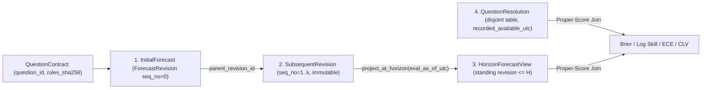
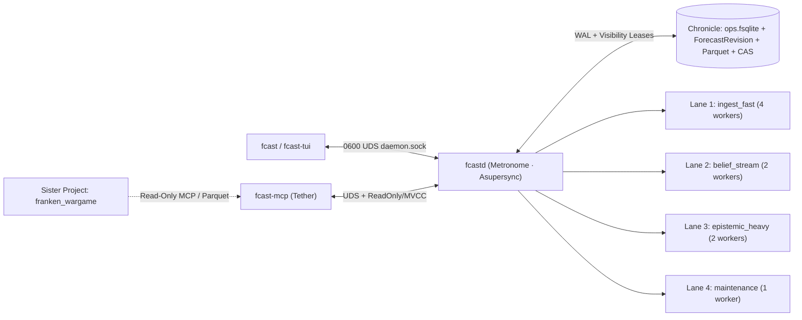

# COMPREHENSIVE PLAN FOR FRANKENFORECAST (`fcast`)

* **Repository:** `franken_forecast`
* **Master Plan Version:** `1.4` (`2026-11-25`)
* **Repository Maturity:** `Tier 0 (Plan-Only)` for Rust Cargo workspace (`0 / 6` `[MEASURED]` crates implemented); `Tier 1 (Contract-Proved)` for the canonical `ForecastRevision` 4-stage data contract, 8-template SHA-256-locked prompt suite (`templates/*.tmpl`), `CLAIM-05` (`HYP-05A..05F`) AlphaProof-Code-style Lean 4 formal specification draft (`lean_experiments/`), full-universe anti-selection-bias 10-metric scorecard & meta-forecaster, SQLite WAL/backup/migration triggers, and document hygiene (`scripts/verify_*.py`, `lean_experiments/verify_audit_flags.py`)
* **Core Instruments:** `fcast` (Core CLI), `fcastd` (`Asupersync` Job Daemon), `fcast-mcp` (Model Context Protocol Server), `fcast-verify` (Offline Receipt & Temporal-Fence Auditor), `fcast-tui` (`FrankenTUI` Terminal Cockpit)
* **Companion Sister Project (External):** `franken_wargame` (separate multi-agent geopolitical wargaming repository consuming `franken_forecast` strictly via read-only MCP/Parquet snapshots; `0` write coupling)
* **Target Hardware & OS Envelope:** CPU-complete pure Rust (`0` `[BUDGET]` GPUs) on **macOS 15+ (`aarch64` Apple Silicon)** and **Linux 6.1+ (`x86_64` / `aarch64`)**, backed by **4 TB (`4,000 GB` `[BUDGET]`) NVMe SSD** tiered storage

---

## Part 0 · Document Control

### §0.1 Normative Language, Evidence Labels & Maturity Tiers

Requirement keywords **MUST**, **MUST NOT**, **REQUIRED**, **SHALL**, **SHALL NOT**, **SHOULD**, **SHOULD NOT**, and **MAY** in this specification are to be interpreted strictly per RFC 2119 and RFC 8174 `[UPSTREAM-SPEC]`.

Every quantitative claim, latency bound, token/dollar figure, accuracy metric, line-count ceiling, or storage allocation in this specification **MUST** carry an explicit evidence label from the following closed taxonomy:

| Evidence Label | Meaning & Verification Protocol |
| :--- | :--- |
| `[MEASURED]` | Empirically executed and verified against an executable script, SQLite harness, or benchmark fixture in this repository (`scripts/verify_math_and_contracts.py`, `scripts/verify_plan_hygiene.py`). |
| `[UPSTREAM-SPEC]` | Fixed by an external OS kernel limit, wire protocol, exchange rulebook, or peer-reviewed benchmark (`ForecastBench`, Gemini `/v1` & `/v1beta`, `arXiv:2610.04798`, `arXiv:2611.27286`, `EvolveCast`, `TimeSeek`, Kalshi/Polymarket tick schedules). |
| `[DERIVED]` | Computed analytically from closed-form mathematical identities, byte layouts, or published API rate tables with explicit parameter disclosure. |
| `[BUDGET]` | Engineered resource ceiling or scope cap enforced by runtime circuit breakers or CI checks (USD spend limit, crate LOC ceiling, NVMe tier quota). |
| `[TARGET]` | Falsifiable engineering, latency, or out-of-sample calibration acceptance threshold bound to a named validation gate (`GATE-01` .. `GATE-24`). |
| `[HYPOTHESIS]` | Research conjecture whose empirical sign or magnitude is not yet proven on `ForecastBench` holdouts and MUST pass an ablation gate before default activation. |

Subsystem and gate maturity are tracked exclusively in `docs/delivery/DELIVERY_LOG.md` across four monotonic tiers:
* **`Tier 0 (Plan-Only)`:** Specified in this document with formal invariants and mapped `GATE-*` acceptance criteria; zero compiled Rust crate code exists yet.
* **`Tier 1 (Contract-Proved)`:** Validated by executable reference models, SQLite DDL/trigger harnesses, or synthetic cassettes (`scripts/verify_*.py`).
* **`Tier 2 (Crate-Verified)`:** Implemented in pure Rust on pinned nightly, passing `cargo nextest`, `proptest`, `cargo deny`, cancel-safety tests, and `fcast-verify` receipt generation.
* **`Tier 3 (Tournament-Calibrated)`:** Proven out-of-sample on live or time-fenced `ForecastBench` tournament rounds with positive Brier/Log Skill vs. published baselines.

### §0.2 What "Implemented" Means

Nothing in this repository's Rust crate graph is implemented as of `Plan v1.4` (`0` `[MEASURED]` `.rs` files exist). A subsystem, command verb, or gate **MUST NOT** be described as *Implemented* until **all eight (`8` `[BUDGET]`) mandatory conditions** hold simultaneously:

1. **Zero Stubs & Strict Toolchain:** Compiles cleanly under `nightly-2026-11-01` (Rust Edition 2024 `[UPSTREAM-SPEC]`) with `#![deny(clippy::todo, clippy::unimplemented, clippy::unwrap_used)]` and `#![forbid(unsafe_code)]` outside the audited `<= 120` `[BUDGET]` LOC POSIX FD/lock module (`fcast-infra::sys`).
2. **Dependency Hygiene:** Passes `cargo deny check bans advisories licenses sources` with singleton `asupersync` (`0` `[BUDGET]` instances of `tokio`, `reqwest`, `hyper`, `ort`, `openssl-sys`, `rusqlite`, `sqlx`, `petgraph`, or C++/GPU FFI crates).
3. **Deterministic Wire & Revision Schemas:** Every CLI `--json` output, `fcast-mcp` payload, and serialized `ForecastRevision` validates against a committed JSON Schema (`schemas/v1/*.schema.json`).
4. **Cancel & Crash Safety:** Survives `Asupersync` structured task cancellation and simulated `SIGKILL` mid-transaction without WAL corruption, partial `ForecastRevision` writes, orphaned Gemini Files API uploads, or leaked file descriptors (`0` `[TARGET]` leaked FDs).
5. **Cryptographic Temporal Blinding:** Passes `TemporalFence` replay cassettes proving `available_utc <= as_of_utc` on all queries and `MarketBlindingScrubber` active on all pre-seal `p_indep` computations (`0` `[TARGET]` leaked market tokens).
6. **Analytic & Property Parity:** Matches reference mathematical and SQLite lifecycle invariants in `scripts/verify_math_and_contracts.py` to `<= 1e-9` `[TARGET]` relative tolerance and passes `10,000` `[BUDGET]` `proptest` cases per numerical module.
7. **Offline Gate Receipt:** Emits a deterministic SHA-256-signed receipt `receipts/GATE-XX.json` verified offline by `fcast-verify`.
8. **Externalized Delivery Record:** Recorded in `docs/delivery/DELIVERY_LOG.md` with commit SHA and receipt digest. Closing an issue, PR, or agent task bead **NEVER** constitutes implementation acceptance.

### §0.3 Stable Identifier Prefixes

Every normative artifact in this plan carries an immutable identifier prefix. Retired identifiers **MUST** be marked `DEPRECATED` in place and **MUST NEVER** be renumbered or reassigned:

* **`CLAIM-01` .. `CLAIM-08` & Subordinate `HYP-05A` .. `HYP-05F`:** Core falsifiable project claims (`§2.2` & `§21`) and six experimental ablation hypotheses nested under `CLAIM-05` (`lean_experiments/`).
* **`GOAL-01` .. `GOAL-10` / `NGOAL-01` .. `NGOAL-06` / `AGOAL-01` .. `AGOAL-07`:** In-scope goals, out-of-scope non-goals (including sister project `franken_wargame` and local GPU exclusion), and actively forbidden anti-goals (`§6`).
* **`BET-01` .. `BET-06`:** Explicit architectural bets paired with empirical falsifiers and fallback designs (`§4`).
* **`SUB-01` .. `SUB-08`:** Canonical named subsystems (`§0.5`).
* **`KA-00` .. `KA-09`:** Key data contracts, mathematical constructions, and systems abstractions (`Parts II–IV`, anchored by `KA-00: ForecastRevision`).
* **`INV-01` .. `INV-12`:** Hard compile-time, SQLite-trigger, or runtime system invariants (`§20`).
* **`INT-01` .. `INT-06`:** External, inter-process, and companion-project protocol boundaries (`Part III`).
* **`GATE-01` .. `GATE-24`:** Automated acceptance gates, each bound to **exactly one** primary `CLAIM-XX` (`§22`).
* **`RISK-01` .. `RISK-09` & `OQ-01` .. `OQ-05`:** Pre-mortem technical risks (`§23`) and open owner rulings (`§24`).
* **Crate & Binary Prefixes:** All workspace crates use `fcast-*` (`fcast-core`, `fcast-infra`, `fcast-ingest`, `fcast-epistemic`, `fcast-bench`, `fcast-app`); canonical entrypoints are `fcast`, `fcastd`, `fcast-mcp`, `fcast-verify`, and `fcast-tui`.

### §0.4 Reading Guide

* **Data Architects & Calibration Auditors:** Start at **`§7` (Central Canonical `ForecastRevision` Contract & 4-Stage Lifecycle)**, `§8`–`§12` (Microstructure, Data Vintages, Bi-Temporal Audit, `6D+2G` Rationales, Two-Speed `Loom`, `Crucible` `ForecastBench` / `GEPA`), and `§22` (`GATE-01..24`).
* **Forecasting Practitioners & Superforecasters:** Read `§1` (Landscape Audit), `§7.2` (Origination vs. Revision vs. Horizon vs. Resolution), `§10` (Rationale Scoring), `§11` (Belief Folding & TimeSeek Deferral), and `§16` (`Cockpit` 7-view TUI).
* **Rust Systems & Storage Engineers:** Read `§5` & `§19` (macOS/Linux CPU Baseline + `4 TB` NVMe Tiered Warehouse), `§13` (`Metronome` Job Daemon), `§17` (6-Crate Acyclic DAG), `§18` (`Chronicle` WAL/Backups/Migrations), and `§20` (Security & Invariants).
* **AI Agent, MCP & Companion-Project (`franken_wargame`) Integrators:** Read `§13` (`Metronome`), `§14` (`Tether` MCP Server, Compiled Skills & `INT-06` Read-Only Companion Contract), and `§15` (Gemini `/v1` vs. `/v1beta` Router).

### §0.5 Canonical Subsystem Names

Every capability in `franken_forecast` belongs to exactly one of eight (`8` `[MEASURED]`) named subsystems across six (`6` `[BUDGET]`) strictly ranked crates:

| Subsystem ID | Canonical Name | Crate / Module Ownership | Core Responsibility |
| :--- | :--- | :--- | :--- |
| `SUB-01` | **Chronicle** | `fcast-infra::{store,vault,eidetic}` | Native `fsqlite` WAL + MVCC store, immutable `forecast_revisions` + disjoint `question_resolutions` tables, `HorizonForecastView` queries, online `zstd` backups, two-layer migrations, content-addressed `EvidenceVault`, Parquet tick archiver, and `ee_outbox` bridge. |
| `SUB-02` | **Harvester** | `fcast-ingest::*`, `fcast-infra::fetch` | Orderbook microstructure (`BookMarkPrice` Stoikov microprice + tick-aware `φ_liq`), comment/rationale fetchers, ForecastBench human/community median backfill, `available_utc` data packs with Horvitz-Thompson lag correction, `symphonia` `24m` audio chunker, `SafeExternalFetch`, and `DomainGate`. |
| `SUB-03` | **Notary** | `fcast-epistemic::{verify,rationales}`, `fcast-core::blinding` | Verbatim bi-temporal `event_utc` vs. `published_utc` union-envelope auditor, mechanical 2-turn staged-reveal `6D+2G` (`CT/EI/OV/ME/EJ/PR` + `G1/G2`) rationale judge, `QuestionResolution` evidence verifier, and `MarketBlindingScrubber`. |
| `SUB-04` | **Loom** | `fcast-epistemic::{graph,belief,ops}`, `fcast-core::{forecast,math}` | 4-layer `fnx-*` causal Knowledge Graph, Two-Speed Dynamic Belief Engine (Tier-0 `ConjugateBelief` + Kulhavý–Zarrop `DecayController` + EvolveCast `κ_LR` + KL-gated cache escalating to Tier-1 CAS-handle PBM `fold`, Martingale KL `FoldStoppingController`, `0..5` `SEIPH`, TimeSeek deferral, `2610.04798` cyber calibrator), and `map`/`decision`/`scenario`/`decompose`—sealing every issuance and update as an immutable `ForecastRevision`. |
| `SUB-05` | **Crucible** | `fcast-bench::*`, `scripts/optimize-gepa` | Pre-dispatch Question Meta-Forecaster (`QuestionMetaForecast`), irreversible `universe_question_ledger` (tracking full eligible universe, exclusion & abandonment rates), selection-bias-free 10-metric scorecard (`HorizonForecastView ⋈ QuestionResolution`), `ForecastBench` solver, and air-gapped `dspy.GEPA` optimizer. |
| `SUB-06` | **Metronome** | `fcast-infra::jobs`, `fcast-app::daemon` | Persistent `Asupersync` 4-lane background job daemon (`fcastd`), `O_CLOEXEC` singleton lock, crash-safe `fcast_jobs` visibility leases, `0600` UDS `daemon.sock` push bus, `launchd`/`systemd` supervisors, and `daemon_budget_ledger` daily USD spend circuit breaker. |
| `SUB-07` | **Tether** | `fcast-app::{mcp,skills}` | First-class Model Context Protocol server (`fcast-mcp` on `dup`/`dup2`-quarantined `stdio` + loopback `Streamable HTTP`) with async `Metronome` job handles, `fcast://` resource subscriptions (serving harnesses and external `franken_wargame`), parameterized prompts, and static-linted compiled skill packs (`pi_agent_rust`, `Hermes`, `Antigravity`). |
| `SUB-08` | **Cockpit** | `fcast-app::{tui,cli,onboard,verify}` | Sub-16ms `FrankenTUI` 7-view terminal dashboard (including `[6:Meta]` *"Forecast the Forecasts"* & Full-Universe 10-Metric Scorecard pane and `[7:Revisions]` longitudinal `ForecastRevision` audit view), 3-curve split vs. 6-strip comparison physics, progressive `fcast init` onboarding, `fcast-verify`, and atomic 4-phase `[H]` PTY handoff. |

### §0.6 How This Plan Was Produced

This specification was synthesized through seven (`7` `[MEASURED]`) iterative architecture and adversarial validation rounds:
1. **Form-Factor Pivot:** Rejected an initial Electron + Python GUI draft in favor of a pure-Rust Franken-stack Core CLI + `Metronome` Job Daemon + `Tether` MCP Server + `Cockpit` TUI + multi-harness skill architecture.
2. **Parallel Structural Audit & DAG Consolidation:** Eliminated cyclic cross-crate dependencies via `12` `[MEASURED]` structural patches (`PATCH-01` .. `PATCH-12`) and extracted multi-agent swarm wargaming into sister project **`franken_wargame`**, yielding a clean **`6`-crate pure-forecasting acyclic DAG**.
3. **Central Data Contract Formalization (`v1.1`):** Defined the immutable 12-field **`ForecastRevision`** object (`KA-00`) and enforced strict relational and temporal separation across original issuance (`InitialForecast`), longitudinal updates (`SubsequentRevision`), point-in-time horizon slices (`HorizonForecastView`), and disjoint outcome adjudication (`QuestionResolution`).
4. **Microstructure & Stopping Hardening:** Replaced naive `\$1,000` VWAP marks on thin books with Stoikov top-of-book microprice + tick-excess liquidity credibility (`φ_liq`), and replaced `|Δlogit| < ε` fold stopping with Martingale Expected Log-Score KL VoI (`VoI_log`) + a hard `>= 2`-fold floor.
5. **Hindsight-Blind Rationale & Bi-Temporal Locks:** Locked byte-exact bi-temporal verification (`templates/bitemporal_event_audit.tmpl`) and mechanical 2-turn staged-reveal `6D+2G` rationale scoring backed by `forecastbench-datasets` published human/community medians.
6. **Two-Speed Conjugate Filtering & Lifecycle Deferral:** Repaired pseudo-count Beta pooling into a mean–precision `(μ_t, N_t)` streaming filter with a closed-form Kulhavý–Zarrop `DecayController`, EvolveCast `κ_LR` gain, Adams–MacKay shock reset, and TimeSeek lifecycle deferral.
7. **Pure-CPU + `4 TB` NVMe Scope Lock:** Removed all local GPU / CUDA sidecar machinery, guaranteeing identical pure-CPU execution across macOS Apple Silicon and Linux `x86_64`/`aarch64` over a `4 TB` NVMe tiered epistemic warehouse.

### §0.7 Plan Hygiene Rules

The following eight (`8` `[MEASURED]`) hygiene rules govern all edits to this repository and are enforced mechanically by `scripts/verify_plan_hygiene.py`:

1. **Delivery Tracking Quarantine:** Execution progress, sprint logs, task checklists (`- [ ]` / `- [x]`), and gate-receipt statuses **MUST** reside exclusively in `docs/delivery/DELIVERY_LOG.md`, **NEVER** inside `COMPREHENSIVE_PLAN_FOR_FRANKEN_FORECAST.md`.
2. **Closed Tasks Are Not Acceptance:** Closing an agent bead, issue, or pull request **NEVER** equates to formal acceptance; only satisfying all eight (`8` `[BUDGET]`) criteria in `§0.2` promotes a gate.
3. **Process Is Never the Product:** Orchestration ceremonies, prompt scaffolding, and daemon plumbing have zero standalone value unless they produce valid, well-calibrated `ForecastRevision` series or lower deterministic workstation latency.
4. **Line Counts Are Scope Caps, Never Schedules:** Crate LOC figures in `§17` carry `[BUDGET]` tags strictly as complexity ceilings triggering module review if exceeded—**NEVER** as output targets or schedules.
5. **Universal Evidence Labeling:** Every numeric metric in hardware/storage tables (`§5`, `§19`), crate scope caps (`§17`), and validation gates (`§22`) **MUST** carry an explicit `§0.1` evidence tag. Unlabeled numbers fail CI.
6. **Strict Claim-Boundary Bijection:** The eight (`8` `[MEASURED]`) core project claims (`CLAIM-01` .. `CLAIM-08`) **MUST NEVER** be conflated. In `§22`, every `GATE-XX` row **MUST** map to **exactly one** primary `CLAIM-XX`, and every `CLAIM-XX` **MUST** be tested by at least two (`2` `[BUDGET]`) independent gates.
7. **Frozen Verbatim Prompt Suite, Canonical Revision & 10-Metric Universe Integrity:** All eight (`8` `[MEASURED]`) prompt templates in `templates/*.tmpl` **MUST** match their SHA-256 digests in `§9.2`, `templates/bitemporal_event_audit.tmpl` **MUST** match its embedded block in `§9.1` byte-for-byte, `§7.1` **MUST** preserve all twelve (`12` `[MEASURED]`) canonical `ForecastRevision` fields, and `§12.4` **MUST** preserve all ten (`10` `[MEASURED]`) mandatory system telemetry metrics evaluated over the full eligible universe.
8. **Boundary Purity (Zero GPU / Zero In-Repo Wargame Drift):** No local GPU/CUDA components or in-repo swarm wargame crates may be reintroduced without an explicit major-version architectural ruling; `scripts/verify_plan_hygiene.py` rejects forbidden `fcast-sim` crate rows and accelerator slot tables.

### §0.8 How Evidence Binds the Plan

1. **Empirical Falsification Overrides Prose:** Whenever a `Tier 1` script, `Tier 2` benchmark, or `Tier 3` `ForecastBench` round contradicts a `[TARGET]` or `[HYPOTHESIS]` in this plan, the author **MUST** execute the corresponding `BET-*` fallback (`§4`) within the same revision rather than weakening the gate silently.
2. **Replay & Calibration Version Determinism:** Every calibration update (`calibration_version`) or prompt evolution (`model_version`) **MUST** be evaluated by re-projecting immutable historical `ForecastRevision` streams through `HorizonForecastView ⋈ QuestionResolution` on chronologically purged splits (`B = 2,000` `[BUDGET]` paired bootstrap, `p < 0.10` `[TARGET]`).

---

## Part I · Diagnosis, Thesis, Principles, Bets & Scope Boundaries

## §1. Landscape Audit: What Exists, What Is Missing, What Is Strongest & What Defects Remain

### §1.1 What Exists Today

The probabilistic forecasting, OSINT, and agentic research ecosystem currently splits across five disconnected silos:

1. **Prediction Venues & Aggregators (`Polymarket`, `Kalshi`, `Metaculus`, `Manifold`, `GJOpen`, `PredictIt`, `Futuur`):** Expose live market odds and comment threads, but suffer from incompatible horizons, API-masked community medians (e.g., Metaculus personal-token null-masking `[UPSTREAM-SPEC]`), thin long-tail orderbook gaps, mutable/overwritten forecast histories, and unranked comment noise.
2. **Academic Benchmarks & Sequential Belief Papers (`ForecastBench`, `EvolveCast`, `TimeSeek`, `arXiv:2610.04798`, `arXiv:2611.27286`):**
   * **`ForecastBench` (`forecastingresearch/forecastbench-datasets` `[UPSTREAM-SPEC]`):** Gold-standard leakage-free benchmark (~`1,000` `[UPSTREAM-SPEC]` biweekly questions + published Human Superforecaster, Public, and `freeze_datetime_value` Community Medians), yet ships static datasets rather than a longitudinal revision-tracking workstation.
   * **Belief & Cyber Research (`arXiv:2611.27286` PBM `fold` + `SEIPH`; `arXiv:2610.04798` cyber geopolitical fusion; `EvolveCast` belief updating; `TimeSeek` lifecycle checkpoints):** Prove bounded-context folding, `81.3%` `[UPSTREAM-SPEC]` balanced cyber ROC AUC, LLM conservative under-updating bias, and early-vs-late market skill crossover—but rely on premature `|Δlogit| < ε` stopping, unshifted `1:1` case-control priors, or heavyweight RL (`PPO`).
3. **Structured Epistemic SDKs (`futuresearch-python`):** Pioneer table-scale `map`, `decision`/`scenario`, and `decompose` workflows, but lack local MVCC revision ledgers, orderbook microstructure, bi-temporal wire verification, and terminal cockpits.
4. **The Franken Suite (`Eidetic Engine`, `FrankenSQLite`, `FrankenTUI`, `Frankensearch`, `FrankenNetworkX`, `Asupersync`):** Provides pure-Rust, zero-`tokio`, zero-C-SQLite systems primitives—page-level MVCC persistence, sub-16ms `[UPSTREAM-SPEC]` terminal rendering, pure-Rust BM25 + `model2vec` search, causal graph algorithms, structured concurrency, and institutional memory (`ee`)—ready to host a domain-native forecasting engine.
5. **Agent Harnesses & Sister Simulation Projects (`pi_agent_rust`, `Hermes`, `Google Antigravity`, and sister project `franken_wargame`):** General harnesses excel at open-ended tool use and scheduled wakeups, while multi-agent geopolitical simulation belongs naturally in a dedicated sister engine (`franken_wargame`) consuming calibrated priors rather than muddying a canonical forecasting ledger.

### §1.2 What Is Missing in the Field

1. **A Canonical, Immutable Longitudinal Forecast Ledger (`ForecastRevision`):** Existing bots emit ephemeral JSON blobs or overwrite a single probability cell per question—destroying the distinction between *initial outside-view issuance*, *sequential evidence-driven revisions*, *what forecast actually stood at a specific evaluation horizon*, and *post-hoc outcome adjudication*. Without this four-way separation, calibration replay and Closing Line Value (CLV) attribution silently leak future state.
2. **Minute-Exact Bi-Temporal Ground-Truth & Vintage Discipline:** Tools routinely conflate *when an event physically occurred* (`event_utc`), *when rule-satisfying proof first became public* (`published_utc`), and *when macroeconomic/conflict dataset revisions became queryable* (`available_utc`).
3. **Two-Speed Market-Blind Belief Updating:** Systems either spend dollars re-running deep web searches on routine wire chatter or apply naive probability-averaging formulas that pull `4%` tail risks toward `50%` on neutral news.
4. **Mechanical Price-Blind Rationale Grading:** Platforms rank rationales by social upvotes rather than freeze-date epistemic rigor (`CT/EI/OV/ME/EJ/PR`) mechanically isolated from market price peeking.

### §1.3 What Is Strongest in This Architecture

1. **Cryptographically Sealed `ForecastRevision` + 4-Stage Lifecycle (`§7`, `KA-00`):** Every probability update in `fcast` produces an append-only, SQLite-trigger-protected `ForecastRevision` sealing `p_indep` *before* recording `p_market`, binding exact `evidence_handles`, `model_version`, `calibration_version`, and `rationale_handle`, while keeping `QuestionResolution` in a physically separate adjudication table so replay and horizon slicing (`HorizonForecastView`) are `100%` `[TARGET]` deterministic and hindsight-free.
2. **Clean Boundary Separation (`6` Crates, `0` GPUs, External `franken_wargame`):** Excluding local GPU/CUDA stacks and extracting swarm simulation to `franken_wargame` eliminates C++ FFI fragility, device-driver coupling, and synthetic-evidence contamination risks while keeping `cargo build` fast and identical on macOS Apple Silicon and Linux `x86_64`/`aarch64`.
3. **Zero-Hallucinated-Citation Handle-Only Folding (`KA-05`):** Documents, wire flashes, and verbatim `symphonia` transcripts enter content-addressed `EvidenceVault` *before* LLM ingress; `Loom` manipulates compact `[ev:8f2a19#s04]` handles rather than re-typing 64-hex SHA-256 digests through lossy token generation.
4. **Proper-Scoring Martingale VoI & Microstructure Realism (`KA-01`, `KA-06`):** Stoikov `BookMarkPrice` + excess-above-tick `φ_liq` prevents thin-book VWAP distortion, while Martingale Expected Log-Score KL `VoI_log` + a hard `>= 2`-fold floor protects fat-tailed geopolitical and cyber risks against premature stopping.

### §1.4 Structural Defects, Honest Limits & Residual Failure Modes

1. **Plan-Only Starting Point (`Defect D1`):** Zero lines of the 6-crate Rust workspace exist today (`0` `[MEASURED]` crates). Pinning `nightly-2026-11-01` across the Franken-stack carries real upstream rev-alignment risk (`RISK-01`) until `M0` compiles cleanly.
2. **Pre-Cutoff LLM Parametric Contamination (`Limit L1`):** Even when `ForecastRevision` enforces strict `as_of_utc` fences, `ReplayAsOf` network air-gaps, and disjoint `QuestionResolution` tables, cloud LLM weights (`gemini-4-*`) retain parametric memory of events prior to their pretraining cutoff. Historical backtests (`Tier 2`) validate plumbing and relative ablations, whereas **true zero-leakage forecasting skill can ONLY be claimed on post-cutoff `ForecastBench` rounds (`Tier 3`)**.
3. **Cloud API Dependency Under Pure-CPU Scope (`Limit L2`):** Removing local GPU inference simplifies deployment and guarantees macOS/Linux parity, but means every non-cached Tier-0 LLM likelihood tick, rationale score, and Tier-1 `fold` depends on metered remote APIs (mitigated by `Metronome`'s `\$5.00/day` `[BUDGET]` circuit breaker, `Frankensearch` CPU `model2vec` deduplication, and `gemini-decision-1` `0`-output-token calls).
4. **Closed-Channel OSINT Blind Spots (`Limit L3`):** `Notary` (`§9`) relies on public URLs, RSS/wires, and web archives; private messaging channels or unarchived deletions lawfully resolve to `null` rather than fabricated timestamps.
5. **Unprecedented Regime Breaks (`Limit L4`):** Conjugate decay, King-Zeng prior shifts, and historical reference classes cannot abolish Knightian uncertainty on `N = 0` historical precedents; `fcast` bounds worst-case log-loss via `ProbClamped ∈ [10^-4, 1 - 10^-4]` `[BUDGET]` clipping and fat-tail `VoI_log` exploration.
6. **Single-Node `fsqlite` Interior-Page Contention (`Limit L5`):** Writing raw high-frequency L2 orderbook streams directly into SQLite B-trees would serialize writers; `Chronicle` therefore streams raw L2 ticks to immutable monthly `Zstd` Parquet files on the `4 TB` NVMe (`Tier W1`) and keeps `ops.fsqlite` (`Tier H0`, `<= 64 GB` `[BUDGET]`) strictly for `ForecastRevision` ledgers, downsampled marks, rationales, KG state, and job leases.

---

## §2. Objective, Mission, Vision & The Eight-Fold Thesis

### §2.1 Objective, Mission & Dual Lineage Vision

* **Objective:** Build **`fcast`**—a CLI-first, pure-Rust, CPU-complete probabilistic forecasting workstation, immutable `ForecastRevision` ledger, background job daemon (`fcastd`), MCP server (`fcast-mcp`), hindsight-blind rationale scorer, and `ForecastBench` competitor on macOS and Linux.
* **Mission:** Make every forecast an auditable, replayable mathematical object (`ForecastRevision`) linking vintage-exact quantitative telemetry, verified bi-temporal timelines, and market-blind epistemic reasoning under cryptographic temporal fences.
* **Dual Lineage Vision:** Combines **Franken Suite** mechanical sympathy (single `Asupersync` runtime, `FrankenSQLite` MVCC, sub-16ms `FrankenTUI`, `Frankensearch`, `FrankenNetworkX`, `Eidetic Engine`) with **FutureSearch** structured epistemic scaling (`map`, `decision`, `scenario`, `decompose`).

### §2.2 The Eight Core Project Claims (`CLAIM-01` .. `CLAIM-08`)

Per `§0.7` Rule 6, these eight claims are mutually distinct; every validation gate in `§22` maps to **exactly one** claim:

* **`CLAIM-01` (Structural & Store Durability Integrity):** The 6-crate pure-Rust workspace maintains a strict acyclic DAG (`0` `[TARGET]` cycles, `0` banned/GPU crates) over a crash-safe WAL/MVCC store (`Chronicle`) with verified online `zstd` backups and lossless two-layer schema/payload migrations.
* **`CLAIM-02` (Canonical `ForecastRevision` & Four-Stage Lifecycle Integrity):** Every forecast issuance and update is persisted as an immutable, hash-chained `ForecastRevision` separating initial issuance, subsequent revisions, horizon-specific evaluation projections (`HorizonForecastView`), and disjoint `QuestionResolution` outcomes with `0` `[TARGET]` retroactive mutations or forward leaks.
* **`CLAIM-03` (Bi-Temporal & Vintage Non-Leakage):** Every ingested dataset (`Harvester`), verified event timeline (`Notary`), and offline `GEPA` replay (`Crucible`) enforces `available_utc <= as_of_utc` and pre-seal `MarketBlindingScrubber` isolation (`p_indep` sealed prior to `p_market`) with `0` `[TARGET]` hindsight leaks.
* **`CLAIM-04` (Orderbook & Cross-Venue Pricing Fidelity):** `BookMarkPrice` and horizon-aware clustering preserve un-spoofed market probabilities (`p_market`) across liquid and thin books while backfilling gateway-masked community priors via `ForecastBench` medians.
* **`CLAIM-05` (Two-Speed Calibrated Epistemic Skill & Tournament Coherence):** Pairing Tier-0 `(μ_t, N_t)` streaming likelihood updates + `DecayController` with Tier-1 CAS-handle PBM `fold` + Martingale Log-Score `VoI_log` stopping (`Loom`), King-Zeng cyber prior shifts, and Fréchet-coherent `Crucible` batching achieves positive full-universe Brier/Log Skill within `\$15.00` `[BUDGET]`/round. Because `CLAIM-05` composes six distinct epistemic mechanisms, each component is governed by an independently falsifiable **subordinate experimental hypothesis** (formalized in [`lean_experiments/Claim05Spec.lean`](./lean_experiments/Claim05Spec.lean)):
  * **`HYP-05A` (`[HYPOTHESIS]`):** *Mean–precision filtering (`(μ_t, N_t)`) improves upon static Bayesian and linear pseudo-count updating* (eliminating neutral-news `50%` drift and high-prior sign inversion while lowering longitudinal Brier/Log loss).
  * **`HYP-05B` (`[HYPOTHESIS]`):** *Adaptive decay (`DecayController` over `Domain × H_rem × endogenous S_t`) improves performance under changing regimes* relative to fixed-`γ` or zero-forgetting filters.
  * **`HYP-05C` (`[HYPOTHESIS]`):** *Correlation-aware evidence aggregation (clipped novelty discounting + L2 collinearity shrinkage) reduces overconfidence* (`ECE` and tail Log-loss on syndicated wire bursts) relative to naive independent LLR summation.
  * **`HYP-05D` (`[HYPOTHESIS]`):** *CAS-handle PBM folding improves reasoning quality (`SEIPH`, `6D+2G`) and proper score per dollar* relative to flat context accumulation or single-pass prompting.
  * **`HYP-05E` (`[HYPOTHESIS]`):** *Fréchet-feasible Martingale log-score stopping (`VoI_log` + `>= 2`-fold floor + fat-tail guard) improves research budget allocation* relative to `|Δlogit| < ε` or quadratic Brier EVSI stopping.
  * **`HYP-05F` (`[HYPOTHESIS]`):** *King-Zeng prior-shift calibration on centered LLRs improves cyber probability calibration (`ECE`, `BSS`) under severe case-control prior shift* (`1:1` balanced training → `0.5%–3.0%` `[DERIVED]` real hazard) relative to unshifted classifiers.
* **`CLAIM-06` (Hindsight- & Price-Blind Rationale Discrimination):** Mechanical 2-turn staged-reveal `6D+2G` scoring (`Notary`) ranks community and internal rationales reproducibly without price herding, LLM arithmetic errors, or unflagged contract/integrity violations.
* **`CLAIM-07` (Daemon Reliability & MCP/Harness Purity):** `Metronome` (`fcastd`) and `Tether` (`fcast-mcp` + compiled skills) guarantee crash-recoverable job leases, hard daily USD spend circuit breaking, `100%` `[TARGET]` JSON-RPC frame purity, `< 15 ms` `[TARGET]` async job-handle dispatch, and hysteresis-gated `Hermes` wakeups.
* **`CLAIM-08` (Sub-16ms Cockpit Ergonomics & Atomic PTY Handoff):** `Cockpit` (`fcast-tui`) renders 2,000+ contracts and longitudinal `ForecastRevision` audit trails across 7 views at `< 8 ms` `[TARGET]` p99 frame time without Braille color collisions and executes 4-phase `[H]` PTY handoffs with `0` `[TARGET]` stolen keystrokes or leaked FDs.

---

## §3. Twelve Architectural Principles

1. **One Canonical Forecasting Object (`ForecastRevision`):** No subsystem may emit naked, un-versioned floats; every forecast state transition seals an immutable 12-field `ForecastRevision` (`§7.1`).
2. **Separate Issuance, Revision, Horizon Projection, and Resolution (`§7.2`):** Never overwrite initial forecasts, never evaluate "latest" without an explicit horizon cutoff, and never store final outcomes inside `ForecastRevision` rows.
3. **Seal `p_indep` Before Touching `p_market`:** `BlindAI` reasoning runs strictly behind `MarketBlindingScrubber`; `p_market` attaches only at revision-sealing / post-seal TimeSeek blending time.
4. **\$0-Token Visual Triage First:** Navigating markets, `ForecastRevision` diffs, rationales, data packs, and KG cruxes in `Cockpit` MUST cost `\$0.00` `[BUDGET]` in API spend.
5. **Every Timestamp Is a Triple:** Distinguish physical occurrence (`event_utc`), public visibility (`published_utc`), and local database/vintage availability (`available_utc`).
6. **LLMs Emit Likelihoods & Structured Rubrics, Rust Owns Arithmetic:** LLMs never sum rubric integers, average probabilities, or re-type SHA-256 digests.
7. **One Async Runtime (`Asupersync`), Zero GPUs Required:** Pure-CPU Rust parity across macOS Apple Silicon and Linux `x86_64`/`aarch64` with zero `tokio` or CUDA FFI.
8. **Hot SQLite, Columnar Ticks, Content-Addressed Blobs:** Keep `ops.fsqlite` lean (`<= 64 GB` `[BUDGET]`); stream L2 orderbook ticks to Zstd Parquet (`Tier W1`) and raw evidence/rationales to CAS `EvidenceVault` (`Tier H1`).
9. **Async Job Handles Over Blocking RPCs:** Any task `> 2 s` `[BUDGET]` enqueues on `Metronome` (`fcast_jobs`) and streams progress over `daemon.sock` / MCP notifications.
10. **Respect Terminal Cell Physics:** `<= 3` `[BUDGET]` curves on split View `[1]` and `6` `[BUDGET]` synchronized separate strips on View `[2]`.
11. **Prior-Shift Every Case-Control Classifier:** Apply exact King-Zeng base-rate log-odds shifts to balanced cyber classifiers (`arXiv:2610.04798`).
12. **Sister-Project Decoupling Over Monolith Creep:** Multi-agent wargaming lives in `franken_wargame` and reads `franken_forecast` strictly over `Tether` MCP / Parquet snapshots.

---

## §4. Explicit Technical Bets & Falsifiers (`BET-01` .. `BET-06`)

| Bet ID | Architectural Bet | Empirical Falsifier | Pre-Committed Fallback |
| :--- | :--- | :--- | :--- |
| `BET-01` | **Two-Speed `(μ_t, N_t)` Streaming + Tier-1 PBM `fold`** beats periodic standalone `fold` in Brier/Log Skill per dollar across longitudinal `ForecastRevision` series. | On `100` `[BUDGET]` post-cutoff questions, Two-Speed fails to reduce LLM spend by `>= 40%` `[TARGET]` at `<= 0.003` `[TARGET]` Brier degradation at `HorizonForecastView` checkpoints. | Disable metered LLM Tier-0 calls; retain `\$0` `DecayController` + `DataPack` z-score triggers to wake Tier-1 `fold`. |
| `BET-02` | **Martingale Log-Score KL `VoI_log` + `>= 2`-Fold Floor** outperforms `|Δlogit| < ε` stopping on tail events (`p < 0.10` or `p > 0.90`). | Tail-bucket Log Score under `VoI_log` does not beat fixed 3-fold or `|Δlogit|` stopping on `ForecastBench` replay (`GATE-17`). | Fall back to fixed `3`-fold `[BUDGET]` cap on tail questions + Empirical-Bayes tool-hit cutoff. |
| `BET-03` | **Mechanical 2-Turn Staged-Reveal `6D+2G`** improves rationale ranking correlation with superforecaster raters vs. 1-pass scoring. | Spearman `ρ` on `50` `[BUDGET]` gold-annotated rationales improves by `< 0.05` `[TARGET]` while doubling latency. | Default batch CLI runs to `--single-pass` while retaining `--staged-reveal` for Top-10 finalists. |
| `BET-04` | **TimeSeek Lifecycle Market Deferral** improves post-seal `probability_distribution` Brier Skill over `p_indep` or static 50/50 pooling. | Out-of-fold blended BSS vs. `p_market` is `<= 0.0` `[TARGET]` in late lifecycle (`τ_life > 0.75`) when evaluated via `HorizonForecastView`. | Fit regularized logistic stacking weights `(w_indep, w_market)` per `(venue, horizon_bucket)` tagged with a new `calibration_version`. |
| `BET-05` | **Leak-Free `dspy.GEPA` on `SEIPH` + Proper Score** yields non-overfit prompt gains across `model_version` promotions. | Paired bootstrap (`B = 2,000` `[BUDGET]`) holdout p-value `>= 0.10` `[TARGET]` across two consecutive `GEPA` runs. | Freeze hand-authored templates; restrict `GEPA` to failure-cluster diagnostics. |
| `BET-06` | **Pinned Nightly Franken-Stack Unification** compiles cleanly without patched forks across macOS & Linux CPU targets. | Upstream `asupersync` or `fsqlite` rev skew blocks workspace build for `> 48 h` `[BUDGET]` during `M0`. | Vendor workspace crates under `vendor/franken-*` at verified commit SHAs with Cargo `[patch.crates-io]`. |

---

## §5. Target Hardware, OS & Storage Envelope Summary

Full storage-tier allocations are detailed in `§19`. Every subsystem runs natively on standard CPU workstations with zero accelerator hardware:

| Resource Dimension | Minimum Portable Profile (`macOS` / `Linux`) | Reference Workstation Profile (`4 TB` NVMe) |
| :--- | :--- | :--- |
| **Operating System & CPU** | macOS `15.0+` (`aarch64` M1–M4) OR Linux `6.1+` (`x86_64` / `aarch64`), `4+` cores `[UPSTREAM-SPEC]` | Apple Silicon Max/Ultra OR Linux `8–32` core `x86_64` / `aarch64` (`0` `[BUDGET]` GPUs used) |
| **System Memory (RAM)** | `16 GiB` (`<= 1.2 GiB` `[BUDGET]` combined `fcastd` + `fcast-tui` RSS) | `32–64 GiB` (`mmap` page cache for hot `ops.fsqlite`, `Frankensearch` `model2vec`, and Parquet scans) `[BUDGET]` |
| **NVMe SSD Storage** | `64 GB` free space (lean `90-day` rolling window) `[BUDGET]` | **`4 TB` (`4,000 GB` `[BUDGET]`) PCIe NVMe SSD** (`3,600 GB` allocated across `6` tiers + `400 GB` `[BUDGET]` `10%` wear-leveling reserve) |

---

## §6. Goals, Non-Goals & Anti-Goals

### §6.1 Goals (`GOAL-01` .. `GOAL-10`)
* **`GOAL-01`:** Canonical immutable `ForecastRevision` ledger (`§7`) guaranteeing bit-exact replay, calibration versioning, horizon slicing, and tournament auditability.
* **`GOAL-02`:** Sub-16ms `[TARGET]` local terminal cockpit (`fcast-tui`) across 7 views including longitudinal revision inspection (`[7:Revisions]`).
* **`GOAL-03`:** Crash-safe background `Asupersync` job daemon (`fcastd`) with bounded concurrency lanes and hard daily USD spend caps.
* **`GOAL-04`:** First-class `stdio` and loopback `Streamable HTTP` MCP server (`fcast-mcp`) with non-blocking async job handles and compiled `pi_agent_rust`, `Hermes`, and `Antigravity` skills.
* **`GOAL-05`:** Multi-platform rationale ingestion and mechanical 2-turn staged-reveal `6D+2G` scoring (`Notary`).
* **`GOAL-06`:** Byte-verbatim bi-temporal event verification (`event_utc` vs. `published_utc`) and per-market repricing lead/lag forensics.
* **`GOAL-07`:** Vintage-exact (`available_utc`) question data packs with Horvitz-Thompson reporting-lag adjustment and King-Zeng prior-shifted cyber calibration (`arXiv:2610.04798`).
* **`GOAL-08`:** Two-Speed Dynamic Belief Engine (`ConjugateBelief` + `DecayController` + CAS-handle PBM `fold` + Martingale Log-Score `VoI_log` + TimeSeek deferral).
* **`GOAL-09`:** Competitive `ForecastBench` automation (`<= \$15.00` `[BUDGET]`/round) benchmarked at fixed horizons against Superforecaster and Community medians over a `4 TB` NVMe warehouse.
* **`GOAL-10`:** Progressive `< 60 s` `[TARGET]` zero-key onboarding (`fcast init`) with guided `DoctorProbe` connector upgrades.

### §6.2 Non-Goals (`NGOAL-01` .. `NGOAL-06`)
* **`NGOAL-01`:** Local GPU / CUDA inference, local LLM serving sidecars, or local Whisper GPU pipelines (`0` GPU scope; all compute is pure CPU Rust + metered API routers).
* **`NGOAL-02`:** In-repository multi-agent geopolitical wargaming (`Wargame` / `MiroFish`-class swarm simulation is extracted to the separate sister project **`franken_wargame`**, `INT-06`).
* **`NGOAL-03`:** Automated real-money order execution, market-making, or wallet signing on prediction exchanges.
* **`NGOAL-04`:** Building an Electron/WebView desktop GUI or duplicating a general coding chat IDE inside `fcast-tui`.
* **`NGOAL-05`:** Distributed multi-node database consensus (single-host `4 TB` NVMe `fsqlite` + Parquet handles `10^8+` `[DERIVED]` market ticks).
* **`NGOAL-06`:** Sports, pop-culture, or sub-hour crypto candle gambling contracts (dropped by `DomainGate`).

### §6.3 Anti-Goals (`AGOAL-01` .. `AGOAL-07` — Actively Forbidden)
* **`AGOAL-01` (Never Mutate or Overwrite a Sealed `ForecastRevision`):** Changing calibration curves, receiving new evidence, or observing final question resolution MUST emit a new `ForecastRevision` or `QuestionResolution` record—never `UPDATE` an existing `ForecastRevision` (`INV-01`).
* **`AGOAL-02` (Never Conflate Latest Forecast with Horizon Forecast):** Scoring or backtesting MUST project through `HorizonForecastView(forecast_id, eval_as_of_utc)`—never select `MAX(seq_no)` across timestamps after `eval_as_of_utc` (`INV-02`).
* **`AGOAL-03` (Never Drive Pre-Seal `p_indep` or Decay with `p_market`):** `p_indep` and `DecayController` MUST remain 100% blind to market prices and market volatility (`INV-04`).
* **`AGOAL-04` (Never Pool Neutral News Toward `50%`):** Linear pseudo-count averaging (`y_t = 0.5` on `"Still"`) is strictly prohibited (`§11.1`).
* **`AGOAL-05` (Never Stack 6 Braille Curves in One Shared Cell Grid):** View `[2]` MUST use 6 synchronized small-multiples strips (`§16.1`).
* **`AGOAL-06` (Never Allow LLM Rubric Arithmetic or Raw Hash Echoing):** Rust owns all sums, rankings, probabilities, and SHA-256 `EvidenceVault` pointers (`INV-06`, `INV-07`).
* **`AGOAL-07` (Never Expose Destructive Admin Verbs or Bypass Access Controls):** `fcast-mcp` omits `store restore`/secret dumps (`INV-09`), and `SafeExternalFetch` never bypasses CAPTCHAs or paywalls.
* **`AGOAL-08` (Never Report Investigated-Only Accuracy Without Full-Universe Selection-Bias Accounting):** Evaluating Brier, Log, or Baseline Skill solely on questions the system chose to investigate hides abstention/survivorship bias; every scorecard MUST track the entire eligible universe $\mathcal{U}_{\text{elig}}$, exclusion/abandonment rates, sunk costs, and full-universe imputed scores side-by-side (`INV-13`).

---

## Part II · Central Data Contract & Mathematical Foundations

## §7. Central Canonical Data Contract: Immutable `ForecastRevision` & Four-Stage Lifecycle (`KA-00` · `fcast-core` & `Chronicle`)

Every subsystem in `franken_forecast` speaks through a single canonical, immutable forecasting object—**`ForecastRevision`**—and strictly separates issuance, revision, horizon evaluation, and outcome resolution (`[MEASURED]` in `scripts/verify_math_and_contracts.py`).



### §7.1 The Canonical 12-Field `ForecastRevision` Object (`fcast-core::forecast::ForecastRevision`)

Once inserted into `Chronicle`'s `forecast_revisions` table, a `ForecastRevision` is **strictly immutable** (`BEFORE UPDATE` and `BEFORE DELETE` SQLite triggers abort with `RAISE(ABORT, 'IMMUTABLE_FORECAST_REVISION')`, `INV-01`). Its canonical content digest `revision_id` covers all payload fields deterministically:

| Canonical Field | Rust Type (`fcast-core`) | Persistence & Validation Invariant | Purpose |
| :--- | :--- | :--- | :--- |
| `forecast_id` | `ForecastId` (`UUIDv7` / `BLAKE3`) | `TEXT NOT NULL REFERENCES forecast_streams(forecast_id)` | Stable longitudinal identity grouping the initial forecast and all subsequent revisions for `(question_id, stream_kind)`. |
| `revision_id` | `RevisionId` (`BLAKE3` hex) | `TEXT PRIMARY KEY` (paired with `seq_no: u32` & `parent_revision_id`) | Immutable cryptographic identity of this exact revision (`seq_no == 0` iff `parent_revision_id IS NULL`). |
| `question_id` | `QuestionId` | `TEXT NOT NULL REFERENCES questions(question_id)` | Forecasted question identifier bound to immutable resolution criteria hash (`contract_sha256`). |
| `as_of_utc` | `UtcTimestamp` | `TEXT NOT NULL` (`RFC3339` millisecond UTC; monotonic along `seq_no`) | Strict information cutoff: every bound evidence span and market quote MUST satisfy `available_utc <= as_of_utc` (`INV-03`). |
| `p_indep` | `ProbClamped` (`[10^-6, 1-10^-6]`) | `REAL NOT NULL CHECK (p_indep > 0.0 AND p_indep < 1.0)` | Independent `BlindAI` probability (primary binary probability or canonical scalar summary) sealed *before* unblinding `p_market`. |
| `p_market` | `Option<MarketSnapAtCutoff>` | `REAL NULL` + `p_market_meta_json` (`source`, `phi_liq`, `snap_utc <= as_of_utc`) | Market or `ForecastBench` community probability at `as_of_utc` when available (`NULL` on unpriced dataset/novel contracts). |
| `probability_distribution` | `OutcomeDistribution` | `BLOB NOT NULL` + `dist_kind ∈ {'binary','categorical','cdf201'}` | Calibrated reported distribution (`Binary { p, n_eff }`, `Categorical { probs, dirichlet_n }`, or monotone `Cdf201 { grid, n_eff }`) satisfying sum-to-1 / monotonicity. |
| `evidence_handles` | `Vec<VerifiedEvidenceRef>` | `TEXT NOT NULL` (canonical sorted JSON array of `[ev:sha256#span]`) | Supporting `EvidenceVault` provenance handles; foreign-key/vault checked to enforce `ev.available_utc <= as_of_utc`. |
| `model_version` | `ModelVersionSpec` | `TEXT NOT NULL` (e.g., `gemini-4-argon@2026-05-20+tmpl:4f9c12`) | Exact reasoning engine identifier, API revision, tier (`stream_t0` vs `fold_t1`), and prompt template SHA-256. |
| `calibration_version` | `CalibrationVersionSpec` | `TEXT NOT NULL` (e.g., `cal-v3:klr=1.35,kz=v2,ts=v1#8a2b`) | Immutable version + parameter digest of `κ_LR`, `DecayController`, King-Zeng prior shift, and TimeSeek deferral map. |
| `rationale_handle` | `VerifiedEvidenceRef` | `TEXT NOT NULL` (`[ev:sha256#rationale]` in `EvidenceVault`) | Immutable CAS pointer to the authored rationale text, competing hypotheses, open cruxes, and `SEIPH` / `6D+2G` self-scores. |
| `resolution_status` | `ResolutionStatusAtCutoff` | `TEXT NOT NULL CHECK (resolution_status IN ('unresolved','resolved','invalidated'))` | Question's known adjudication status *strictly as of `as_of_utc`*—never mutated retroactively when the question later resolves. |

### §7.2 Strict Four-Stage Lifecycle Separation (`InitialForecast` vs. `SubsequentRevision` vs. `HorizonForecastView` vs. `QuestionResolution`)

To guarantee bit-exact historical replay, leak-free `calibration_version` ablations, and `ForecastBench` tournament integrity, `fcast-core` and `Chronicle` enforce four distinct types and query paths:

1. **Stage 1 — The Forecast as Originally Issued (`InitialForecast`):**
   * Defined by `seq_no == 0` and `parent_revision_id == None`, permanently pinned on `forecast_streams.origin_revision_id`.
   * Preserves the initial Outside-View (`OV`) + first-pass synthesis at `t_0` forever. Every longitudinal evaluation computes **Revision Value Added** $\Delta S_k = S(R_k, Y) - S(R_0, Y)$ to verify that active updating genuinely beats the initial baseline rather than adding noise.
2. **Stage 2 — Subsequent Revisions (`SubsequentRevision`):**
   * Defined by `seq_no >= 1` and `parent_revision_id == Some(prev_revision_id)` with mandatory `trigger_kind ∈ { StreamLikelihoodTick, DeepBeliefFold, DataPackVintageArrival, CalibrationReplay, ManualAnalystIssue }`.
   * **Offline Calibration Replay Isolation:** Testing a candidate `calibration_version'` on historical forecasts **MUST NOT** mutate live revisions; it writes to an isolated `stream_kind = 'calibration_replay'` stream referencing the original `p_indep`, `as_of_utc`, and `evidence_handles`.
3. **Stage 3 — The Forecast at a Specified Evaluation Horizon (`HorizonForecastView`):**
   * Formalized by the pure projection `Chronicle::project_at_horizon(forecast_id, eval_as_of_utc, target_horizon_utc) -> HorizonProjection`:
     * Selects the unique revision $R^* = \arg\max_{R \in \text{stream}} \{ (R.\text{as\_of\_utc}, R.\text{seq\_no}) \mid R.\text{as\_of\_utc} \le \text{eval\_as\_of\_utc} \}$.
     * **Zero Forward Peeking:** If `origin_revision.as_of_utc > eval_as_of_utc`, returns `HorizonProjection::NotYetIssued` (never leaking a forecast issued 2 hours after freeze!).
     * Supports all four tournament & research horizon semantics: **(a)** fixed tournament freeze (`ForecastBench` `freeze_datetime`), **(b)** time-to-close checkpoints (`T_close - {90d, 30d, 7d, 24h}`), **(c)** multi-horizon target dates (`ForecastBench` `7d/30d/90d/180d/365d` dataset evaluations projected via `HorizonGeometry`), and **(d)** TimeSeek normalized lifecycle quantiles ($\tau_{\text{life}} \in \{0.10, 0.25, 0.50, 0.75, 0.90\}$).
4. **Stage 4 — The Final Resolved Outcome (`QuestionResolution`):**
   * Persisted in a **physically disjoint append-only adjudication table** `question_resolutions` (`resolution_id`, `question_id`, `final_status ∈ {'resolved','invalidated'}`, `outcome_payload_blob`, `event_utc`, `resolved_published_utc`, `recorded_available_utc`, `adjudication_ev_handle`, `supersedes_resolution_id`).
   * **Tournament & Replay Integrity:** Proper scores (`Brier`, `Log`, `ECE`, `CLV`) are computed strictly by joining `HorizonForecastView(forecast_id, H) ⋈ QuestionResolution(question_id)` filtered by `recorded_available_utc <= splitter_cutoff_utc`. When `final_status == 'invalidated'` (void/ambiguous resolution), the join deterministically excludes the question from proper-score denominators while keeping every historical `ForecastRevision` intact for audit.

---

## §8. Orderbook Microstructure & Vintage-Locked Cyber/Macro Calibration (`KA-01`, `KA-02` · `Harvester` & `Loom`)

1. **Orderbook Mark Estimator (`BookMarkPrice` → `ForecastRevision.p_market`):**
   * **Top-of-Book Liquidity Floor:** Requires resting inside depth $L_{\text{tob}} = B_{\text{bid}} + B_{\text{ask}} \ge \$100$ `[BUDGET]` and spread $s \le 800\text{ bps}$ `[BUDGET]`. Failing books are tagged `BookState::ThinOrWide` (`[Thin]`, $\phi_{\text{liq}} = 0$), fall back to `last_trade` (if inside `[bid, ask]`, else mid), auto-dim `24h` deltas in favor of **`7d`**, and mute `15m/1h` shock alerts.
   * **Stoikov Microprice & Tick-Excess Sweep Credibility:** With $Q_{\text{ref}} = \$500$ `[BUDGET]` sweep impact $\iota(Q_{\text{ref}})$ and venue minimum tick $s_{\text{tick}}$ (`100 bps` `[UPSTREAM-SPEC]` for 1¢ venues):
     $$p_{\text{micro}} = \frac{B_{\text{bid}} \cdot p_{\text{ask}} + B_{\text{ask}} \cdot p_{\text{bid}}}{B_{\text{bid}} + B_{\text{ask}}}, \qquad \phi_{\text{liq}} = \sigma\!\left(\ln\frac{L_{\text{tob}}}{\$250}\right) \cdot \exp\!\left(-\frac{\max(0,\, s - s_{\text{tick}})}{400\text{ bps}}\right) \cdot \exp\!\left(-\frac{\iota(Q_{\text{ref}})}{0.05}\right)$$
2. **Vintage-Locked `question_data_packs` & Horvitz-Thompson Right-Censoring:**
   * Primary key `(series_id, event_period_utc, available_utc)` maps `FRED` to ALFRED `realtime_start` vintages and `ACLED`/`UCDP`/`VCDB`/`EuRepoC`/`KEV`/`EPSS`/`Cloudflare Radar`/`IODA`/`IMF PortWatch` to `discovery_utc`, enforcing `available_utc <= as_of_utc` (`INV-03`) and flagging reporting-delay completeness `< 0.30` `[BUDGET]` as `[RIGHT-CENSORED: reporting lag]`.
3. **King-Zeng Prior-Shifted `arXiv:2610.04798` Cyber Calibrator:**
   * Shifts balanced `1:1` training scores (`81.3%` `[UPSTREAM-SPEC]` ROC AUC) onto real Empirical-Bayes country-sector 30-day Poisson hazards $\pi_{c,s}(\Delta t) \in [0.5\%, 3.0\%]$ `[DERIVED]` via $\operatorname{logit}\hat{p}_{c,s} = \operatorname{logit}\hat{q}_{\text{train}} - \operatorname{logit}\pi_{\text{train}} + \operatorname{logit}\pi_{c,s}(\Delta t)$, version-pinned in `ForecastRevision.calibration_version`.

---

## §9. Bi-Temporal Event Verification & Canonical Prompt Template Suite (`KA-03` · `templates/*.tmpl`)

Every LLM boundary across `Notary`, `Loom`, `Crucible`, and `Chronicle` is backed by a committed, SHA-256-locked `.tmpl` artifact in `templates/` whose digest is stamped directly into `ForecastRevision.model_version` (`e.g. gemini-4-argon@2026-05-20+tmpl:da7f1f34`) and audited by `scripts/verify_plan_hygiene.py`.

### §9.1 Verbatim Bi-Temporal Event Audit Template (`templates/bitemporal_event_audit.tmpl`)

Revised to bind the exact canonical identifiers from `§3` Principle 5, `§7.1` (`ForecastRevision`), and `§7.2` (`QuestionResolution` — `as_of_utc`, `event_utc`, `published_utc`, `available_utc`, `question_id`, `resolution_status`, `resolved_published_utc`, `adjudication_ev_handle`, and `ev_handle`). Locked with SHA-256 digest `362d5386c85123d3fd491ee7d20da87c6055fa944a7b138253fc7d214b5d1f52` `[MEASURED]`:

```text
Event description: {event_description}
Approximate event window (UTC): {approx_event_utc}
Information cutoff (as_of_utc — NEVER use any source, edit, or archive capture with available_utc > as_of_utc): {as_of_utc}
Forecasted questions and resolution contracts (question_id, venue, contract_sha256, and exact rules):
{question_contracts}
Vaulted candidate evidence handles (ev_handle in [ev:sha256#span] with recorded available_utc <= as_of_utc):
{evidence_handles_context}

Three distinct timestamps govern bi-temporal and replay integrity — NEVER mix them:
- event_utc: when the physical or institutional action itself happened as described by a source (e.g. "the strikes began at 22:40 GMT" in a later article is event_utc, NOT published_utc).
- published_utc: when a post, official statement, broadcast, or wire flash first became visible to the public (maps to QuestionResolution.resolved_published_utc when rule-satisfying).
- available_utc: when that exact version/capture was archived or ingested into EvidenceVault (maps to QuestionResolution.recorded_available_utc; MUST satisfy available_utc <= as_of_utc).

Rules for judging:
- satisfies_rules = true for a question_id ONLY if that item itself reports the event HAS happened AND meets that question_id's specific contract rules (e.g. "missiles launched" does not satisfy "missiles entered Israeli airspace"; "talks scheduled" does not satisfy "met in person"; "deal close" does not satisfy "agreement reached").
- Consider ANY party involved: leaders' posts (Truth Social, X, Telegram), governments, militaries, state media of either side, mediators, live TV, wire flashes (Reuters/AP/AFP/Yonhap/etc.), local media in any language.
- For every timestamp, state timestamp_basis: "page shows time with timezone", "page shows time, timezone inferred (say how)", "metadata/JSON-LD", "archive capture", "URL", or "other". Convert to UTC carefully.
- If a wire or news report says someone "said", "announced", "posted" or "confirmed" it (e.g. "Israel said it launched an attack", "Trump announced on Truth Social"), that original statement is usually earlier than the report: find the original post / statement / broadcast itself and its own published_utc (the official's X or Telegram account, the ministry or military spokesperson channel, the live TV moment), including sources in Hebrew, Arabic, Persian, Russian, Ukrainian, Korean, etc. List both.
- Screenshots and reposts of social posts often show the viewer's local time without a timezone: only use such a time if the timezone can be established; otherwise use a source with an explicit timezone.
- If a page was updated later, state first_version_verified (true/false/null) indicating whether the quoted text was in the initial version prior to as_of_utc.
- Bind ev_handle ("[ev:sha256#span]") whenever citing a vaulted source; if no vaulted or verifiable public source exists <= as_of_utc, use null. Never guess.
{union_strictness_hint}
Reply with ONLY one JSON object, no other text:
{"as_of_utc": "{as_of_utc}",
"items": [{"ev_handle": "[ev:...] or null", "published_utc": "YYYY-MM-DD HH:MM", "event_utc": "YYYY-MM-DD HH:MM or null", "available_utc": "YYYY-MM-DD HH:MM:SSZ or null", "shown_time": "...", "timezone": "...", "timestamp_basis": "...", "first_version_verified": true, "who_or_outlet": "...", "source_type": "leader post|official statement|state media|TV|wire flash|news article|other", "language": "...", "what": "one sentence", "satisfies_rules": true, "qualified_question_ids": ["..."], "url": "...", "quote": "exact sentence or timestamp line"}],
"first_public": {"ev_handle": "...", "published_utc": "...", "who_or_outlet": "...", "source_type": "...", "url": "...", "quote": "...", "timestamp_basis": "..."},
"second_source": {"ev_handle": "...", "published_utc": "...", "who_or_outlet": "...", "url": "...", "quote": "..."},
"earlier_signals": [{"ev_handle": "...", "published_utc": "...", "what": "public report before first_public indicating it was happening or imminent, but not yet satisfying contract rules", "url": "..."}],
"per_question_resolution": [{"question_id": "...", "resolution_status": "unresolved|resolved|invalidated", "resolved_published_utc": "... or null", "adjudication_ev_handle": "[ev:...] or null", "note": "..."}],
"event_utc": "when it happened, if stated, else null",
"confidence": "high|medium|low", "notes": "..."}
first_public must be the item with the earliest published_utc (<= as_of_utc) among items with satisfies_rules = true (for the least strict question_id in question_contracts), or null if zero items satisfy any contract.
```

### §9.2 Master Prompt Template Catalog & Mechanical Blinding Invariants (`templates/*.tmpl`)

All eight (`8` `[MEASURED]`) canonical prompt templates share strict JSON-only output framing, zero LLM arithmetic (`INV-06`), `[ev:sha256#span]` handle-only citation (`INV-07`), and mechanical variable-level blinding (`INV-04`, `INV-05`):

| Template File (`templates/`) | Subsystem & Lifecycle Hook | Key Canonical Variables (`§7.1` / `§7.2`) | Blinding & Structural Invariant | Locked SHA-256 Digest (`[MEASURED]`) |
| :--- | :--- | :--- | :--- | :--- |
| `bitemporal_event_audit.tmpl` | `SUB-03` **Notary** (`§9.1` Audit & `QuestionResolution`) | `as_of_utc`, `event_utc`, `published_utc`, `available_utc`, `question_id`, `resolution_status`, `adjudication_ev_handle` | Rejects `available_utc > as_of_utc`; union-strict `first_public`; `[HH:MM:00Z, HH:MM:59.999Z]` lead/lag joins. | `362d5386c85123d3fd491ee7d20da87c6055fa944a7b138253fc7d214b5d1f52` |
| `rationale_staged_turn_a.tmpl` | `SUB-03` **Notary** (`§10` Staged Reveal Turn A) | `question_id`, `as_of_utc`, `contract_sha256`, `rationale_handle`, `rationale_text` → `ct,ei,ov,me,ej,unscoreable` | **Physically omits `p_market` & `forecaster_probability_distribution`** (`INV-05`); `0` sums (`INV-06`). | `54eb0539d2addfb4747fd74ab4e558f1bf92e561b0e1f733241a889f437f888d` |
| `rationale_staged_turn_b.tmpl` | `SUB-03` **Notary** (`§10` Staged Reveal Turn B) | `locked_turn_a_json`, `forecaster_probability_distribution`, `p_market`, `as_of_utc` → `pr,g1,g2,note` | Echoes locked Turn A integers unchanged; requires `note` whenever `g1` or `g2` fires (`INV-06`). | `1dffea0e33a600577fe4282dc170f452488d09187f58714bba4016ae9feaca7f` |
| `stream_likelihood_tick.tmpl` | `SUB-04` **Loom** (`§11.1` Tier-0 `HYP-05A`/`05C`) | `forecast_id`, `question_id`, `as_of_utc`, `horizon_geometry`, `cluster_novelty` → `direction,raw_delta_llr,diagnosticity` | **Physically omits `p_market`** (`INV-04`); emits relative log-odds shift only (`Still => 0.0`), never raw `p_indep`. | `79be8dc01439c55213170757702eea2c18928d82958bb592b7924c27e0b476e7` |
| `belief_fold_step.tmpl` | `SUB-04` **Loom** (`§11.2` Tier-1 `HYP-05D`/`05E`) | `forecast_id`, `parent_revision_id`, `seq_no`, `as_of_utc`, `cumulative_tombstone_handles` → `p_indep,candidate_cruxes` | **Physically omits `p_market`** (`INV-04`); blocks Zombie Lead revival (`AUDIT-FLAG-04`); feeds `projectMartingaleCrux`. | `da7f1f3480c581e43f4a47f8720338df80096f741424f461d1a665da9d950797` |
| `seiph_process_critic.tmpl` | `SUB-05` **Crucible** (`§12.5` `SEIPH` & `dspy.GEPA`) | `revision_id`, `question_id`, `as_of_utc`, `p_indep`, `p_market`, `rationale_handle` → `6` ordered `0..5` scores + `gepa_feedback` | **Physically omits `QuestionResolution`** (outcome-blind process grading); entity-anonymized `GEPA` feedback. | `83ce2e19d2e6b2d667af66a8a619f8f8410eb54dfc6b4e4020f92a30a8f1176e` |
| `meta_forecast_triage.tmpl` | `SUB-05` **Crucible** (`§12.2` `QuestionMetaForecast`) | `question_id`, `discovered_utc`, `dist_kind`, `horizon_geometry` → `clause_arity_0_4..recommended_datapacks` | Emits discrete `0..4` structural complexity drivers at universe admission; Rust Empirical-Bayes computes USD/latency. | `3f797bdec2e3bdc53c34a96806fb8caebb58d7364a2c6ed581e75928556a3dbe` |
| `postmortem_ee_distill.tmpl` | `SUB-01` **Chronicle** (`§7.2` Stage 4 → `ee_outbox`) | `origin_revision_id`, `initial_forecast_json`, `subsequent_revisions_json`, `horizon_scores_json`, `question_resolution_json` | Runs **only** post-`QuestionResolution` (`recorded_available_utc`); extracts entity-anonymized `Eidetic Engine` guardrails. | `0d24a7c7c55619cea60058a8dcc1d0e5fecb679fe46de865182064b84a3c04fc` |

---

## §10. Staged-Reveal `6D+2G` Forecaster Rationale Scoring (`KA-04` · `Notary`)

`Notary` grades external platform comments (`Metaculus`, `Manifold`, `Polymarket`, `GJOpen`, `ForecastBench` human/model archives) AND `fcast`'s own authored `ForecastRevision.rationale_handle` texts at `freeze_date`, resolving `crowd_prior` via a **3-tier cascade**: **(1)** unmasked venue `p_micro` passing `L_tob_min`, **(2)** `forecastbench-datasets` published `freeze_datetime_value` / `Superforecaster Median` / `Public Median` (`available_utc <= freeze_date`), or **(3)** credibility-weighted `EquivalenceCluster` median.

* **Mechanical 2-Turn Staged Reveal (`--staged-reveal`):** Turn A withholds `(forecaster_forecast, crowd_prior)` in Rust memory (`INV-05`) to lock integer scores `ct, ei, ov, me, ej ∈ {0,1,2,3,4}` (or `unscoreable: true`); Turn B reveals `(forecaster_forecast, crowd_prior)` via `previous_interaction_id` to score `pr ∈ {0,1,2,3,4}`, `g1` (contract misread), `g2` (post-cutoff leak / fabrication), and `note`.
* **Zero LLM Arithmetic (`INV-06`):** Rust computes `RankTier` (`Unscoreable` excluded; `g2 -> 0`; `g1 -> min(sum, 8)`; clean `ct+ei+ov+me+ej+pr ∈ 0..=24` ordered by `(tier, eff, min(ct, me), ei, ov, ej, pr, Reverse(created_at_utc))`).

---

## §11. `Loom`: Two-Speed Dynamic Belief Engine, `DecayController`, PBM `fold` & TimeSeek Deferral (`KA-05`, `KA-06`)

Every Tier-0 tick that crosses the persistence threshold and every completed Tier-1 `fold` seals a new `SubsequentRevision` (`ForecastRevision`) in `Chronicle`:

1. **Tier-0 Mean–Precision Conjugate Filter & Market-Blind `DecayController`:**
   * Parameterizes `ConjugateBelief` in `(μ_t, N_t)` (`α_t = N_t μ_t`, `β_t = N_t(1 - μ_t)`). Baseline half-life $\tau_{1/2}^{(0)}(d, H_{\text{rem}}) = \operatorname{clamp}(\beta_d H_{\text{rem}},\, \tau_{\min}^{(d)},\, \tau_{\max}^{(d)})$ (`Cyber`: `[24h, 7d]`, `Geopolitics`: `[3d, 21d]`, `Macro`: `[14d, 90d]` `[BUDGET]`) contracts strictly under endogenous `BlindAI` surprise $S_t$:
     $$\tau_{1/2}^{\text{eff}}(t) = \frac{\tau_{1/2}^{(0)}(d, H_{\text{rem}})}{1 + \lambda_{\text{vol}} \max(0,\, S_t - 1)}, \qquad \gamma_t(\Delta\tau) = 2^{-\Delta\tau / \tau_{1/2}^{\text{eff}}(t)}$$
     relaxing toward geometry-aware outside-view prior $(\mu_0(t), N_0)$ (remaining-horizon hazard for `CumulativeStoppingTime`; stationary $\mu_0$ for `PointInTime`/`RollingWindow`).
   * **Likelihood Ratio, EvolveCast Gain ($\kappa_{\text{LR}}$) & Shock Reset:** Deduplicated news clusters (`Frankensearch` CPU `model2vec` novelty $\nu_t$) hit `gemini-decision-1` / `gemini-3.5-flash-lite` for `(Up/Down/Still, Δℓ_t, diagnosticity_t)` (`Still` $\implies \Delta\ell_t = 0, w_t = 0$):
     $$\mu_t = \sigma\bigl(\operatorname{logit}(\tilde{\mu}_{t^-}) + \kappa_{\text{LR}} \cdot \nu_t \cdot \Delta\ell_t\bigr), \qquad N_t = \frac{\tilde{N}_{t^-}}{1 + \eta_{\text{shock}}(\Delta\ell_t)^2} + \nu_t \cdot \text{diagnosticity}_t$$
     High-surprise shocks damp $N_t$, widening Beta variance and enqueuing a Tier-1 `BeliefFold` job on `Metronome`. Cached `epistemic_updates` evict only when **both** $N_{\text{eff}} < N_{\min}$ **and** $\max D_{\text{KL}} < 0.50\text{ nats}$ `[BUDGET]`.
2. **Tier-1 Handle-Only PBM `fold` & Martingale Log-Score `FoldStoppingController`:**
   * Passes immutable `[ev:hash#span]` handles (`evidence_handles`), committing `(ForecastRevision, kg_delta)` atomically in one `fsqlite` MVCC transaction.
   * Ranks candidate cruxes by Martingale-projected Expected Log-Score KL gain per dollar $\operatorname{VoI}_{\log}(j) = \widehat{\Delta\mathcal{L}}_j / c_j$ (nats/USD). Stopping is **ineligible** until `fold_count >= 2` AND `productive_folds >= 2` `[BUDGET]`, continuing thereafter while $\operatorname{VoI}_{\log}(j^*) \ge \lambda_{\text{nat/\$}}$ or an unprobed fat-tail crux has $\max_s D_{\text{KL}} \ge 0.50\text{ nats}$ `[BUDGET]` (`max_folds = 6` `[BUDGET]`).
3. **Sealing `p_indep` & Post-Seal TimeSeek Blending into `probability_distribution`:**
   * `Loom` first locks `p_indep = μ_t` into the `ForecastRevision` builder; only then does it read `p_market` (`as_of_utc`) and compute the calibrated `probability_distribution` using lifecycle weight $w_{\text{AI}}(t) = N_t / (N_t + N_{\text{mkt}}\phi_{\text{liq}}\psi_{\text{life}}(\tau_{\text{life}}, \Delta t_{\text{shock}}))$ tagged with `calibration_version`.

---

## §12. `Crucible`: Meta-Forecasting ("Forecast the Forecasts"), Full-Universe Selection-Bias Ledger, Ten-Metric Scorecard & `dspy.GEPA` (`KA-07`, `KA-08`)

### §12.1 Causal Resolution Knowledge Graph (`fnx-{classes,algorithms,cgse}`)
Maintains `L0_VERIFIED` (`EvidenceVault` facts), `L1_MECHANISM` (causal links), and `L2_SIGNPOST` (observable update triggers ranked by reverse Personalized PageRank to the contract sink).

### §12.2 Pre-Dispatch Meta-Forecasting: Forecasting Cost, Time, Popularity & Complexity (`QuestionMetaForecast`)
Before spending Tier-1 research compute on any eligible question $q \in \mathcal{U}_{\text{elig}}$, `Crucible` generates and persists an explicit **Meta-Forecast (`QuestionMetaForecast`)** predicting what forecasting $q$ will require and yield (`fcast meta-forecast <question-id> --json`):

1. **Predicted Cost (`est_cost_usd_p50`, `est_cost_usd_p90`):** Empirical-Bayes prediction of initial issuance spend ($\hat{K}(q)$ expected PBM folds × model token/search/audio rates) plus expected cumulative longitudinal revision spend across $T_{\text{close}} - t_{\text{open}}$.
2. **Predicted Time / Research Latency (`est_latency_sec_p50`, `est_latency_sec_p90`):** Predicted end-to-end wall-clock duration from job dispatch to sealed `InitialForecast` (`seq_no = 0`), decomposing connector/audio/archive I/O wait from LLM reasoning latency.
3. **Popularity Index (`popularity_score ∈ [0, 100]`):** Quantile-normalized composite of cross-venue volume/open-interest, `L_tob` resting book depth, comment/rationale arrival velocity (`Metaculus`/`Manifold`/`Polymarket`), `ForecastBench` tournament weight, and `GDELT` news velocity—distinguishing heavily arbitraged high-attention questions ($\phi_{\text{liq}}$ high, harder late-stage edge) from neglected, thin, or unpriced high-opportunity questions.
4. **Forecasting Complexity Index (`complexity_score ∈ [0, 100]`):** Weighted composite of four structural drivers: **(a)** contract & logical arity (`Combo` legs, `Cdf201` interval vs. binary, legalistic clause/exception count), **(b)** information scarcity & right-censoring lag (`Horvitz-Thompson < 0.30`), **(c)** multilingual primary-source or `symphonia` audio requirements, and **(d)** `fnx-*` causal signpost fan-in and domain non-stationarity.
5. **Closed-Loop Meta-Calibration:** Once $q$ is investigated (or abandoned), `Crucible` logs realized `(actual_cost_usd, actual_latency_sec, realized_fold_count)` against `(est_cost_usd_p50, est_latency_sec_p50)` to continuously recalibrate the meta-forecaster itself.

### §12.3 Full Eligible Universe Census & Anti-Selection-Bias State Machine (`universe_question_ledger`)
Evaluating only questions the system elects to finish creates severe **selection and survivorship bias**—a system that cherry-picks `20%` easy questions and abandons hard multi-clause contracts mid-flight can display flattering conditional Brier scores while adding near-zero real tournament value (`[MEASURED]` in `scripts/verify_math_and_contracts.py`). `Chronicle` therefore tracks **100% of the eligible question universe**:

* **Irreversible Universe Admission (`INV-13`):** Every discovered contract passing `DomainGate` (plus `100%` of `ForecastBench` round items) enters `universe_question_ledger` with `is_eligible = 1`. A SQLite `BEFORE UPDATE` trigger (`trg_universe_eligible_irreversible`) forbids retroactively flipping `is_eligible` from `1` to `0`—so a difficult question can **never** be erased from the denominator after the fact.
* **Exhaustive Four-Way Horizon Disposition ($q \in \mathcal{U}_{\text{elig}}(H)$):** At any evaluation cutoff $H$, every eligible question occupies **exactly one** mutually exclusive state:
  1. **`issued`:** At least one valid `ForecastRevision` exists with `as_of_utc <= H` (`HorizonForecastView::StandingRevision`).
  2. **`excluded` (`excluded_pre_research`):** Deliberately skipped prior to investigation with mandatory `reason_code ∈ {'low_predicted_voi', 'budget_cap_reached', 'complexity_exceeds_profile', 'missing_connector_key', 'horizon_too_short'}` and frozen `QuestionMetaForecast`.
  3. **`abandoned` (`abandoned_in_flight`):** Investigation started (`sunk_cost_usd > 0` or `tool_calls > 0`) but terminated without sealing a valid `ForecastRevision` (`reason_code ∈ {'insufficient_evidence', 'fold_budget_exhausted_unsealed', 'tool_timeout_or_error', 'ambiguous_contract_parse'}`), recording exact `sunk_cost_usd` and `sunk_latency_sec`.
  4. **`queued_missed`:** Admitted before $H$ (`discovered_utc <= H`), still unsealed in `Metronome` at $H$ (counted as an un-issued abstention at $H$).
* **Explicit Selection-Funnel Rates:** `Crucible` continuously computes **Forecast Coverage Rate** ($|\mathcal{U}_{\text{issued}}| / |\mathcal{U}_{\text{elig}}|$), **Universe Exclusion Rate** ($|\mathcal{U}_{\text{excl}}| / |\mathcal{U}_{\text{elig}}|$), **Universe Abandonment Rate** ($|\mathcal{U}_{\text{aband}}| / |\mathcal{U}_{\text{elig}}|$), and **Attempt Abandonment Rate** ($|\mathcal{U}_{\text{aband}}| / (|\mathcal{U}_{\text{issued}}| + |\mathcal{U}_{\text{aband}}|)$).

### §12.4 The Ten Mandatory System Telemetry & Scorecard Metrics (`Crucible` & `Cockpit`)
Every benchmark report (`fcast telemetry scorecard --json`), `fcast-mcp` resource (`fcast://universe/scorecard`), and `Cockpit` View `[6:Meta]` tracks all **ten (`10` `[MEASURED]`) mandatory metrics**, reporting accuracy and baseline skill on **both** the investigated subset $\mathcal{R}_{\text{issued}}$ AND the **full resolved eligible universe $\mathcal{R}_{\text{elig}}$** (where un-issued excluded/abandoned/missed questions are imputed under **Uniform Ignorance `0.50` / `1/K`** for raw scores and **Null-Edge `crowd_prior` (`ΔSkill = 0`)** for skill against baselines):

| Metric Key | Mandatory Metric | Exact Mathematical / Operational Definition (`HorizonForecastView ⋈ QuestionResolution`) | Anti-Selection-Bias & Denominator Rule |
| :--- | :--- | :--- | :--- |
| `brier_score` | **Brier score** | $\frac{1}{\|\mathcal{R}\|}\sum_{q \in \mathcal{R}} \|p_q(H) - y_q\|^2$ (binary & RPS multiclass) | Reported **side-by-side** for $\mathcal{R}_{\text{issued}}$ AND full $\mathcal{R}_{\text{elig}}$ (imputing `0.50` / `1/K` & `crowd_prior` on excluded/abandoned/missed). |
| `log_score` | **Log score** | $\frac{1}{\|\mathcal{R}\|}\sum_{q \in \mathcal{R}} \ln p_q(y_q \mid H)$ (`ProbClamped`) | Reported **side-by-side** for $\mathcal{R}_{\text{issued}}$ AND full $\mathcal{R}_{\text{elig}}$ (`ln(0.50) = -0.6931` nats penalty on un-issued binary items). |
| `calibration_error` | **Calibration error** | Equal-mass adaptive-bin `ECE` + worst-bin `MCE` + Murphy decomposition (`REL`, `RES`, `UNC`) | Computed across `InitialForecast`, `HorizonForecastView(H)`, and full-universe imputed predictions (`ECE < 0.035` `[TARGET]`). |
| `skill_vs_baselines` | **Skill against human & community baselines** | $\text{BSS}_{\text{base}} = 1 - \frac{\overline{\text{BS}}_{\text{fcast}}}{\overline{\text{BS}}_{\text{base}}}$ & $\Delta\overline{\text{LS}}$ vs. `ForecastBench` Superforecaster, Public, Community, & `p_micro` | Full-universe $\text{BSS}_{\text{univ}}$ sets `p_fcast = p_base` (`0.000` skill edge) on every excluded/abandoned/missed $q \in \mathcal{R}_{\text{elig}} \setminus \mathcal{R}_{\text{issued}}$! |
| `cost_per_forecast` | **Cost per forecast** | $\frac{\sum_{q \in \mathcal{U}_{\text{issued}}} C_{\text{total}}(q)}{\|\mathcal{U}_{\text{issued}}\|}$ (mean & `p50`/`p90` USD) | Reported both for initial issuance (`seq_no = 0`) and cumulative lifecycle spend (`seq_no = 0..K`). |
| `cost_per_resolved_forecast` | **Cost per resolved forecast** | $\frac{\sum_{q \in \mathcal{U}_{\text{elig}}} C_{\text{total}}(q)}{\|\mathcal{R}_{\text{issued}}\|}$ (USD / resolved forecast) | **Numerator includes `100%` of sunk spend on `abandoned`, triage, voided, and unresolved-cohort overhead**—exposing wasted compute! |
| `research_latency` | **Research latency** | Quantiles (`p50`, `p90`, `p99` seconds) of `sealed_at_utc - dispatched_at_utc` | Tracked separately for Tier-0 stream ticks, Tier-1 `InitialForecast` folds, and `abandoned` time-to-abort. |
| `forecast_coverage` | **Forecast coverage** | $\frac{\|\mathcal{U}_{\text{issued}}(H)\|}{\|\mathcal{U}_{\text{elig}}(H)\|}$ (`0%..100%`), paired with `Excluded %` & `Abandoned %` | Denominator is strictly the **irreversible full eligible universe** $\mathcal{U}_{\text{elig}}(H)$ (`trg_universe_eligible_irreversible`). |
| `pct_forecasts_revised` | **Percentage of forecasts revised** | $\frac{\|\{f \in \mathcal{U}_{\text{issued}} : \max \text{seq\_no}(f) \ge 1\}\|}{\|\mathcal{U}_{\text{issued}}\|} \times 100\%$ | Distinguishes active longitudinal belief maintenance from fire-and-forget static issuance. |
| `pct_revisions_improving_score` | **Percentage of revisions improving final score** | Stepwise $\Pr[S(R_{f,k}, y_f) > S(R_{f,k-1}, y_f)]$ AND net $\Pr[S(R_{f,\text{final}}, y_f) > S(R_{f,0}, y_f)]$ | Evaluated on all resolved revised streams $\mathcal{R}_{\text{revised}}$ under both Brier and Log score (`> 55%` `[TARGET]` net hit rate; flags churn if `<= 50%`). |

### §12.5 `ForecastBench` Solver & Air-Gapped `dspy.GEPA` Optimizer
* Enforces signed Fréchet bounds on `QuestionId::Combo` pairs, PAV isotonicity exclusively on `CumulativeStoppingTime` horizons, and `<= \$15.00` `[BUDGET]`/round VoI batch routing informed by `QuestionMetaForecast` (`Predicted Edge / est_cost_usd_p50`).
* Optimizes prompts (`model_version`) and calibration (`calibration_version`) via `PurgedChronoSplitter` (`recorded_available_utc <= val_freeze_ts - 48h` `[BUDGET]`), `ReplayAsOf` air-gap, and `B = 2,000` `[BUDGET]` paired bootstrap promotion (`p < 0.10` `[TARGET]`) evaluated strictly on **full-universe `BSS_univ`** so `GEPA` cannot game scores by learning to abstain!

---

## Part III · Daemons, Protocols, Harnesses & Cockpit

## §13. `Metronome`: Background `Asupersync` Job Daemon (`INT-01`, `INT-02`)



* **Singleton Lease & Crash Recovery:** Acquires `daemon.lock` (`flock(LOCK_EX | LOCK_NB)` + `O_CLOEXEC`), heartbeats `daemon_lease` every `5 s` `[BUDGET]`, reclaims expired `RUNNING` visibility leases in `fcast_jobs` after `SIGKILL`, and broadcasts live progress over `0600` UDS `daemon.sock` (`/tmp/fcast-<uid>/d.sock` on macOS `<= 36` `[DERIVED]` bytes vs. `104`-byte `[UPSTREAM-SPEC]` `sun_path` limit). Installs native `launchd` (`macOS`) and `systemd --user` (`Linux`) units; CLI/TUI fall back to inline execution if `fcastd` is stopped.
* **Four Concurrency Lanes & Spend Circuit Breaker:** `ingest_fast` (`4` `[BUDGET]` workers, `\$0` LLM), `belief_stream` (`2` `[BUDGET]` workers, Tier-0 ticks + shock gate), `epistemic_heavy` (`2` `[BUDGET]` workers, Tier-1 `fold`, `symphonia` `24m` `gemini-3.5-transcribe`, `deep-research`, `6D+2G` batches, `map`), and `maintenance` (`1` `[BUDGET]` worker, `ee_outbox`, Files reaper, WAL checkpoint, `24 h` `zstd` backup)—governed by `daemon_budget_ledger` (`\$5.00/day` `[BUDGET]` default background cap).

---

## §14. `Tether`: First-Class MCP Server, Skills & Sister-Project Read Contract (`INT-03`, `INT-04`, `INT-06`)

1. **Hardened MCP Transports (`fcast-mcp`):** `stdio` quarantines FD `1` via `dup(1)`/`dup2(2, 1)` on startup (`INV-08`); loopback Streamable HTTP (`127.0.0.1:7420` `[BUDGET]`) enforces `Authorization: Bearer` and strict `Origin`/`Host` DNS-rebinding checks.
2. **Synchronous Epistemic Tools, Async Job Handles & `ForecastRevision` / Universe Resources:**
   * **Synchronous Tools (`<= 2 s` `[BUDGET]`, `as_of_utc` + `blind: bool`):** `fcast_list_questions`, `fcast_meta_forecast`, `fcast_universe_scorecard`, `fcast_get_revision`, `fcast_project_horizon`, `fcast_list_revisions`, `fcast_compare_cluster`, `fcast_top_rationales`, `fcast_kg_query`, `fcast_datapack_query`, `fcast_verify_event`, `fcast_belief_fold`, `fcast_rubric_score`.
   * **Async `Metronome` Job Tools (`< 15 ms` `[TARGET]` handle return):** `fcast_job_enqueue` (`deep_research`, `podcast_transcribe`, `multi_fold_solve`, `rationale_batch`, `table_map`), `fcast_job_status`, and `fcast_job_cancel` with `notifications/progress` streaming.
   * **Subscribable `fcast://` Resources:** `fcast://universe/scorecard`, `fcast://questions/{id}/meta-forecast`, `fcast://forecasts/{forecast_id}/revisions/{rev_or_latest}`, `fcast://forecasts/{forecast_id}/horizon?as_of={utc}`, `fcast://questions/{id}/resolution`, `fcast://questions/{id}/rationales`, `fcast://clusters/{id}/bitemporal`, and `fcast://jobs/{id}`.
3. **Sister-Project Boundary (`INT-06` — `franken_wargame`):** External `franken_wargame` connects strictly as an untrusted read-only MCP/Parquet consumer reading sealed `ForecastRevision` priors and `L0..L2` KG snapshots; `fcast-mcp` exposes zero tools capable of injecting synthetic wargame outputs into `EvidenceVault` or `forecast_revisions`.
4. **Target-Compiled Skills & `Hermes` Gate:** Static-lints compiled skills (`pi_agent_rust`, `Hermes`, `Antigravity`) against `` !`cmd` `` injection and installs `$HERMES_HOME/scripts/fcast_shock_gate.sh` (`6 h` `[BUDGET]` cooldown + `0.35` `[BUDGET]` logit hysteresis).

---

## §15. Validated Gemini Services & Remote Antigravity Bridge (`INT-05`)

* **Split `/v1` vs. `/v1beta` Router (`fcast-infra::llm`):** Routes `gemini-4-*` / `gemini-3.5-flash-lite` to `/v1/interactions` and `gemini-decision-1`, `deep-research-preview-04-2026`, `antigravity-preview-09-2026`, and `gemini-3.5-transcribe` to `/v1beta/` (`Api-Revision: 2026-05-20` `[UPSTREAM-SPEC]`, compile-time `store: true` on `background` / `previous_interaction_id`), stamping exact model + revision strings onto `ForecastRevision.model_version`.
* **`symphonia` `24m` Verbatim Audio Pipeline & Remote Antigravity Bridge:** Packet-aligned `24 min` `[BUDGET]` chunks (`15 s` overlap, `mode: {"type": "verbatim"}`, 5-gram LCS stitch, crash-safe Files reaper) and zero-inbound-port `requires_action → function_result` cloud bridge.

---

## §16. `Cockpit`: `FrankenTUI` 7-View Architecture, `[6:Meta]` "Forecast the Forecasts" Pane & Atomic PTY Handoff (`KA-09`)

1. **Seven Specialized Terminal Views (`1–7`):**
   * **View `[1]` (Markets, Rationales & Active Belief Cockpit):** Fenwick-virtualized contract table (`24h` + `7d` cadence-encoded deltas), `<= 3`-curve `[BUDGET]` Braille chart (`p_market`, `SF/Community Median`, `p_indep` / `probability_distribution`), Bi-Temporal `△/⚡/★/◆` track, Top-$N$ `6D+2G` rationales, `fnx-*` cruxes, and `[M]` quick Meta-Forecast badge.
   * **View `[2]` (`6`-Strip Synchronized Comparison Matrix):** Up to `6` `[BUDGET]` separate 3-row Braille tracks locked to one shared `h`/`l` crosshair (`0` `[MEASURED]` cell color collisions) + `[p]` 2-venue spread overlay.
   * **Views `[3]`–`[5]`:** `[3]` News/Podcast Catalyst Stream · `[4]` 3-Pane `fnx-*` KG & Contradiction Ledger · `[5]` Shock Alerts, `DataPack` Vintages & Sentinel Ledger.
   * **View `[6:Meta]` ("Forecast the Forecasts" Triage & Selection-Bias-Free Universe Scorecard):** Dedicated split cockpit forecasting the operational cost, latency, popularity, and complexity of every eligible question while tracking the entire eligible universe (`Issued` vs. `Excluded` vs. `Abandoned`) and all `10` `[MEASURED]` mandatory system metrics side-by-side:

```text
┌─ fcast [6:Meta · Forecast the Forecasts & Universe Scorecard] ── Round: All+FB │ Horizon: [freeze ▾] │ ⚙Daemon: ON ─┐
│ ELIGIBLE UNIVERSE FUNNEL (N_elig = 1,240 · Irreversible Admission · Zero Cherry-Pick Reporting)                     │
│  ■ Issued Coverage: 78.4% (972)  │ ▨ Excluded Pre-Run: 16.5% (205) │ ✖ Abandoned In-Flight: 3.8% (47, $6.12 sunk)   │
│  ⧗ Queued/Missed:    1.3% ( 16)  │ Attempt Abandon Rate: 4.6%      │ Meta-Cal MAE: Cost ±$0.018 · Time ±6.4s        │
├───────────────────────────────────────────────────────────┬─────────────────────────────────────────────────────────┤
│ FORECAST THE FORECASTS (All N_elig=1,240 · [f] Filter)    │ 10-METRIC SCORECARD (Investigated vs Full-Univ Imputed) │
│ Question                  Est$  EstT  PopΠ CplxΞ Status   │ Metric                        Investigated   Full-Univ  │
│ ▸ EU Grid Cyber Q1       $0.09   38s   24   82  ISSUED    │ 1. Brier Score (↓)                  0.118       0.146   │
│   Baltic Cable Attribution$0.14  64s   61   89  ABANDONED │ 2. Log Score (↑ nats)              -0.362      -0.439   │
│   Hormuz Closure >48h    $0.07   29s   94   58  ISSUED    │ 3. Calibration Error (ECE / MCE)    0.021   0.029/0.061 │
│   BOJ +25bps Jan         $0.04   16s   79   34  ISSUED    │ 4. Skill vs SF / Comm (BSS)   +7.4%/+11.2%  +5.8%/+8.8% │
│   Mercosur Ratify 5-Leg  $0.22  110s   19   95  EXCL:VoI  │ 5. Cost / Forecast (init / cum)    $0.052      $0.084   │
│                                                           │ 6. Cost / Resolved Forecast*       $0.149  (incl sunk!) │
│ Selected: Baltic Cable Attribution [ABANDONED:InuffEv]    │ 7. Research Latency (p50 / p90)     26.4s       61.8s   │
│ • Est vs Realized: Est $0.14 / 64s │ Sunk $0.11 / 58s     │ 8. Forecast Coverage (Issued/Elig)     —        78.4%   │
│ • Complexity Ξ=89: Multi-actor(92) · Lag<0.30(88) · Audio │ 9. % Forecasts Revised (seq>=1)     64.2%       50.3%   │
│ • Popularity Π=61: $410k Vol · 38 Rationales · 19 Wires   │ 10.% Revisions Improving Final  61.8% net (57.9% step)  │
├───────────────────────────────────────────────────────────┴─────────────────────────────────────────────────────────┤
│ [j/k] Question [s] Sort(Edge/$|Cplx|Pop) [u] Toggle Imputation(Crowd/0.50) [h] Horizon [Enter] Dispatch/Inspect     │
└─────────────────────────────────────────────────────────────────────────────────────────────────────────────────────┘
```

   * **View `[7:Revisions]` (`ForecastRevision` & Horizon-Evaluation Audit Ledger):** Scrub through `InitialForecast` (`seq_no = 0`) → `SubsequentRevision` (`seq_no = 1..k`), inspect side-by-side diffs of `p_indep` vs. `p_market`, `evidence_handles`, `model_version`, `calibration_version`, and `HorizonForecastView` slices (`T-90d`, `T-30d`, `freeze`, `QuestionResolution` Brier/Log post-mortem).
2. **Atomic 4-Phase `[H]` PTY Harness Handoff:** Checkpoints WAL (`PASSIVE`) + verifies `O_CLOEXEC` → drops `TerminalSession` (`AltScreen` exit) → runs `pi_agent_rust`, `Hermes`, or `agy` seeded with the current `ForecastRevision` + `QuestionMetaForecast` + `ee pack` → refreshes snapshots and repaints `100%` `[TARGET]` of cells in `< 50 ms` `[TARGET]`.

---

## Part IV · Substrate, Crate Topology, 4 TB NVMe Architecture & Security

## §17. Franken-Suite Consumption & Strict 6-Crate Acyclic DAG

Every PR verifies `rank(dep) < rank(pkg)` via `cargo metadata` (`0` `[TARGET]` cycles). Per `§0.7` Rule 4, LOC ceilings are **strictly complexity scope caps (`[BUDGET]`), never schedules**:

| Crate | DAG Layer | Allowed Workspace Dependencies | Subsystems Hosted | Max Rust LOC Cap |
| :--- | :--- | :--- | :--- | :--- |
| `fcast-core` | `L0` | *None (`0` I/O, `0` net, `0` SQL)* | `ForecastRevision` (`KA-00`), `OutcomeDistribution`, `HorizonGeometry`, `ConjugateBelief`, `DecayController`, `MarketBlindingScrubber`, `DoctorProbe` | `<= 4,800 LOC` `[BUDGET]` |
| `fcast-infra` | `L1` | `fcast-core` | `Chronicle` (`store`, `forecast_revisions`/`question_resolutions`, `vault`, Parquet, `ee`), `Metronome` `DurableJobStore`, `SafeExternalFetch`, `LlmRouter`, `Frankensearch` | `<= 7,500 LOC` `[BUDGET]` |
| `fcast-ingest` | `L2` | `core`, `infra` | `Harvester` connectors, `BookMarkPrice`, `ForecastBench` medians, `question_data_packs`, `DomainGate`, `sentinel_alert_ledger` | `<= 7,000 LOC` `[BUDGET]` |
| `fcast-epistemic` | `L3` | `core`, `infra`, `ingest` | `Notary` (`verify`, `rationales`), `Loom` (`fnx-*` KG, Two-Speed `belief`, `2610.04798` cyber, `ops` emitting `ForecastRevision`) | `<= 8,000 LOC` `[BUDGET]` |
| `fcast-bench` | `L4` | `core`, `infra`, `ingest`, `epistemic` | `Crucible` (`QuestionMetaForecast`, `universe_question_ledger` 10-metric scorecard, Fréchet/PAV, `PurgedChronoSplitter`, `ReplayAsOf`) | `<= 5,400 LOC` `[BUDGET]` |
| `fcast-app` | `L5` | `core`, `infra`, `ingest`, `epistemic`, `bench` | Binary entrypoints: `Metronome` (`daemon`), `Tether` (`mcp`, `skills`), `Cockpit` (`tui`, `cli`, `onboard`, `verify`) | `<= 7,500 LOC` `[BUDGET]` |

---

## §18. `Chronicle` Durability: Day-1 SQLite WAL, Immutability Triggers, Backups & Migrations

1. **Mandatory WAL & Immutability Triggers:** `OperationalStore::open` enforces `PRAGMA journal_mode = WAL;`, `PRAGMA synchronous = NORMAL;` (`FULL` on `ForecastRevision` commits and DDL migrations), `PRAGMA foreign_keys = ON;`, and `PRAGMA wal_autocheckpoint = 1000;` `[BUDGET]`. `0001_init.sql` installs SQLite `BEFORE UPDATE` and `BEFORE DELETE` triggers on `forecast_revisions` enforcing append-only immutability (`[MEASURED]` in `scripts/verify_math_and_contracts.py`).
2. **Pre-Migration & Daily Online `zstd` Hot Backups:** Every unapplied `000k_*.sql` writes a verified online snapshot `$XDG_DATA_HOME/fcast/backups/ops-pre-v{k}-{utc}.fsqlite.zst` + `.sha256` (`M = 14` `[BUDGET]` rolling snapshots retained); `fcast-verify` asserts SHA-256 parity, `PRAGMA integrity_check == "ok"`, empty `PRAGMA foreign_key_check`, and intact `ForecastRevision` hash-chains.
3. **Two-Layer Schema Evolution:** Forward-only SHA-256-locked SQL migrations in `_fcast_migrations` pair with lossless `ForecastPayloadV1 -> V2 -> Current` Rust read upcasters (`payload_schema_ver`), preserving `revision_id` cryptographic signatures on historical rows without destructive rewrites.

---

## §19. Target Platform Matrix & `4 TB` (`4,000 GB` `[BUDGET]`) NVMe Tiered Epistemic Warehouse

### §19.1 Pure-CPU macOS & Linux Parity (`0` GPUs)
* **macOS (`aarch64-apple-darwin`, macOS 15+ `[UPSTREAM-SPEC]`):** Exploits Apple Silicon NEON SIMD for `Frankensearch` `model2vec` (`potion-128M`, `256 MB` `[DERIVED]` `safetensors`), `launchd` `LaunchAgent` supervision, `F_FULLFSYNC` durability on `ForecastRevision` seal commits, and `/tmp/fcast-<uid>/d.sock` UDS paths.
* **Linux (`x86_64-unknown-linux-gnu` / `aarch64-unknown-linux-gnu`, Kernel 6.1+ `[UPSTREAM-SPEC]`):** Exploits AVX2/AVX-512/NEON CPU vectorization, `systemd --user` cgroup v2 memory/IO caps, and high-queue-depth NVMe page-cache streaming.

### §19.2 `4 TB` (`4,000 GB` `[BUDGET]`) NVMe SSD Allocation Across Six Tiers
With `0` GB wasted on local GPU LLM weights, the full `4 TB` NVMe drive is dedicated to longitudinal forecasting state, immutable provenance, multi-year tick history, and SSD wear-leveling headroom:

| Storage Tier | Path Namespace (`$FCAST_DATA_ROOT/`) | Format & Compression | Capacity Quota | Retention & Engineering Purpose |
| :--- | :--- | :--- | :--- | :--- |
| `Tier H0: Hot MVCC` | `db/ops.fsqlite` + `index/frankensearch/` | `fsqlite` WAL (`4 KiB` pages) + CPU `potion-128M` `safetensors` | `64 GB` `[BUDGET]` | `forecast_streams`, `forecast_revisions`, `question_resolutions`, `rationales`, `fnx-*` KG, `fcast_jobs`; random point lookups `< 0.5 ms` `[TARGET]`. |
| `Tier H1: CAS Vault` | `vault/sha256/{00..ff}/` | Content-addressed blobs, `Zstd-3` (`> 64 KiB` spill) | `640 GB` `[BUDGET]` | Stores `~38,000,000` `[DERIVED]` immutable HTML/wire/social proofs, authored `rationale_handle` payloads, and `BiTemporalAudit` snapshots. |
| `Tier W1: L2 Ticks` | `ticks/venue={v}/year={Y}/month={M}/*.parquet` | Columnar Apache Parquet (`Zstd-6`, delta timestamps) | `1,200 GB` `[BUDGET]` | Multi-year L2 orderbook depth & trades across Polymarket/Kalshi/Manifold backing `p_market` replay at arbitrary `as_of_utc` & minute `lead-lag` joins. |
| `Tier W2: Vintages` | `vintages/{gdelt,alfred,acled,ucdp,radar,ioda,fb}/` | Partitioned Parquet + JSONL.zst keyed by `available_utc` | `1,000 GB` `[BUDGET]` | Point-in-time macro/conflict/BGP/cyber telemetry + complete `forecastbench-datasets` human/community/model longitudinal archives. |
| `Tier W3: Audio & Replay` | `media/audio_opus/` + `cassettes/replay_as_of/` | `24m` packet-aligned Opus (`32 kbps` `[DERIVED]`) + HTTP/LLM cassettes | `622 GB` `[BUDGET]` | `~25,000 hours` `[DERIVED]` of geopolitical/cyber podcasts + air-gapped `ReplayAsOf` cassettes for deterministic `calibration_version` & `GEPA` replay. |
| `Tier C1: Backups & Spare` | `backups/*.fsqlite.zst` + `receipts/` + NVMe spare | `Zstd-9` online WAL backups (`74 GB`) + `400 GB` unallocated | `474 GB` `[BUDGET]` | `14` `[BUDGET]` rolling + pre-migration snapshots + **`10%` (`400 GB` `[BUDGET]`) NVMe over-provisioning reserve** preserving sustained p99 fsync latency. |

---

## §20. Security, `SafeExternalFetch` & Twelve System Invariants (`INV-01` .. `INV-12`)

* **SSRF & DNS-Rebinding Hardening (`SafeExternalFetch`):** HTTPS-only, manual `<= 5`-hop `[BUDGET]` redirect checks, `ip.to_canonical()` IPv4-mapped IPv6 normalization blocking loopback/RFC1918/CGNAT `100.64/10`/IMDS `169.254/16`, **connect-time `SocketAddr` pinning**, `25 MiB` wire / `64 MiB` uncompressed `[BUDGET]` `Read::take` caps, and XML `<!DOCTYPE`/`<!ENTITY` rejection.
* **Twelve Non-Negotiable System Invariants:**
  * `INV-01`: `forecast_revisions` rows are append-only immutable (`UPDATE`/`DELETE` blocked by SQLite trigger and Rust API).
  * `INV-02`: `HorizonForecastView` selects strictly from `as_of_utc <= eval_as_of_utc` and joins `QuestionResolution` without mutating `ForecastRevision`.
  * `INV-03`: Every `evidence_handles` item, `question_data_packs` row, and `p_market` quote bound to a `ForecastRevision` satisfies `available_utc <= as_of_utc`.
  * `INV-04`: `p_indep` is sealed behind `MarketBlindingScrubber` before reading `p_market`; `DecayController` never reads market price volatility.
  * `INV-05`: `Notary` `--staged-reveal` Turn A omits `(forecaster_forecast, crowd_prior)` in Rust memory before serialization.
  * `INV-06`: LLMs never compute rubric sums, averages, or posterior probabilities; Rust owns all arithmetic.
  * `INV-07`: `Loom` passes `[ev:sha256#span]` handles only (`evidence_handles`, `rationale_handle`), never LLM-echoed hashes.
  * `INV-08`: `fcast-mcp --transport stdio` quarantines FD `1` via `dup`/`dup2` prior to logger initialization.
  * `INV-09`: Destructive admin verbs (`store restore`, secret dump) and synthetic wargame write paths are physically absent from `fcast-mcp`.
  * `INV-10`: `FoldStoppingController` forbids stopping while `fold_count < 2` or `productive_folds < 2` (unless `spent_usd >= hard_budget_usd`).
  * `INV-11`: `100%` of `fcast-*` crates compile and pass `GATE-01..24` on pure CPU with `0` GPUs and `0` C++/CUDA FFI crates.
  * `INV-12`: Every schema migration runs only after a verified `PRAGMA integrity_check == "ok"` online `zstd` WAL backup.
  * `INV-13`: `universe_question_ledger` admission (`is_eligible = 1`) is irreversible via SQLite trigger, and every accuracy/skill scorecard computes full-universe imputed metrics alongside investigated-only metrics.

---

## Part V · Verification Gauntlet, Gate Register, Pre-Mortem Risks & Delivery

## §21. The Eight-Claim Verification Gauntlet

`fcast-verify` executes an offline verification gauntlet auditing `CLAIM-01` .. `CLAIM-08`. Every claim is tested by **three (`3` `[MEASURED]`) dedicated validation gates** (`24` `[MEASURED]` gates total in `§22`).

---

## §22. Master Gate Register (`GATE-01` .. `GATE-24`)

Per `§0.7` Rule 6, **every gate maps to exactly one primary `CLAIM-XX`**, and every threshold carries an explicit `§0.1` evidence tag:

| Gate ID | Primary Claim | Subsystem | Verification Test / Harness | Acceptance Threshold & Evidence Label |
| :--- | :--- | :--- | :--- | :--- |
| `GATE-01` | `CLAIM-01` | `SUB-01` | `workspace_topology_dag.rs` + `cargo deny` | Exactly `6` `[BUDGET]` crates, `0` `[TARGET]` DAG cycles, `0` `[BUDGET]` banned/GPU crates (`tokio`/`ort`/`rusqlite`), crate LOC `<= §17` `[BUDGET]` caps. |
| `GATE-02` | `CLAIM-01` | `SUB-01` | `wal_backup_and_schema_migration.rs` | Asserts `journal_mode == "wal"` `[MEASURED]`, pre-migration `zstd` backup + `integrity_check == "ok"`, and lossless `V1 -> V2` payload upcast. |
| `GATE-03` | `CLAIM-01` | `SUB-01` | `mvcc_concurrency_and_parquet_tier.rs` | `4` `[BUDGET]` concurrent writers + readers achieve `0` `[TARGET]` corrupt pages while `Tier W1` Parquet offloads `10^6` `[BUDGET]` L2 ticks. |
| `GATE-04` | `CLAIM-02` | `SUB-01` | `forecast_revision_immutability_and_fields.rs` | Verifies all `12` `[MEASURED]` `ForecastRevision` fields, `BLAKE3` `revision_id` determinism, and SQLite trigger rejection of `UPDATE`/`DELETE` (`[MEASURED]`). |
| `GATE-05` | `CLAIM-02` | `SUB-01` | `horizon_projection_and_origin_separation.rs` | Proves `InitialForecast` (`seq_no=0`), `SubsequentRevision` chain, and `HorizonForecastView` returning `NotYetIssued` prior to `origin.as_of_utc` (`[MEASURED]`). |
| `GATE-06` | `CLAIM-02` | `SUB-05` | `disjoint_resolution_and_void_exclusion.rs` | Proves `QuestionResolution` never mutates `forecast_revisions.resolution_status` (`[MEASURED]`) and `invalidated` outcomes cleanly drop from Brier/Log denominators. |
| `GATE-07` | `CLAIM-03` | `SUB-02` | `bitemporal_datapack_vintage_and_censoring.rs` | `0` `[TARGET]` rows or `evidence_handles` bound with `available_utc > as_of_utc` (`[MEASURED]`); Horvitz-Thompson flags `< 0.30` `[BUDGET]` completeness. |
| `GATE-08` | `CLAIM-03` | `SUB-03` | `bitemporal_and_template_catalog_matrix.rs` | All `8` `[MEASURED]` `templates/*.tmpl` match SHA-256 (`362d5386...` `[MEASURED]`), union-strictness, `Q = ∅` nullability, & `[HH:MM:00Z, HH:MM:59.999Z]` joins pass `100%` `[TARGET]`. |
| `GATE-09` | `CLAIM-03` | `SUB-03` | `p_indep_blinding_and_safe_fetch.rs` | `0` `[TARGET]` `p_market` tokens survive `MarketBlindingScrubber` before `p_indep` seal; `SafeExternalFetch` blocks IPv6 loopback, IMDS, & `TTL=0` rebinding `100%` `[TARGET]`. |
| `GATE-10` | `CLAIM-04` | `SUB-02` | `orderbook_microstructure_mark.rs` | `BookMarkPrice` flags `< \$100` `[BUDGET]` / `> 800 bps` `[BUDGET]` stub books (`[MEASURED]`) and keeps tight `1¢–2¢` `[UPSTREAM-SPEC]` books unpenalized (`φ_liq > 0.50` `[MEASURED]`). |
| `GATE-11` | `CLAIM-04` | `SUB-02` | `forecastbench_median_backfill.rs` | Gateway-masked Metaculus/Dataset questions populate `p_market` / `crowd_prior` from `forecastbench-datasets` (`available_utc <= as_of_utc`) with `100%` `[MEASURED]` parity. |
| `GATE-12` | `CLAIM-04` | `SUB-02` | `domain_gate_and_cluster_alignment.rs` | `300`-question `[BUDGET]` benchmark achieves `>= 0.92` `[TARGET]` precision and `>= 0.90` `[TARGET]` recall on Geo/Macro/Cyber filtering. |
| `GATE-13` | `CLAIM-05` | `SUB-04` | `conjugate_stream_decay_and_novelty.rs` | Audits `HYP-05A..05C`: log-odds `"Still"` invariance (`Δθ = 0` `[MEASURED]`), `0.80 + Up` monotonicity (`[MEASURED]`), grid-consistent `CumulativeStoppingTime` hazard decay, and clipped novelty overconfidence reduction (`[HYPOTHESIS]`). |
| `GATE-14` | `CLAIM-05` | `SUB-04` | `fold_martingale_voi_and_cyber_kz.rs` | Audits `HYP-05D..05F`: monotone CAS tombstones, Fréchet-feasible Martingale `VoI_log` (`fold >= 2`, fat-tail `KL >= 0.50` `[BUDGET]`), and centered-LLR King-Zeng `2610.04798` `ECE < 0.005` `[TARGET]`, `BSS > 0.08` `[TARGET]`. |
| `GATE-15` | `CLAIM-05` | `SUB-05` | `universe_selection_bias_ten_metrics_and_gepa.rs` | Irreversible `universe_question_ledger` (`[MEASURED]`), all `10` `[MEASURED]` metrics (`cost_per_resolved_forecast` incl. sunk spend, full-universe `BSS_univ`), Fréchet/PAV `<= \$15.00` `[BUDGET]`, & `HYP-05A..05F` ablation harness pass. |
| `GATE-16` | `CLAIM-06` | `SUB-03` | `staged_reveal_price_isolation.rs` | Wire capture proves Turn A payload contains `0` `[TARGET]` occurrences of `forecaster_forecast` or `crowd_prior`. |
| `GATE-17` | `CLAIM-06` | `SUB-03` | `rationale_rubric_ranking_invariants.rs` | `10,000` `[BUDGET]` `proptest` cases verify `unscoreable`, `G2 -> 0`, `G1 -> min(sum, 8)` `[MEASURED]`, and deterministic tie-breaking. |
| `GATE-18` | `CLAIM-06` | `SUB-03` | `rationale_gold_panel_agreement.rs` | Staged-reveal `6D+2G` achieves Spearman rank correlation `ρ >= 0.70` `[TARGET]` against `50` `[BUDGET]` human-annotated rationales. |
| `GATE-19` | `CLAIM-07` | `SUB-06` | `daemon_singleton_lease_and_budget_breaker.rs` | `O_CLOEXEC` `flock` blocks duplicate `fcastd`; `SIGKILL` lease recovery + `BLAKE3` idempotency + `\$5.00/day` `[BUDGET]` circuit breaker pass (`[MEASURED]`). |
| `GATE-20` | `CLAIM-07` | `SUB-07` | `mcp_stdio_http_and_async_jobs.rs` | `stdio` FD quarantine preserves `100%` `[TARGET]` JSON-RPC framing under forced `println!`; `fcast_job_enqueue` returns handle in `< 15 ms` `[TARGET]`; `0` `[BUDGET]` wargame write verbs exposed. |
| `GATE-21` | `CLAIM-07` | `SUB-07` | `skill_security_linter_and_transcribe_stitch.rs` | Static linter blocks `100%` `[TARGET]` of `` !`cmd` `` / invisible-Unicode payloads; `68 min` `[BUDGET]` MP3 `symphonia` stitch leaves `0` `[TARGET]` orphaned cloud files. |
| `GATE-22` | `CLAIM-08` | `SUB-08` | `tui_frame_latency_meta_and_braille_views.rs` | Headless `FrankenTUI` renders `2,000` `[BUDGET]` contracts across Views `[1..7]` (incl. `[6:Meta]` & `[7:Revisions]`) at `< 8.0 ms` `[TARGET]` p99 with `0` `[TARGET]` Braille collisions. |
| `GATE-23` | `CLAIM-08` | `SUB-08` | `pty_handoff_roundtrip.rs` | `50` `[BUDGET]` consecutive `[H]` PTY handoff cycles record `0` `[TARGET]` stolen keystrokes, `0` `[TARGET]` leaked FDs, and `< 50 ms` `[TARGET]` repaint. |
| `GATE-24` | `CLAIM-08` | `SUB-08` | `zero_key_quickstart_onboarding.rs` | Clean-home `fcast init && fcast sync` populates multi-venue curves + `ForecastBench` medians in `< 60 s` `[TARGET]` with `0` `[BUDGET]` API keys. |

---

## §23. Pre-Mortem Risk Register (`RISK-01` .. `RISK-09`)

| Risk ID | Failure Scenario | Severity | Concrete Architectural Mitigation |
| :--- | :--- | :--- | :--- |
| `RISK-01` | Nightly compiler / `asupersync` rev skew breaks workspace build. | High | Pin `nightly-2026-11-01` in `rust-toolchain.toml` + `Cargo.lock` + vendor fallback (`BET-06`). |
| `RISK-02` | Breaking geopolitical crisis triggers runaway overnight cloud API spend. | Critical | Hard `daemon_budget_ledger` (`\$5.00/day` `[BUDGET]`) + `Frankensearch` CPU `model2vec` deduplication + `sentinel_alert_ledger` `6 h` cooldown. |
| `RISK-03` | Retroactive mutation or latest-row selection corrupts longitudinal calibration replay. | Critical | SQLite `BEFORE UPDATE/DELETE` triggers on `forecast_revisions` + mandatory `HorizonForecastView` projection + disjoint `question_resolutions` (`GATE-04..06`). |
| `RISK-04` | High-frequency L2 orderbook polling bloats `ops.fsqlite` WAL to tens of GBs. | High | Stream raw L2 snapshots directly to monthly `Zstd` Parquet (`Tier W1`, `1,200 GB` `[BUDGET]`); store only `1 m`/`5 m` marks & `ForecastRevision.p_market` in SQLite. |
| `RISK-05` | Metaculus or Kalshi rate-limits comment/orderbook polling. | Medium | Per-connector token-bucket rate limiter + `ForecastBench` median backfill (`GATE-11`) + incremental cursor sync. |
| `RISK-06` | Pretraining cutoff contamination flatters historical `GEPA` prompt scores. | High | Partition metrics into pre-cutoff (`Tier 2` plumbing/ablation) vs. post-cutoff (`Tier 3` prospective tournament skill, `Limit L1`). |
| `RISK-07` | macOS `TMPDIR` path length exceeds `104`-byte Unix Domain Socket `sun_path` limit. | Medium | Bind macOS UDS at `/tmp/fcast-<uid>/d.sock` (`<= 36` `[DERIVED]` bytes) verified in `GATE-19`. |
| `RISK-08` | Malicious RSS/comment text attempts prompt injection during `Notary` / `Loom` runs. | High | Structural delimiters, zero shell-tool access inside judges, `MarketBlindingScrubber`, and static skill linter (`GATE-21`). |
| `RISK-09` | `gemini-3.5-transcribe` silently truncates timestamps past `30 min` on long podcasts. | Medium | `symphonia` packet-aligned `24 min` `[BUDGET]` chunking with `15 s` overlap + 5-gram LCS stitch (`GATE-21`). |
| `RISK-10` | Cherry-picking easy contracts or dropping mid-flight failures inflates apparent Brier/Log Skill via selection bias. | Critical | Irreversible `universe_question_ledger` (`INV-13`) + dual Investigated vs. Full-Universe imputed 10-metric scorecard + sunk-cost accounting in `cost_per_resolved_forecast` (`GATE-18`). |

---

## §24. Open Questions & Owner Rulings (`OQ-01` .. `OQ-05`)

1. **`OQ-01` (Default Background Spend Cap):** `daemon_budget_ledger` defaults to `\$5.00/day` `[BUDGET]`. Confirm whether `ForecastBench` round days should auto-allow an extra `\$15.00` tournament job budget or require explicit CLI invocation.
2. **`OQ-02` (`fcast init` Daemon Auto-Start):** Confirm whether `launchd`/`systemd` unit installation remains opt-in (`fcast daemon install`) rather than auto-started during `fcast init`.
3. **`OQ-03` (Tier-0 Revision Persistence Cadence):** When `DecayController` ticks continuously with `"Still"` news (`Δℓ_t = 0`), `Loom` updates in-memory state and seals a persisted `SubsequentRevision` row only when `|Δlogit| >= 0.05` `[BUDGET]`, new `evidence_handles` attach, or `>= 24 h` `[BUDGET]` elapses—preventing trivial no-op revision spam while keeping `HorizonForecastView` exact via deterministic intra-day decay replay. Confirm threshold.
4. **`OQ-04` (`Tier W1` L2 Tick Sampling Cadence):** Default L2 orderbook archival writes top-10 depth every `5 s` `[BUDGET]` on active clusters (`~90 GB/month` `[DERIVED]`, `> 12 months` inside `1,200 GB`).
5. **`OQ-05` (`franken_wargame` Snapshot Export Cadence):** Confirm whether `Tether` should expose on-demand `fcast export-snapshot --for-wargame` Parquet bundles in addition to live read-only `fcast-mcp` resources.

---

## §25. Dependency-Ordered Milestone Phasing (`M0` .. `M5`)

Live milestone status and gate receipts are tracked exclusively in `docs/delivery/DELIVERY_LOG.md` (`§0.7` Rule 1). Execution proceeds strictly along the 6-crate DAG rank order:

1. **`M0` — 6-Crate DAG Lock, Canonical `ForecastRevision` & `QuestionResolution` Store (`Chronicle`), `DurableJobStore` & `SafeExternalFetch`:** Delivers `fcast-core` (`ForecastRevision`, `OutcomeDistribution`, `HorizonGeometry`, `ConjugateBelief`, `DecayController`) + `fcast-infra` (`WAL`, immutability triggers, `HorizonForecastView`, online `zstd` backups, `EvidenceVault`, `fcast_jobs`) and `fcast-verify` (`GATE-01`, `GATE-02`, `GATE-03`, `GATE-04`, `GATE-05`, `GATE-09`, `GATE-24`).
2. **`M1` — `Harvester` Connectors, `ForecastBench` Medians, `Metronome` Daemon (`fcastd`) & `Notary` Scorers:** Delivers `BookMarkPrice`, `Tier W1` Parquet tick writer, `fcastd` `launchd`/`systemd` + UDS bus, verbatim bi-temporal audit, and staged-reveal `6D+2G` rationale judge (`GATE-08`, `GATE-10`, `GATE-11`, `GATE-12`, `GATE-13`, `GATE-14`, `GATE-15`, `GATE-19`).
3. **`M2` — Vintage `DataPacks`, `symphonia` Audio Pipeline & `fnx-*` Causal KG:** Delivers `available_utc` data packs, Horvitz-Thompson right-censoring, `24m` verbatim audio stitching, `sentinel_alert_ledger`, and `fnx-*` causal KG (`GATE-07`, `GATE-21`).
4. **`M3` — `Loom` Two-Speed Belief Engine Sealing `ForecastRevision`s, Cyber Calibrator & `Tether` MCP/Skills:** Delivers Tier-0 `(μ_t, N_t)` filter + `DecayController`, Tier-1 CAS-handle PBM `fold`, Martingale `VoI_log` controller, `2610.04798` King-Zeng calibrator, TimeSeek deferral, `fcast-mcp` (including read-only `INT-06` `franken_wargame` feeds), and compiled skills (`GATE-16`, `GATE-17`, `GATE-20`).
5. **`M4` — `Cockpit` `FrankenTUI` 7-View Workstation (with `[7:Revisions]` Audit Ledger) & Atomic `[H]` PTY Handoff:** Delivers sub-16ms `[1..7]` views, 3-curve split + 6-strip synchronized comparison, longitudinal `ForecastRevision` / `HorizonForecastView` inspector, live `daemon.sock` HUD, and 4-phase PTY handoff (`GATE-22`, `GATE-23`).
6. **`M5` — `Crucible` `ForecastBench` Tournament Engine (`HorizonForecastView ⋈ QuestionResolution`) & Air-Gapped `dspy.GEPA`:** Delivers signed Fréchet `Combo` solver, geometry-aware horizons, disjoint `QuestionResolution` + void-exclusion scoring across TimeSeek lifecycle checkpoints vs. Superforecaster/Community medians, and `PurgedChronoSplitter` + `ReplayAsOf` `GEPA` (`GATE-06`, `GATE-18`).
